# Relatorio Analitico -- AGIS - Ferrovia Nova Transnordestina (Supressao e Terraplanagem)

**Gerado em:** 2026-06-05 10:47:30  
**Framework:** concilium  

---

## Sumario Executivo

O orçamento contempla obra de terraplenagem denominada **AGIS - Ferrovia Nova Transnordestina (Supressao e Terraplanagem)**, localizada em Ceara, Brasil, com execução prevista para o período 2026-06-01 -> 2027-06-27, (status atual: RASCUNHO).

O preço de venda totaliza **R$ 78,013,218.73**, composto por custo direto de R$ 46,843,791.49 e custo indireto de R$ 19,584,539.27. O resultado bruto apurado é de **R$ 9,884,461.68**, correspondendo a uma margem de **12.7%**, dentro da faixa objetivo.

O custo direto representa 68.8% do custo total, enquanto os custos indiretos correspondem a 28.7% (razão indireto/direto de 0.42).

---

## Resultado Financeiro

| Indicador | Valor |
|-----------|-------|
| Preço de venda (c/ BDI) | R$ 78,013,218.73 |
| Custo direto | R$ 46,843,791.49 |
| Custo indireto | R$ 19,584,539.27 |
| **Custo total** | **R$ 68,128,757.05** |
| **Resultado bruto** | **R$ 9,884,461.68** |

---

## Planejamento por EAP

| Item | Descricao | c/BDI (R$) |
|------|-----------|-----------:|
| eap-1_0 | Desmatamento e limpeza de area vegetada | R$ 2,477,673.16 |
| eap-1_1 | Esc/carg/transp 1aCat DMT<=2000m | R$ 992,406.46 |
| eap-1_2 | Esc/carg/transp 1aCat DMT<=3000m | R$ 3,441,418.84 |
| eap-1_3 | Esc/carg/transp 2aCat DMT<=2000m | R$ 1,280,091.96 |
| eap-1_4 | Esc/carg/transp 2aCat DMT<=3000m | R$ 7,597,204.52 |
| eap-1_5 | Esc/carg/transp 3aCat DMT<=2000m | R$ 5,452,981.76 |
| eap-1_6 | Esc/carg/transp 3aCat DMT<=3000m | R$ 14,870,246.89 |
| eap-1_7 | Compactacao aterros 100% Proctor Normal | R$ 12,156,798.29 |
| eap-1_8 | Compactacao aterros 100% Proctor Intermediario | R$ 411,657.26 |
| eap-1_9 | Construcao corpo aterro material 3a categoria | R$ 6,741,771.10 |
| eap-1_10 | Compactacao camada final aterro sobre rocha | R$ 415,123.69 |

---

## Ponto de Equilibrio

> **Como interpretar ERRO por item sem distorcer o saldo global do projeto?**
>
> O campo `Operacional (R$)` deve refletir **custo alocado por item**, nao o custo bruto do pool inteiro. Em pool compartilhado, a base coerente e a permanencia efetiva da instancia (team-weeks / team-months) e o custo operacional correspondente de cada equipamento/equipe no periodo.
>
> Essa abordagem evita dupla contagem entre atividades atendidas pelo mesmo pool e mantem consistencia entre PE por item e consolidacao financeira do contrato.
>
> **Em resumo:** quando o custo operacional e particionado pela permanencia/capacidade efetiva, o diagnostico por item fica financeiramente honesto e o saldo final volta a representar a alocacao enxuta do resource pool sem inflacao artificial de custo.
>
> **Parametros operacionais de calibracao:** produtividade de CPU, numero maximo de equipes por atividade e perfis de permanencia/ramp-up. **Fatores exogenos:** praticabilidade (clima/terreno) devem ficar explicitos no diagnostico.

| Item | Venda (R$) | Operacional (R$) | Margem Op. Direta | Margem Total Atribuida | Gap Produtivo (R$) | Gap Mob/Demob (R$) | Gap Ociosidade (R$) | Status |
|------|-----------:|-----------------:|-------------------:|------------------------:|-------------------:|--------------------:|---------------------:|--------|
| eap-1_0 | 2,477,673.16 | 2,097,750.46 | 15.33% | 14.85% | 0.00 | 0.00 | 0.00 | OK |
| eap-1_1 | 992,406.46 | 938,899.81 | 5.39% | 14.85% | 0.00 | 0.00 | 0.00 | OK |
| eap-1_2 | 3,441,418.84 | 2,910,596.34 | 15.42% | 14.85% | 0.00 | 0.00 | 0.00 | OK |
| eap-1_3 | 1,280,091.96 | 1,162,236.94 | 9.21% | 14.85% | 0.00 | 0.00 | 0.00 | OK |
| eap-1_4 | 7,597,204.52 | 6,475,315.70 | 14.77% | 14.85% | 0.00 | 0.00 | 0.00 | OK |
| eap-1_5 | 5,452,981.76 | 4,406,341.89 | 19.19% | 14.85% | 0.00 | 0.00 | 0.00 | OK |
| eap-1_6 | 14,870,246.89 | 9,987,716.21 | 32.83% | 14.85% | 0.00 | 0.00 | 0.00 | OK |
| eap-1_7 | 12,156,798.29 | 10,490,750.56 | 13.70% | 14.85% | 0.00 | 0.00 | 0.00 | OK |
| eap-1_8 | 411,657.26 | 224,799.33 | 45.39% | 14.85% | 0.00 | 0.00 | 0.00 | OK |
| eap-1_9 | 6,741,771.10 | 9,400,211.89 | -39.43% | 14.85% | 2,599,849.56 | 58,591.23 | 0.00 | OK |
| eap-1_10 | 415,123.69 | 449,598.65 | -8.30% | 14.85% | 31,653.34 | 2,821.62 | 0.00 | OK |

### Reconciliacao Itens -> Resultado Global

| Indicador | Soma Itens (R$) | Global (R$) | Delta (R$) |
|-----------|----------------:|------------:|-----------:|
| Receita | 55,837,373.93 | 78,013,218.73 | -22,175,844.80 |
| Custo Operacional / Total | 48,544,217.78 | 68,128,757.05 | -19,584,539.27 |
| Resultado | 11,584,887.97 | 9,884,461.68 | 1,700,426.29 |

> Observacao: `Margem Total Atribuida` e reconciliada por rateio de receita e custos globais (direto + indireto) com base na participacao de venda de cada item.
> Decomposicao do gap (itens deficitarios): produtivo=2,631,502.90, mob/demob=61,412.85, ociosidade=0.00.

---

## Grafo de Oportunidades de Compartilhamento

> ADR-078 — Pré-processamento estrutural: pares de atividades com potencial de economia via perpetuação de recursos. `η` = eficiência (desconta custo idle); `Ω` = sobreposição do bundle; `ΔC pot` = economia potencial; `λ_0` = penalidade inicial para Scheduling Modo B.

### gap_r^max por Tipo de Recurso

| Tipo | gap_max (sem.) | Interpretação |
|------|:--------------:|---------------|
| ATERRO | 9 | Perpetuar ≤ 9w é viável |
| DESMAT | 9 | Perpetuar ≤ 9w é viável |
| ESC-1CAT | 9 | Perpetuar ≤ 9w é viável |
| ESC-2CAT | 9 | Perpetuar ≤ 9w é viável |
| ESC-3CAT | 9 | Perpetuar ≤ 9w é viável |

### Oportunidades por Par de Atividades

Total: **8** oportunidades avaliadas · **8** viáveis · **0** podadas · Economia pot.: **R$ 1,545,000.00** · λ_0 total: **R$ 1,432,500.00**

| Atividade i | Atividade j | Tipo | Gap | η | Ω | ΔC Potencial (R$) | λ_0 (R$) | Viável? |
|-------------|-------------|------|:---:|:-:|:-:|------------------:|---------:|:-------:|
| eap-1_5 | eap-1_6 | ESC-3CAT | 0w | 1.000 | 1.00 | R$ 360,000.00 | R$ 360,000.00 | ✅ |
| eap-1_5 | eap-1_9 | ESC-3CAT | 0w | 1.000 | 1.00 | R$ 360,000.00 | R$ 360,000.00 | ✅ |
| eap-1_6 | eap-1_9 | ESC-3CAT | 0w | 1.000 | 1.00 | R$ 360,000.00 | R$ 360,000.00 | ✅ |
| eap-1_3 | eap-1_4 | ESC-2CAT | 0w | 1.000 | 1.00 | R$ 180,000.00 | R$ 180,000.00 | ✅ |
| eap-1_7 | eap-1_8 | ATERRO | 0w | 1.000 | 0.25 | R$ 75,000.00 | R$ 18,750.00 | ✅ |
| eap-1_7 | eap-1_10 | ATERRO | 0w | 1.000 | 0.25 | R$ 75,000.00 | R$ 18,750.00 | ✅ |
| eap-1_8 | eap-1_10 | ATERRO | 0w | 1.000 | 1.00 | R$ 75,000.00 | R$ 75,000.00 | ✅ |
| eap-1_1 | eap-1_2 | ESC-1CAT | 0w | 1.000 | 1.00 | R$ 60,000.00 | R$ 60,000.00 | ✅ |

---

## Insights Acionaveis

- **criticidade**: None
- **sensibilidade**: None
- **intervencao**: None

---

## Graficos Gerados

### area_tempo_componente.png
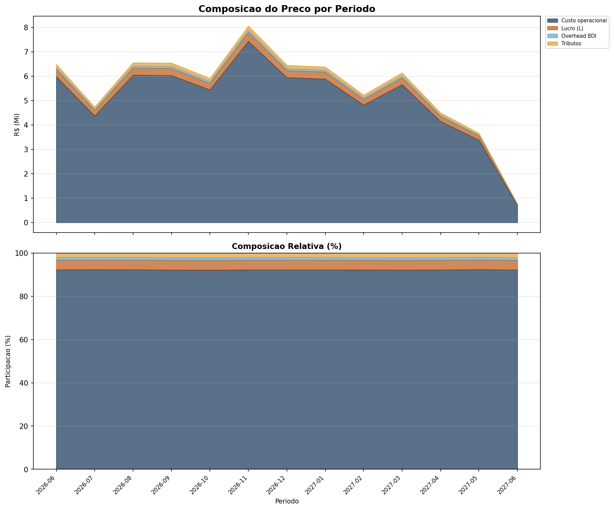

### bar_atividade_componente.png
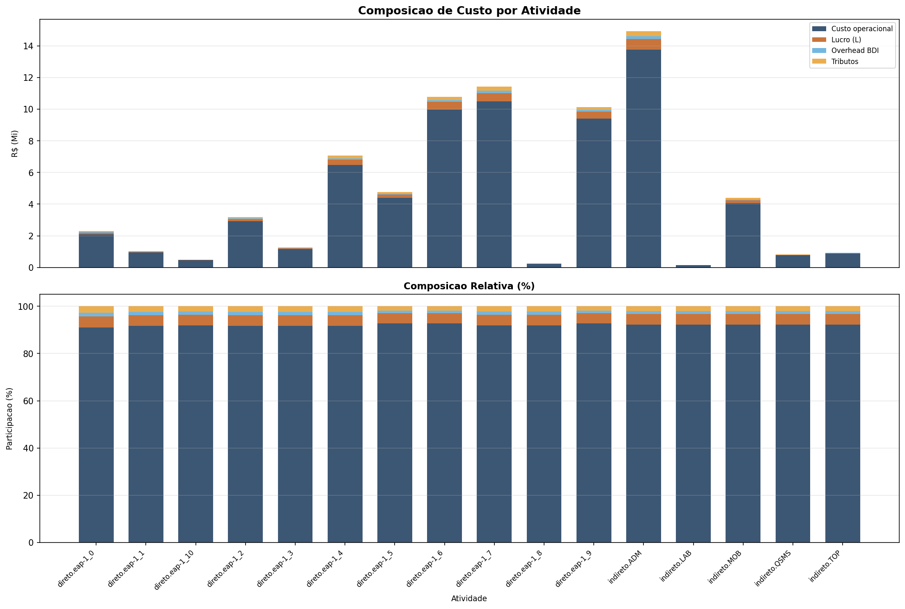

### bar_categoria_componente.png
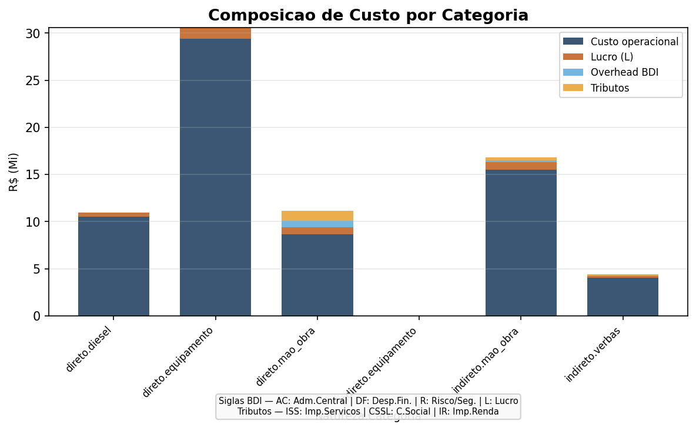

### bar_diesel_temporal.png
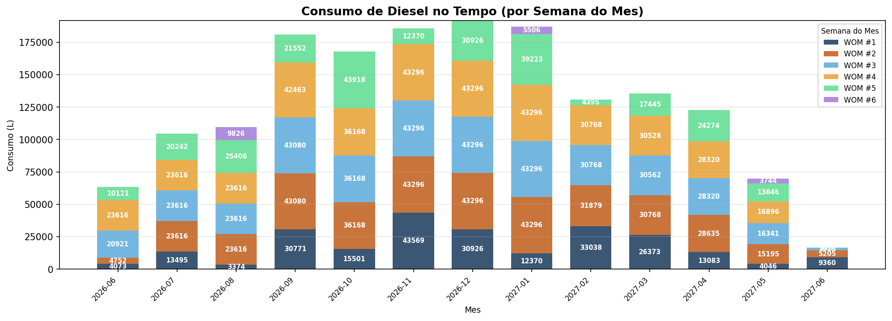

### bar_tempo_natureza.png
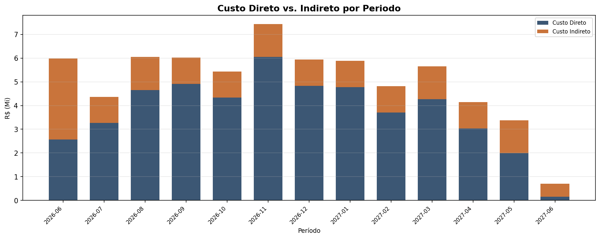

### dependencia_eap.png

### fluxo_financeiro.png
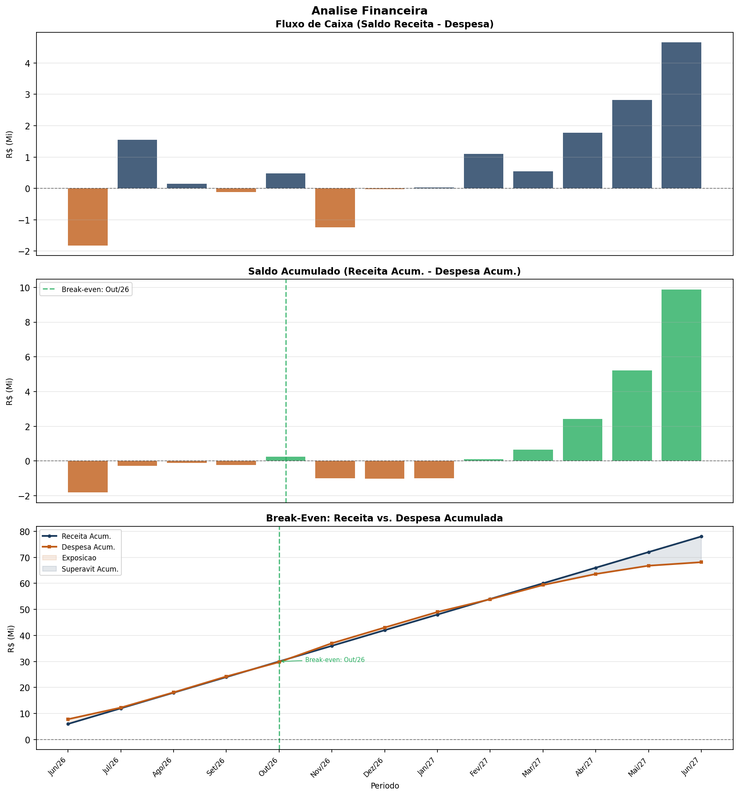

### gantt_cronograma.png

### hist_equipamentos.png

### hist_mao_obra.png

### linha_recursos_tempo.png

### painel_equilibrio.png
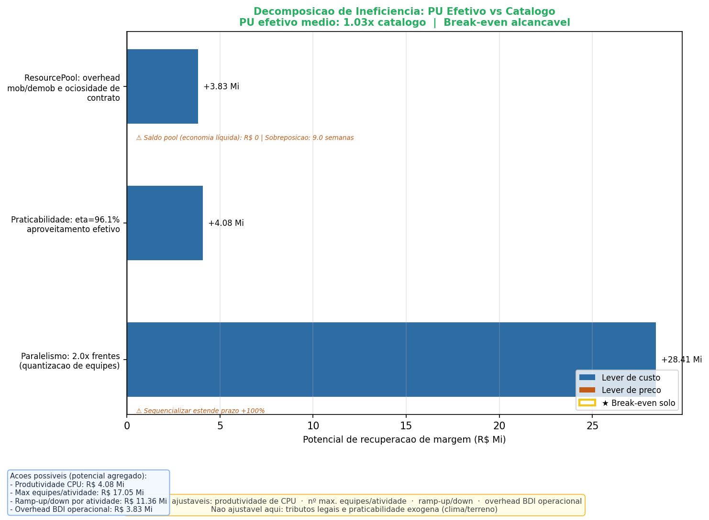

### pool_ciclo_vida.png
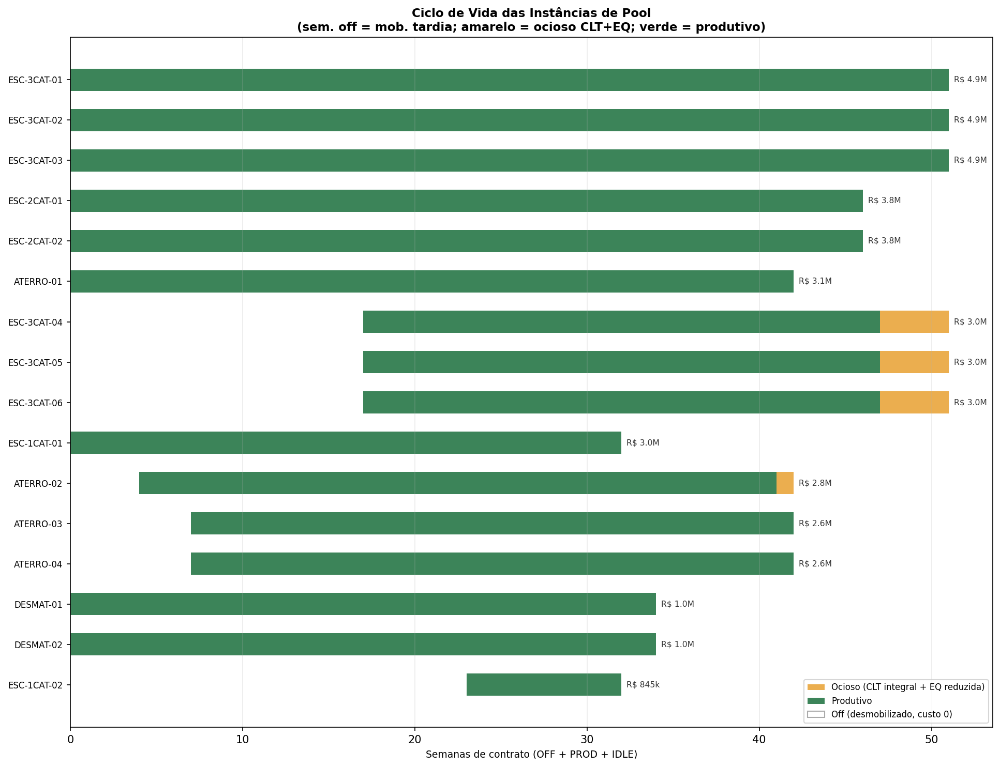

### pool_custo_estado.png
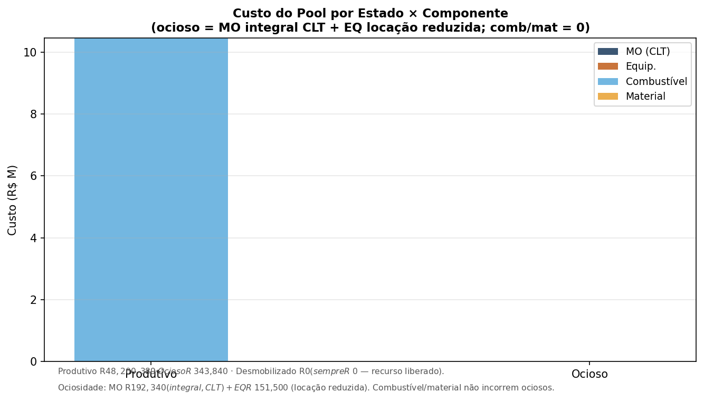

### pool_economia.png
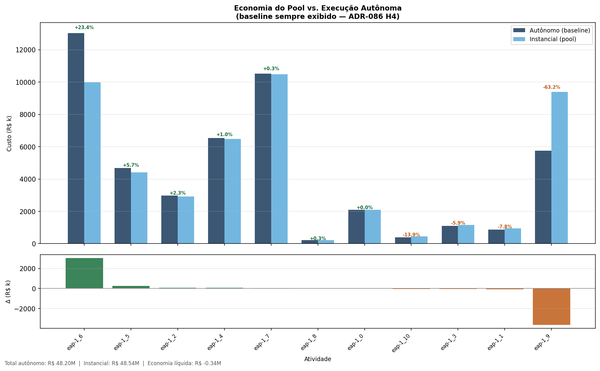

### pool_utilizacao_temporal.png
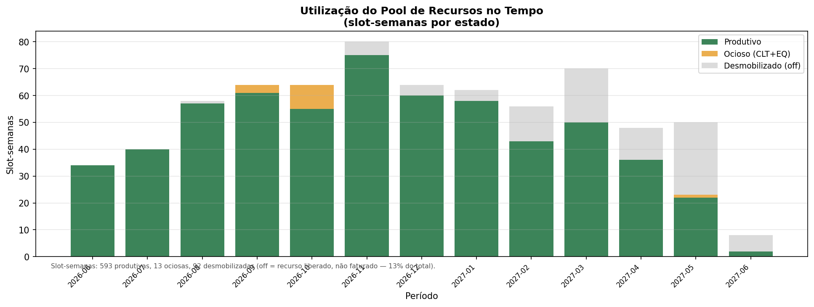

### scurve_custo.png
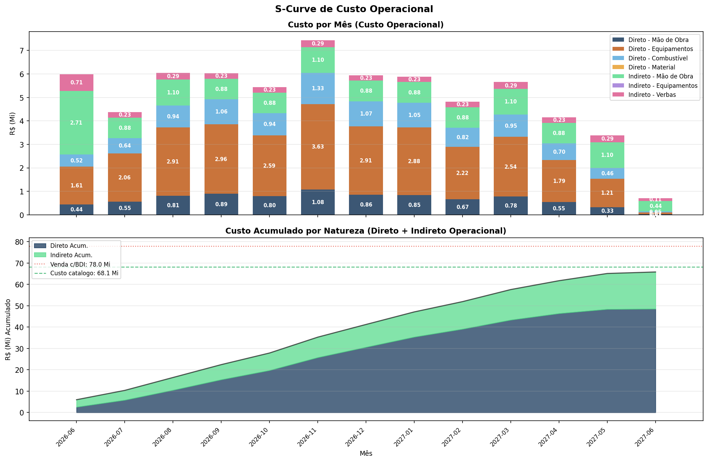
