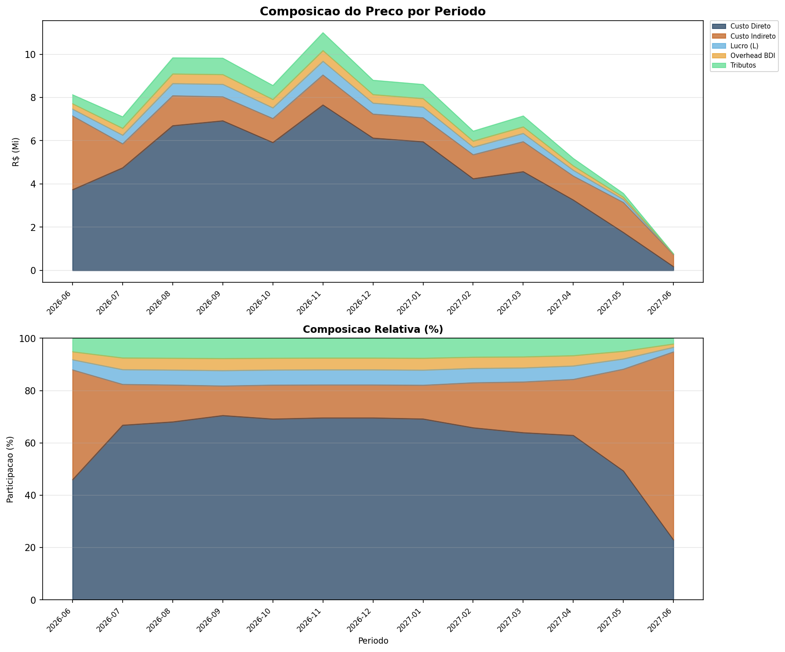
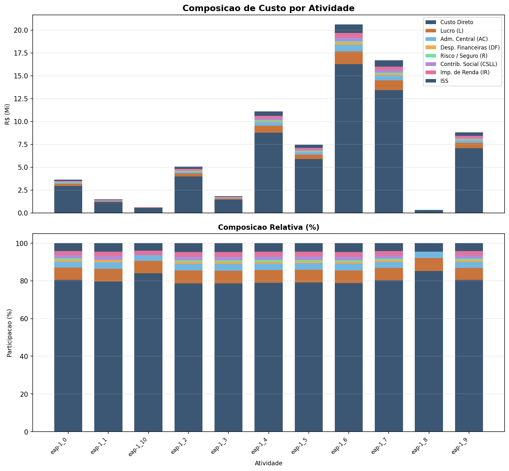
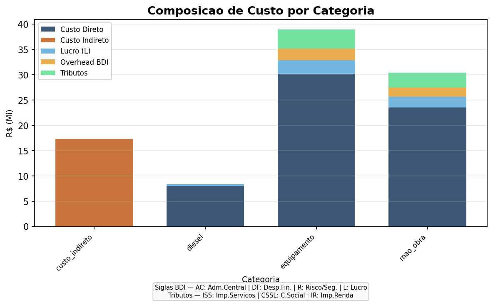
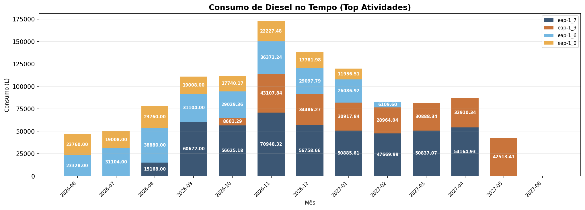
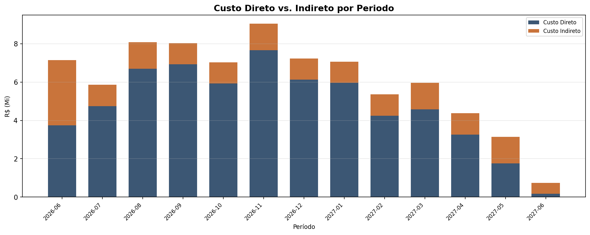
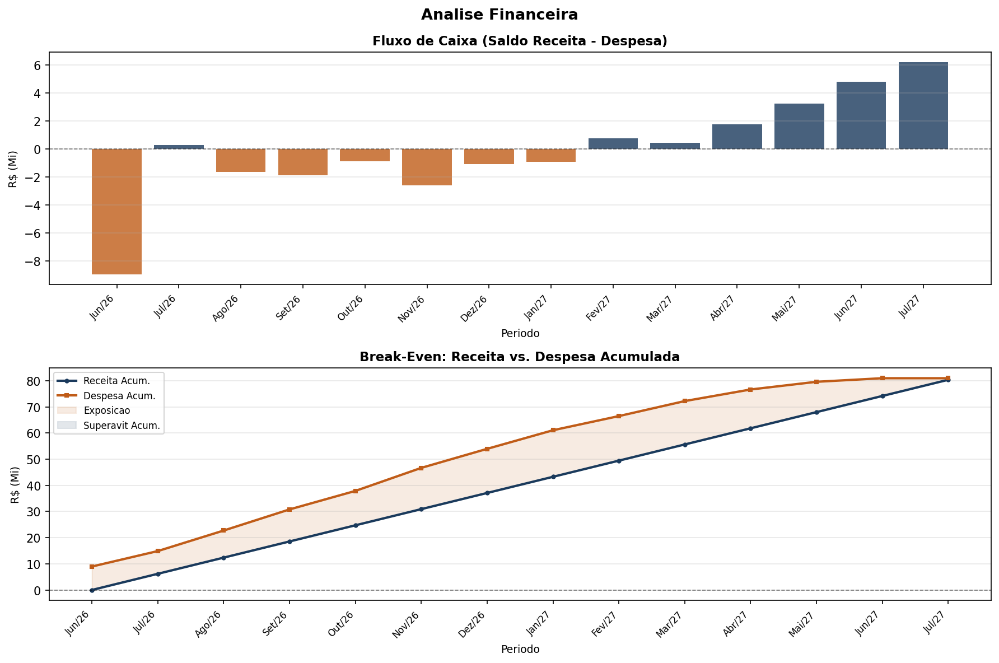
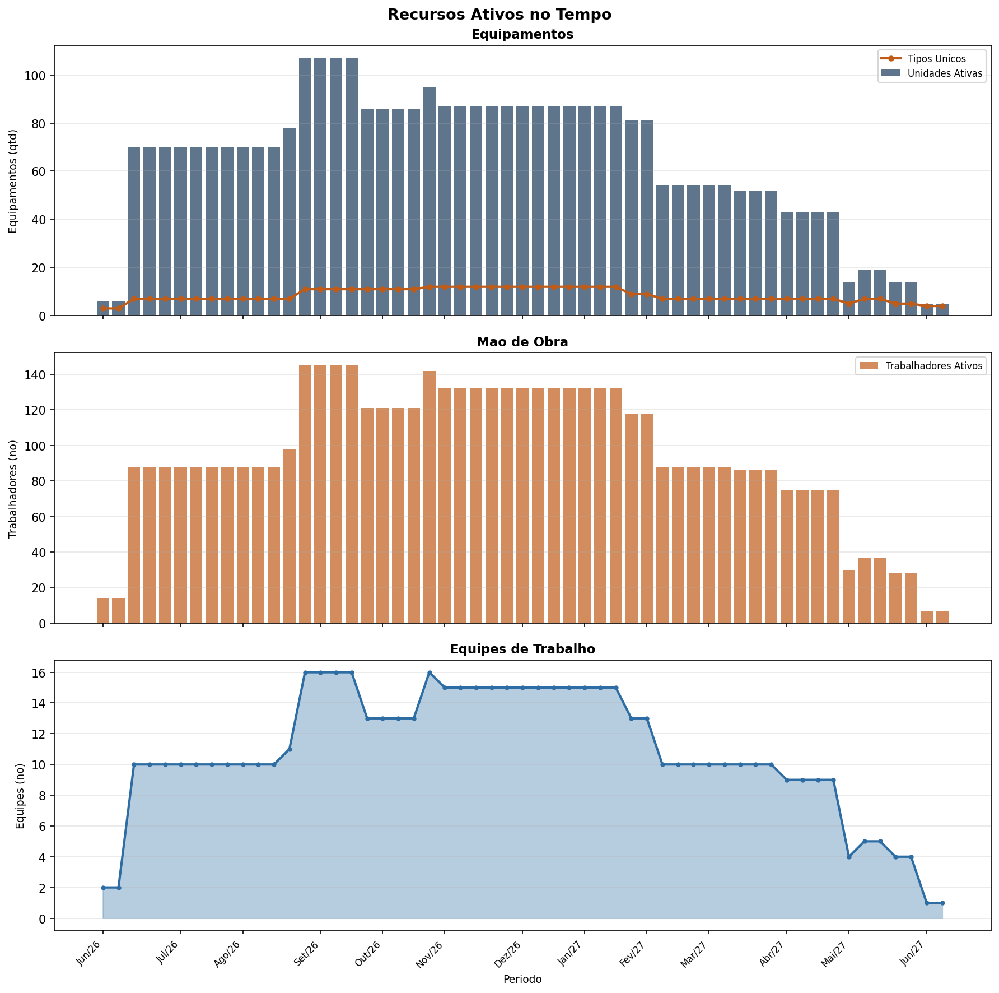
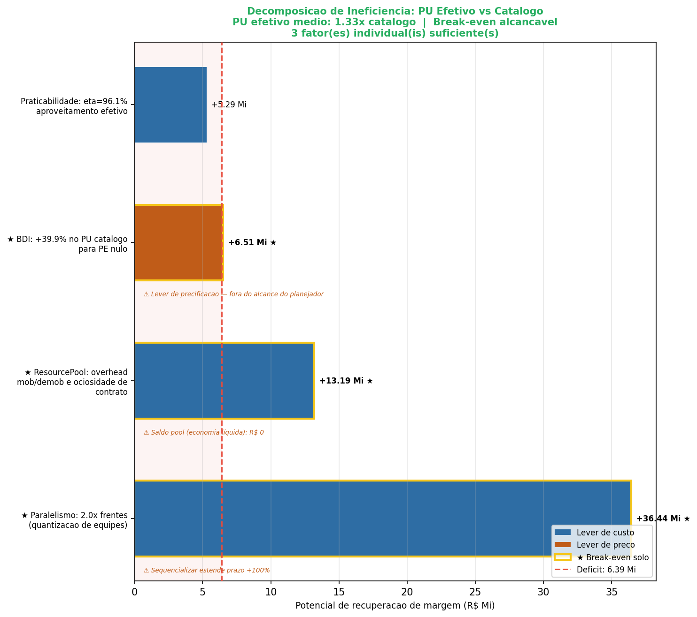
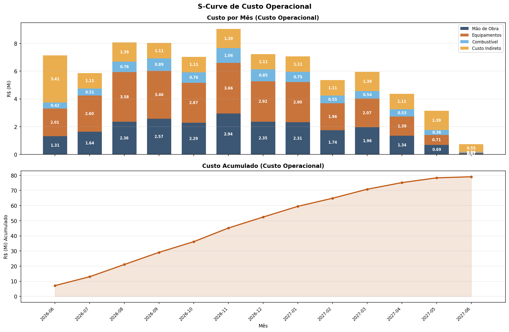

# Relatorio Analitico -- AGIS - Ferrovia Nova Transnordestina (Supressao e Terraplanagem)

**Gerado em:** 2026-05-29 10:55:58  
**Framework:** concilium  

---

## Sumario Executivo

O orçamento contempla obra de terraplenagem denominada **AGIS - Ferrovia Nova Transnordestina (Supressao e Terraplanagem)**, localizada em Ceara, Brasil, com execução prevista para o período 2026-06-01 -> 2027-06-27, (status atual: RASCUNHO).

O preço de venda totaliza **R$ 80,358,255.08**, composto por custo direto de R$ 46,843,791.49 e custo indireto de R$ 19,584,539.27. O resultado bruto apurado é de **R$ 13,929,924.32**, correspondendo a uma margem de **17.3%**, abaixo do mínimo aceitável.

O custo direto representa 70.5% do custo total, enquanto os custos indiretos correspondem a 29.5% (razão indireto/direto de 0.42).

---

## Resultado Financeiro

| Indicador | Valor |
|-----------|-------|
| Preço de venda (c/ BDI) | R$ 80,358,255.08 |
| Custo direto | R$ 46,843,791.49 |
| Custo indireto | R$ 19,584,539.27 |
| **Custo total** | **R$ 66,428,330.76** |
| **Resultado bruto** | **R$ 13,929,924.32** |

---

## Planejamento por EAP

| Item | Descricao | c/BDI (R$) |
|------|-----------|-----------:|
| eap-1_0 | Desmatamento e limpeza de area vegetada | R$ 2,477,673.16 |
| eap-1_1 | Esc/carg/transp 1aCat DMT<=2000m | R$ 992,406.46 |
| eap-1_2 | Esc/carg/transp 1aCat DMT<=3000m | R$ 3,441,418.84 |
| eap-1_3 | Esc/carg/transp 2aCat DMT<=2000m | R$ 1,280,091.96 |
| eap-1_4 | Esc/carg/transp 2aCat DMT<=3000m | R$ 7,597,204.52 |
| eap-1_5 | Esc/carg/transp 3aCat DMT<=2000m | R$ 5,452,981.76 |
| eap-1_6 | Esc/carg/transp 3aCat DMT<=3000m | R$ 14,870,246.89 |
| eap-1_7 | Compactacao aterros 100% Proctor Normal | R$ 12,156,798.29 |
| eap-1_8 | Compactacao aterros 100% Proctor Intermediario | R$ 411,657.26 |
| eap-1_9 | Construcao corpo aterro material 3a categoria | R$ 6,741,771.10 |
| eap-1_10 | Compactacao camada final aterro sobre rocha | R$ 415,123.69 |

---

## Ponto de Equilibrio

| Item | Venda (R$) | Operacional (R$) | Status |
|------|-----------:|-----------------:|--------|
| eap-1_0 | 2,477,673.16 | 2,943,567.46 | ERRO |
| eap-1_1 | 992,406.46 | 1,970,042.70 | ERRO |
| eap-1_2 | 3,441,418.84 | 6,107,146.92 | ERRO |
| eap-1_3 | 1,280,091.96 | 1,558,235.66 | ERRO |
| eap-1_4 | 7,597,204.52 | 8,681,592.84 | ERRO |
| eap-1_5 | 5,452,981.76 | 6,844,322.72 | ERRO |
| eap-1_6 | 14,870,246.89 | 15,513,810.48 | ERRO |
| eap-1_7 | 12,156,798.29 | 15,384,587.28 | ERRO |
| eap-1_8 | 411,657.26 | 329,666.10 | OK |
| eap-1_9 | 6,741,771.10 | 14,601,246.44 | ERRO |
| eap-1_10 | 415,123.69 | 659,332.20 | ERRO |

---

## Insights Acionaveis

- **criticidade**: None
- **sensibilidade**: None
- **intervencao**: None

---

## Graficos Gerados

### area_tempo_componente.png

### bar_atividade_componente.png

### bar_categoria_componente.png

### bar_diesel_temporal.png

### bar_tempo_natureza.png

### dependencia_eap.png

### fluxo_financeiro.png

### gantt_cronograma.png

### hist_equipamentos.png

### hist_mao_obra.png

### linha_recursos_tempo.png

### painel_equilibrio.png

### scurve_custo.png

