# ADRs — Architecture Decision Records

**Projeto:** Concilium — MendesLobo Construtora  
**Convenção de nome:** `adr-{NNN}-{slug}.md` (kebab-case, lowercase)

---

## Convenções de ADR

### Estrutura Obrigatória

```markdown
# ADR-{NNN} — {Título Descritivo}

**Status:** {Implementado | Aceito | Proposta | Parcialmente Implementado | Supersedido}
**Data:** AAAA-MM-DD
**Contexto:** MendesLobo Construtora — Concilium

---

## Contexto
### Problema
P1, P2, P3 — problemas numerados

## Decisão
D1, D2, D3 — decisões numeradas com exemplos de código

## Alternativas Rejeitadas
| ID | Alternativa | Motivo |

## Consequências
### Positivas (tabela)
### Negativas / Riscos (tabela)

## Plano de Implementação
| Fase | Entregas | Status |

## Definition of Done
### Fase 1
- [ ] item
```

### Status Permitidos
- **Implementado:** Código em produção, DoD completo
- **Parcialmente Implementado:** Algumas fases concluídas
- **Aceito:** Decisão tomada, implementação pendente
- **Proposta:** Em discussão
- **Supersedido:** Substituído por ADR posterior


## Índice Completo

### ADRs Fundacionais (001–019)

| # | Título | Status | Dependências |
|---|---|---|---|
| [001](adr-001-semantic-layer.md) | Semantic Layer | ✅ Implementado | — |
| [002](adr-002-resolution-and-matching.md) | Resolution & Matching | ✅ Implementado | — |
| [003](adr-003-weekly-progress.md) | Weekly Progress | ✅ Implementado | — |
| [004](adr-004-scheduling-algorithms.md) | Scheduling Algorithms | ✅ Implementado | — |
| [005](adr-005-replanning-strategy.md) | Replanning Strategy | ✅ Implementado | — |
| [006](adr-006-team-composition.md) | Team Composition | ✅ Implementado | — |
| [007](adr-007-productivity-as-first-class.md) | Productivity as First-Class | ✅ Implementado | — |
| [008](adr-008-skills-visualization-mermaid.md) | Skills Visualization (Mermaid) | ✅ Implementado | — |
| [009](adr-009-indirect-costs-as-first-class.md) | Indirect Costs as First-Class | ✅ Implementado | — |
| [010](adr-010-activity-cost-breakdown-and-resource-allocation.md) | Activity Cost Breakdown | ✅ Implementado | — |
| [011](adr-011-computable-productivity.md) | Computable Productivity | ✅ Implementado | — |
| [012](adr-012-catalog-update.md) | Catalog Update | ✅ Implementado | — |
| [013](adr-013-mcp-facade.md) | MCP Facade (v1) | ⬜ Supersedido por ADR-037 | — |
| [014](adr-014-mcp-facade-interaction.md) | MCP Facade Interaction | ⬜ Supersedido por ADR-037 | — |
| [015](adr-015-interaction-space.md) | Interaction Space | ✅ Implementado | — |
| [016](adr-016-resource-sharing-taxonomy.md) | Resource Sharing Taxonomy | ✅ Implementado | — |
| [017](adr-017-catalog-lifecycle-management.md) | Catalog Lifecycle Management | ⬜ Supersedido por ADR-040 | — |
| [018](adr-018-typed-artifact-system.md) | Typed Artifact System | ✅ Implementado | — |
| [019](adr-019-replanning-and-structural-gaps.md) | Replanning & Structural Gaps | ✅ Implementado | — |

### ADRs de Maturação (020–033)

| # | Título | Status | Dependências |
|---|---|---|---|
| [020](adr-020-criticidade-multidimensional.md) | Criticidade Multidimensional | ✅ Implementado | — |
| [021](adr-021-plan-space-explorer.md) | Plan Space Explorer | ✅ Implementado | — |
| [022](adr-022-wave-execution-e-gate-propagation.md) | Wave Execution & Gate Propagation | ✅ Implementado | — |
| [023](adr-023-bdi-diferenciado-por-categoria.md) | BDI Diferenciado por Categoria | ✅ Implementado | — |
| [024](adr-024-referencias-planilha-editavel-snapshot-auditavel.md) | Referências: Planilha Editável + Snapshot | ✅ Implementado | — |
| [025](adr-025-mcp-catalog-tax-reference-policy.md) | MCP Catalog & Tax Reference Policy | ✅ Implementado | — |
| [026](adr-026-fase-saida-multicanal-relatorios-analiticos.md) | Saída Multicanal: Relatórios Analíticos | ✅ Implementado | — |
| [027](adr-027-cpu-sensitivity-profile.md) | CPU Sensitivity Profile | ✅ Implementado | — |
| [028](adr-028-controle-variavel-balanco-margem.md) | Controle Variável: Balanço × Margem | ✅ Implementado | — |
| [029](adr-029-ddd-package-reorganization.md) | DDD Package Reorganization | ✅ Implementado | — |
| [030](adr-030-cpu-team-composition-fuel-material.md) | CPU Team Composition + Fuel/Material | ✅ Implementado | — |
| [031](adr-031-escopos-e-planos-paralelos.md) | Escopos e Planos Paralelos | ✅ Implementado | — |
| [032](adr-032-cpu-insumo-jurisdicao-v2.md) | CPU × Insumo × Jurisdição v2 | ✅ Implementado | — |
| [033](adr-033-blob-storage-excel-ingestion.md) | Blob Storage + Excel Ingestion | ✅ Implementado | — |

### ADRs de Governança e Infraestrutura (034–052)

| # | Título | Status | Dependências |
|---|---|---|---|
| [034](adr-034-unit-conversion-service.md) | Serviço de Conversão de Unidades | ✅ Implementado | ADR-032 |
| [035](adr-035-lifecycle-data-orchestrator.md) | Lifecycle & Data Governance Orchestrator | ✅ Implementado | ADR-032, ADR-034 |
| [036](adr-036-cli-reorganization.md) | Reorganização da CLI: Gestão vs. Operação | ✅ Implementado | ADR-035 |
| [037](adr-037-mcp-facade-simplification.md) | MCP Facade: Micro → Macro-Ferramentas | ✅ Implementado | ADR-035, ADR-031 |
| [038](adr-038-regionalized-catalog-taxation.md) | Catálogo Regionalizado + BDI por Jurisdição | ✅ Implementado | ADR-032, ADR-031, ADR-033 |
| [039](adr-039-compensacao-ineficiencias-estruturais.md) | Compensação de Ineficiências Estruturais ("The Bridge") | ✅ Implementado | ADR-031, ADR-032 |
| [040](adr-040-catalog-governance-master-project.md) | Hierarquia Master vs. Project Layer | ✅ Implementado | ADR-033, ADR-038 |
| [041](adr-041-slowly-changing-dimensions.md) | SCD Type 2: Histórico Temporal do Catálogo | ✅ Implementado | ADR-033, ADR-040 |
| [042](adr-042-outsourced-services-integration.md) | Integração de Serviços Terceirizados | 🔴 Proposto | ADR-009, ADR-023 |
| [043](adr-043-benchmark-application-layer.md) | Benchmark Application Layer | ✅ Implementado | ADR-024, ADR-029, ADR-039 |
| [044](adr-044-planilha-first-pu-sbdi.md) | Planilha-First: PU Direto do Catálogo | ✅ Implementado | ADR-038, ADR-023 |
| [045](adr-045-pipeline-ingestao-precos-sinapi-sicro-anp.md) | Pipeline de Ingestão SINAPI / SICRO / ANP | ✅ Implementado | ADR-038, ADR-041, ADR-032 |
| [046](adr-046-rcpsp-complete-implementation.md) | RCPSP: Escalonamento Restrito por Recursos | ✅ Implementado | ADR-004, ADR-006, ADR-007, ADR-016 |
| [047](adr-047-sharepoint-blob-storage-adapter.md) | SharePoint como Backend via BlobStoragePort | ✅ Implementado | ADR-033, ADR-024, ADR-040, ADR-041 |
| [048](adr-048-api_ui_iteracao_rapida.md) | API e UI para iteracao rapida de execucao, override e comparacao de pipelines | ✅ Implementado | ADR-031, ADR-033, ADR-035, ADR-037, ADR-040, ADR-041 |
| [049](adr-049-PU-validation-framework.md) | Validacao Convergente de Preco Unitario (Catalogo + Projeto) | ✅ Implementado | ADR-023, ADR-034, ADR-038, ADR-044 |
| [050](adr-050-cli-unificada-project-benchmark-datasource.md) | CLI Unificada para Projeto e Benchmark com Data Source Versionado | ✅ Implementado | ADR-036, ADR-043, ADR-048, ADR-049 |
| [051](adr-051-governanca-fidelidade-benchmark-e-gates-objetivos.md) | Governança de Fidelidade de Benchmark e Gates | ✅ Implementado | — |
| [052](adr-052-housekeeping-adr-numeracao-e-nomenclatura.md) | Housekeeping de ADRs: Numeração e Nomenclatura para Automação | ✅ Implementado | ADR-036, ADR-051 |
| [053](adr-053-cpu-producao-separation.md) | Separação de CPU e Produtividade — Eliminação de Redundância | ✅ Implementado | ADR-007, ADR-046 |
| [054](ADR-054-workforce-mobilization-policy.md) | Workforce Mobilization Policy System | ✅ Implementado | ADR-004, ADR-005, ADR-030, ADR-039, ADR-046, ADR-053 |
| [055](ADR-055-tax-reform-bdi-cbs-ibs.md) | Reforma Tributária CBS/IBS: Modelagem no Simulador de BDI | ✅ Implementado | ADR-023, ADR-028, ADR-038 |
| [056](ADR-056-technical-debt-remediation.md) | Remediação de Débito Técnico — Lacunas de Planejamento Temporal e Financeiro | ✅ Implementado | ADR-004, ADR-005, ADR-010, ADR-019, ADR-023, ADR-033 |
| [057](ADR-057-memorial-calculo-bdi.md) | Memorial de Cálculo BDI — Auditabilidade Ponta a Ponta | ✅ Implementado | ADR-023, ADR-055, ADR-056 |
| [058](ADR-058-analytical-richness-ontological-space.md) | Analiticidade do Espaço Ontológico — Decomposição Granular e Curva ABC | ✅ Implementado | ADR-010, ADR-023, ADR-027, ADR-039, ADR-056, ADR-057 |
| [059](ADR-059-resource-permanence-scheduling.md) | Permanência de Recursos sem Dismissal — Cronograma pelo Espaço Ontológico | ✅ Implementado | ADR-004, ADR-016, ADR-030, ADR-046, ADR-054 |
| [060](ADR-060-diagnostico-ponto-equilibrio.md) | Diagnóstico de Ponto de Equilíbrio — Decomposição Causal e Recalibração de BDI | ✅ Implementado | ADR-023, ADR-039, ADR-054, ADR-056, ADR-058, ADR-059 |
| [061](ADR-061-inversao-backtracking-pe.md) | Inversão do Cálculo de PE e Validação por Backtracking | ✅ Implementado | ADR-060, ADR-054, ADR-023, ADR-039 |
| [062](ADR-062-versionamento-contextos.md) | Versionamento Explícito de Contextos e Perfis — `ConfigVersionService` | ✅ Implementado | ADR-040, ADR-023, ADR-053, ADR-056 |
| [063](ADR-063-project-type-discriminator-and-creation-page.md) | Discriminador de Tipo de Projeto e Página de Criação Tipada | ✅ Implementado | ADR-031, ADR-040, ADR-046, ADR-048, ADR-050, ADR-053, ADR-062 |
| [064](ADR-064-no-raw-json-editing-typed-form-contract.md) | Proibição de Edição de JSON Bruto — Contrato de Formulários Tipados | ✅ Implementado | ADR-048, ADR-063, ADR-025 |
| [065](ADR-065-tema-visual-entity.md) | `TemaVisual` como Entidade de Primeira Classe — Separação de Identidade Visual | ✅ Implementado | ADR-062, ADR-064, ADR-048 |
| [066](ADR-066-catalog-overlay-model-single-source-of-truth.md) | Catálogo com Fonte Única de Verdade + Composição por Overlay | ✅ Implementado | ADR-040, ADR-032, ADR-041, ADR-018, ADR-043 |
| [067](ADR-067-master-catalog-write-api.md) | API de Escrita no Catálogo Mestre | ✅ Implementado | ADR-040, ADR-066, ADR-064, ADR-041 |
| [068](ADR-068-calendario-operacional-feriados-recesso.md) | Calendario Operacional de Producao (Feriados e Recesso) | 🔴 Proposto | ADR-007, ADR-038, ADR-046, ADR-058, ADR-060, ADR-061 |
| [069](ADR-069-cubo-analitico-faces-granularidades-ux.md) | Cubo Analitico Navegavel por Faces, Medidas e Granularidades para UX Analitica | ✅ Implementado | ADR-058, ADR-059, ADR-060, ADR-061, ADR-068, NEP-024 |

**Legenda:** ✅ Implementado · 🔄 Parcialmente Implementado · 🔴 Proposto/Aceito · ⬜ Supersedido

---

## Mapa de Dependências

Cores: **verde** = Implementado · **amarelo** = Parcialmente Implementado · **vermelho** = Proposto/Aceito

```mermaid
graph TD
    classDef green fill:#22c55e,color:#000,stroke:#16a34a
    classDef yellow fill:#facc15,color:#000,stroke:#ca8a04
    classDef red fill:#ef4444,color:#fff,stroke:#dc2626

    subgraph FUND["ADRs Fundacionais (001–019)"]
        A004[ADR-004\nScheduling Algos]
        A005[ADR-005\nReplanning]
        A006[ADR-006\nTeam Composition]
        A007[ADR-007\nProductivity]
        A009[ADR-009\nIndirect Costs]
        A016[ADR-016\nResource Sharing]
    end

    subgraph MATUR["ADRs de Maturação (020–033)"]
        A023[ADR-023\nBDI Categoria]
        A024[ADR-024\nReferências]
        A028[ADR-028\nBalanço × Margem]
        A029[ADR-029\nDDD Package]
        A030[ADR-030\nCPU Team + Fuel]
        A031[ADR-031\nEscopos e Planos]
        A032[ADR-032\nCPU×Insumo×Jurisdição]
        A033[ADR-033\nBlob Storage]
    end

    subgraph GOV["ADRs de Governança e Infraestrutura (034–055)"]
        A034[ADR-034\nConversor Unidades]
        A035[ADR-035\nLifecycle Coordinator]
        A036[ADR-036\nCLI Reorganization]
        A037[ADR-037\nMCP Facade]
        A038[ADR-038\nCatálogo Regional]
        A039[ADR-039\nThe Bridge]
        A040[ADR-040\nMaster vs Project]
        A041[ADR-041\nSCD Type 2]
        A042[ADR-042\nOutsourced Services]
        A043[ADR-043\nBenchmark App Layer]
        A044[ADR-044\nPlanilha-First PU]
        A045[ADR-045\nPipeline SINAPI/SICRO]
        A046[ADR-046\nRCSP Completo]
        A047[ADR-047\nSharePoint BlobStorage]
        A048[ADR-048\nAPI + UI Iteracao Rapida]
        A049[ADR-049\nValidacao PU Convergente]
        A050[ADR-050\nCLI Unificada]
        A051[ADR-051\nGovernança Benchmark]
        A052[ADR-052\nHousekeeping ADRs]
        A053[ADR-053\nCPU×Produção Separação]
        A054[ADR-054\nWMP Policy System]
        A055[ADR-055\nCBS/IBS BDI Reform]
    end

    %% ── Maturação → Governança ─────────────────────────────────────
    A032 --> A034
    A032 --> A035
    A034 --> A035
    A035 --> A036
    A035 --> A037
    A031 --> A037
    A031 --> A038
    A032 --> A038
    A033 --> A038
    A031 --> A039
    A032 --> A039
    A033 --> A040
    A038 --> A040
    A033 --> A041
    A040 --> A041
    A009 --> A042
    A023 --> A042
    A024 --> A043
    A029 --> A043
    A039 --> A043
    A023 --> A044
    A038 --> A044
    A032 --> A045
    A038 --> A045
    A041 --> A045
    A033 --> A047
    A024 --> A047
    A040 --> A047
    A041 --> A047
    A031 --> A048
    A033 --> A048
    A035 --> A048
    A037 --> A048
    A040 --> A048
    A041 --> A048
    A023 --> A049
    A034 --> A049
    A038 --> A049
    A044 --> A049
    A036 --> A050
    A043 --> A050
    A048 --> A050
    A049 --> A050
    A051 --> A052
    A036 --> A052

    %% ── Fundacionais → Governança ───────────────────────────────────
    A004 --> A046
    A006 --> A046
    A007 --> A046
    A016 --> A046
    A007 --> A053
    A046 --> A053
    A004 --> A054
    A005 --> A054
    A030 --> A054
    A039 --> A054
    A046 --> A054
    A053 --> A054
    A023 --> A055
    A028 --> A055
    A038 --> A055

    A058[ADR-058\nABC Granular]
    A059[ADR-059\nRecurso Permanência]
    A010[ADR-010\nActivity Cost]
    A027[ADR-027\nCPU Sensitivity]
    A039 --> A058
    A056 --> A058
    A057 --> A058
    A004 --> A059
    A046 --> A059
    A054 --> A059

    A063[ADR-063\nTipo Projeto + UI]
    A031 --> A063
    A040 --> A063
    A046 --> A063
    A048 --> A063
    A050 --> A063
    A053 --> A063
    A062 --> A063

    A064[ADR-064\nNo Raw JSON Editing]
    A048 --> A064
    A063 --> A064
    A025 --> A064

    %% ── Status ──────────────────────────────────────────────────────
    class A004,A005,A006,A007,A009,A016 green
    class A023,A024,A028,A029,A030,A031,A032,A033 green
    class A034,A035,A036,A037,A038,A039,A040,A041,A043,A044,A045,A046,A047,A048,A049,A050,A051,A052,A053,A054,A055 green
    class A010,A027 green
    class A042 red
    class A063 green
    A065[ADR-065\nTemaVisual]
    A062 --> A065
    A064 --> A065
    A048 --> A065

    A066[ADR-066\nCatalog Overlay]
    A040 --> A066
    A032 --> A066
    A041 --> A066
    A043 --> A066

    class A064,A065,A066 green
    class A058,A059 green
```



---

## Débitos de Sincronia (Arquitetura x Execução)

| ID | Débito / Assincronia | Impacto | Ação Corretiva | Estado |
|---|---|---|---|---|
| S1 | ADR-049 ausente do índice até este ajuste | Falha de rastreabilidade em governança | Indexado com status e dependências | ✅ Fechado |
| S2 | Referência cruzada incorreta no ADR-049 (Planilha-first apontando para ADR-050) | Ambiguidade de decisão técnica | Corrigido para ADR-044 | ✅ Fechado |
| S3 | Redundância documental de ADR-049 em arquivos satélite | Risco de divergência de fonte de verdade | Mantido apenas ADR raiz | ✅ Fechado |
| S4 | Numeração duplicada ADR-043a/043b | Ruído de governança e automação | Renumerado para ADR-043 e ADR-051 | ✅ Fechado |
| S5 | Inconsistência histórica de nomenclatura (adr_ vs adr-) | Risco para tooling de descoberta e lint documental | Arquivos normalizados para `adr-XXX-kebab` | ✅ Fechado |
| S6 | Ausência de contrato único de CLI para projeto/benchmark | Saídas heterogêneas e custo operacional maior | Implementado via namespace `validate` (project/benchmark/projeto) | ✅ Fechado |

---

## ADRs Supersedidos / Arquivados

| Arquivo Original | Motivo | Supersedido por |
|---|---|---|
| `adr-013-mcp-facade.md` | Conceito inicial de fachada MCP, substituído pela simplificação macro | ADR-037 |
| `adr-014-mcp-facade-interaction.md` | Padrão de interação detalhado, absorvido pela nova fachada | ADR-037 |
| `adr-017-catalog-lifecycle-management.md` | Gestão do lifecycle do catálogo, supersedida pela hierarquia Master/Project | ADR-040 |
| ~~`ADR-037-mcp-business-tools.md`~~ | Conceito precursor absorvido pelo ADR-037 | ADR-037 |

---

