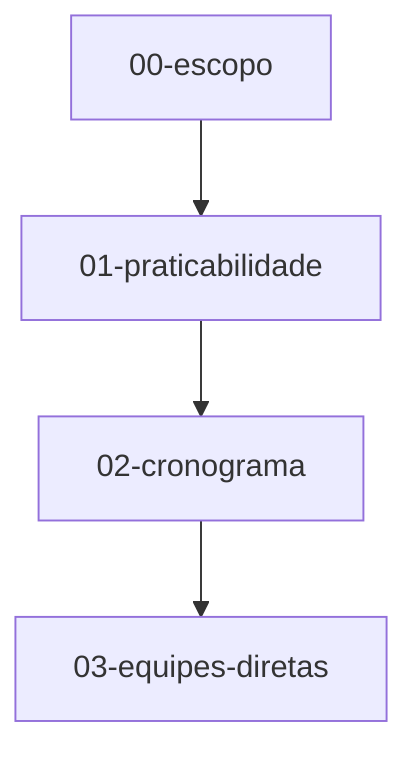
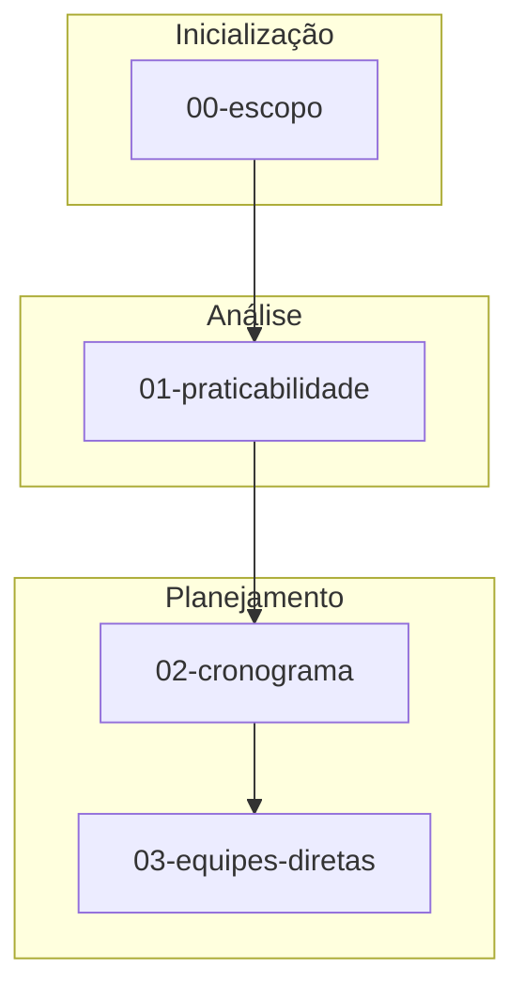

# ADR-008: Skills Visualization: Mermaid Export

**Status:** Implementado  
**Date Decided:** 2026-05-01  
**Date Implemented:** 2026-05-01  
**Implementers:** cli/commands_skills.py, skills/graph_exporter.py  
**Context:**

The Concilium system organizes work into skills (00-escopo, 01-praticabilidade, 02-cronograma, ...) with explicit dependencies. Currently, these dependencies are only encoded in `skill.toml` files. There is no visual representation of the skill pipeline available to users, engineers, or Claude Desktop clients.

A visual dependency diagram would enable:
- Quick understanding of pipeline sequencing
- Identification of bottlenecks and parallelization opportunities
- Documentation of complex workflows (especially for new team members)
- Insight into why a skill has failed (which upstream skills must complete first)

## Problem

1. **No built-in CLI export** for skill graph visualization
2. **Manual hunting** required to understand dependencies (reading each TOML file)
3. **Claude Desktop clients** cannot access the skill topology programmatically
4. **Documentation gaps** when skills are added/removed — no automated graphing

## Decision

Implement a **`skills export`** CLI command that generates **Mermaid diagrams** of the skill pipeline:

```bash
concilium skills export --format mermaid [--output diagram.md]
concilium skills export --format mermaid --group-by-phase
```

The output is a **valid Mermaid graph definition** that can be:
- Embedded in markdown docs
- Rendered by GitHub/GitLab
- Imported into Mermaid.live for interactive exploration
- Consumed programmatically by Claude Desktop agents

### Design Principles

1. **Declarative graph**: Mermaid `graph TD` (top-down) showing task dependencies
2. **Skill nodes**: Each skill is a node, colored by execution phase
3. **Dependency edges**: Arrows show `depends_on` relationships
4. **Phase grouping** (optional): Subgraphs organize skills by logical phases (escopo, praticabilidade, planejamento, execução, análise, etc.)
5. **Validation codes**: Optional annotation with VAL-* codes per skill
6. **No external deps**: Uses only Mermaid graph syntax (no GraphViz)

### Format Examples

**Basic (flat graph):**


**With phase grouping:**


## Implementation

### New Module: `concilium/cli/commands_skills.py`

```python
@app.command("export")
def skills_export(
    format: str = typer.Option("mermaid", help="Format: mermaid | dot | json"),
    output: str | None = typer.Option(None, help="Output file (default: stdout)"),
    group_by_phase: bool = typer.Option(False, help="Group skills by execution phase"),
    show_validations: bool = typer.Option(False, help="Include validation codes"),
) -> None:
    """Export skill dependency graph in specified format."""
```

### New Module: `concilium/skills/graph_exporter.py`

```python
class SkillGraphExporter:
    def __init__(self, skill_registry: SkillRegistry):
        self.registry = skill_registry
    
    def to_mermaid(self, group_by_phase: bool = False, 
                   show_validations: bool = False) -> str:
        """Generate Mermaid graph definition."""
    
    def to_dot(self) -> str:
        """Generate GraphViz DOT format (future)."""
    
    def to_json(self) -> dict:
        """Generate JSON representation of graph."""
```

### New Module: `concilium/skills/phase_classifier.py`

```python
PHASE_MAP = {
    "Inicialização": ["00-escopo", "00A-atividades", "00B-sequenciamento"],
    "Análise": ["01-praticabilidade", "01A-declarar-recursos"],
    "Planejamento": ["02-cronograma", "02B-cronograma-semanal", 
                     "03-equipes-diretas", "03A-derivar-requisitos", ...],
    "Consolidação": ["06-consolidar", "07-adapter-saida"],
    "Análise Financeira": ["04-planejamento-bdi", "05-indiretos", "09-cost-criticality"],
    "Decisões": ["11-decision-log", "12-decision-review"],
}
```

## Testing Strategy (TDD)

### Unit Tests: `tests/unit/test_skills_graph_exporter.py`

1. **Skill registry loading**: Graph loads all skills from manifests
2. **Dependency extraction**: Correctly reads `depends_on.skills` from each TOML
3. **Mermaid syntax validation**: Output is valid Mermaid graph TD
4. **Node naming**: Skills appear as nodes with correct IDs
5. **Edge creation**: Dependencies produce correct arrows
6. **Cycle detection**: Fails gracefully if circular dependency found (validation)
7. **Phase grouping**: Subgraphs created correctly when enabled
8. **Validation annotation**: VAL-* codes attached when flag enabled
9. **Edge cases**: Missing skills, orphaned nodes, complex chains

### Integration Tests: `tests/integration/test_skills_export_cli.py`

1. **CLI command exists**: `concilium skills export` accepted
2. **Default output**: Produces valid Mermaid to stdout
3. **File output**: `-o diagram.md` writes to file
4. **Phase grouping flag**: `--group-by-phase` produces subgraphs
5. **Validation flag**: `--show-validations` includes VAL-* codes
6. **Format validation**: Output can be parsed as valid Mermaid

## Acceptance Criteria

- ✅ CLI command: `concilium skills export [--output file] [--group-by-phase]`
- ✅ Output is **valid Mermaid syntax** (tested via regex or parser)
- ✅ All 20 skills appear as nodes in output
- ✅ Dependency edges match `depends_on.skills` from TOML
- ✅ Phase grouping optional; flat graph is default
- ✅ No external graphing library required (pure string generation)
- ✅ Tests: 100% coverage of `SkillGraphExporter` class
- ✅ CLI help text updated: `concilium skills --help` documents export

## Rollout

1. **Phase 1**: Implement exporter + CLI command (this ADR)
2. **Phase 2** (future): Add to MCP server as `export_skills_graph()` tool for Claude Desktop
3. **Phase 3** (future): Interactive graph in web UI (if web tier added)

## Risks & Mitigations

| Risk | Mitigation |
|------|-----------|
| Circular dependencies not detected | Add cycle check in exporter; fail early with clear error |
| TOML format changes break parser | Version guard in TOML loader; deprecation warnings |
| Mermaid syntax drift in new versions | Use stable base syntax; test against Mermaid.live |
| Performance with 100+ skills | Linear scan; memoize graph construction |

## References

- Mermaid graph syntax: https://mermaid.js.org/syntax/graph.html
- skill.toml format: `src/concilium/skills/manifests/*/skill.toml`
- Related ADRs: ADR-001 (Semantic Layer), ADR-004 (Scheduling)

## Definition of Done

- [x] `SkillGraphExporter` class in `skills/graph_exporter.py` with `to_mermaid()`, `to_dot()`, `to_json()`
- [x] `phase_classifier.py` with `PHASE_MAP` grouping skills by logical phase
- [x] CLI command: `concilium skills export --format mermaid [--output file] [--group-by-phase]`
- [x] Output is valid Mermaid `graph TD` syntax
- [x] All skills appear as nodes; dependency edges match `depends_on.skills` from `skill.toml`
- [x] `--group-by-phase` produces Mermaid subgraphs; flat graph is default
- [x] Cycle detection: fails with clear error if circular dependency found
- [x] No external graphing library required (pure string generation)
- [x] MCP tool: `export_skills_graph()` for Claude Desktop
- [x] Tests: 100% coverage of `SkillGraphExporter`; integration test for CLI output
