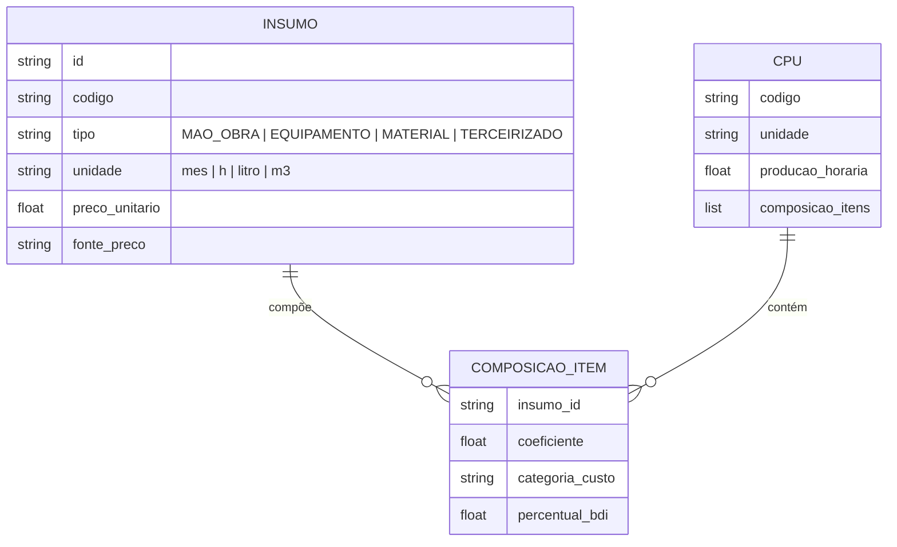
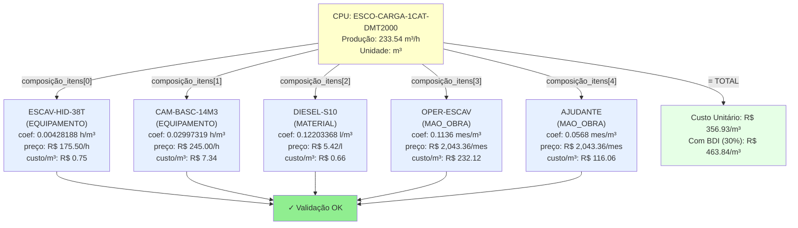
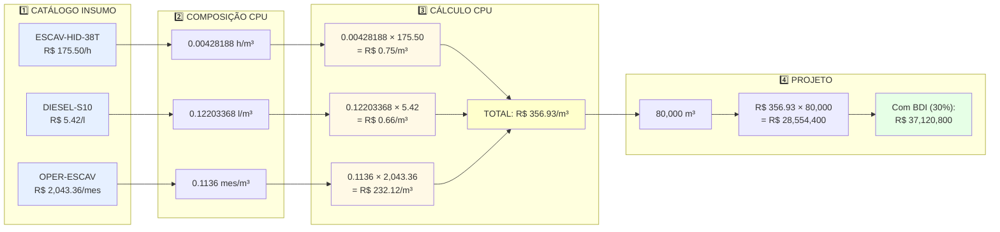
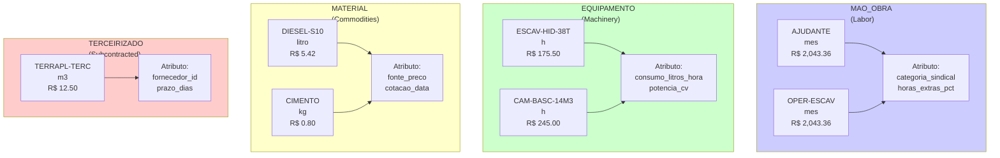
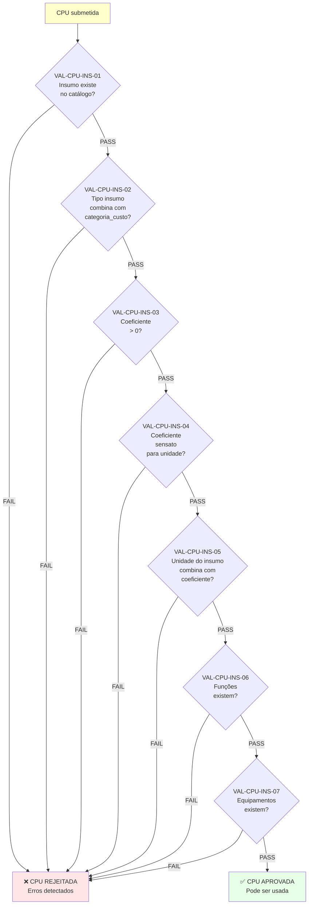
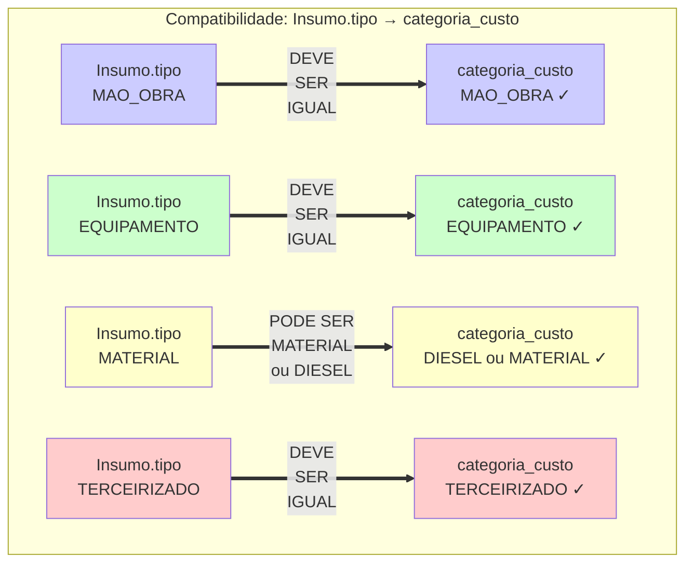
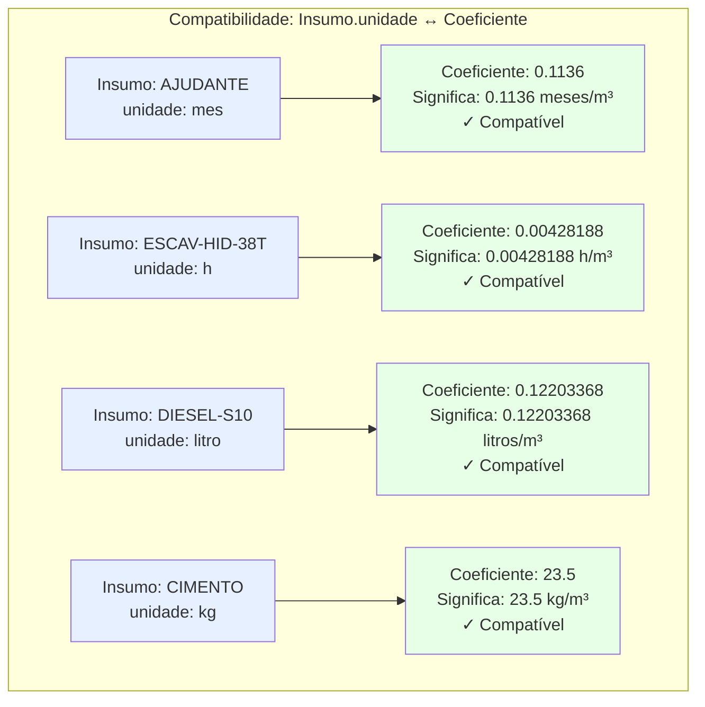

# Diagramas: Insumo ↔ CPU (Compatibilização Relacional)

## 1. Relação M:N (Many-to-Many)

## 2. Exemplo: CPU ESCO-CARGA Composta por Insumos

## 3. Fluxo de Cálculo: Insumo → CPU → Projeto

## 4. Matriz de Tipos de Insumo

## 5. Validações Necessárias (VAL-CPU-INS-*)

## 6. Compatibilidade de Tipos

## 7. Compatibilidade de Unidades

