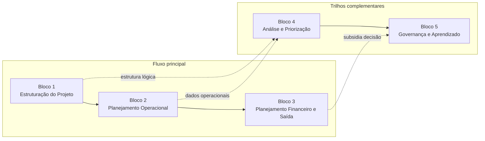
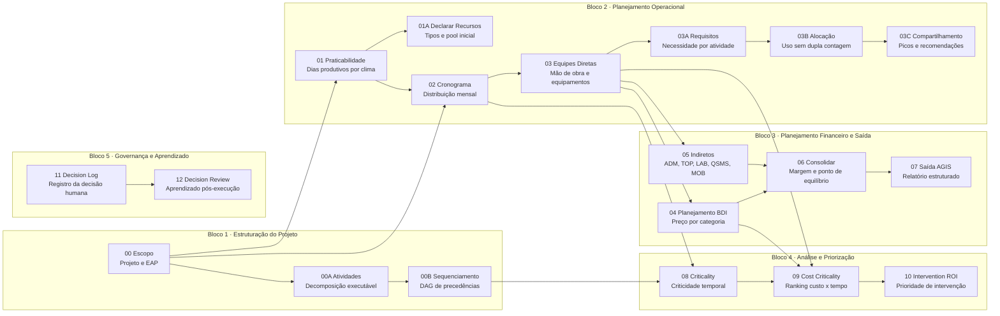

# Concilium — Resumo Executivo
**MendesLobo Construtora | Abril 2026**

---

## 1. Problema que estamos resolvendo

O processo atual de orçamentação e planejamento de obras de infraestrutura é executado de forma manual e assistemática: cada engenheiro aplica seu próprio método, as premissas de BDI são negociadas caso a caso, e não há rastreabilidade formal entre a proposta comercial aprovada e o plano de execução. O resultado prático são três riscos recorrentes:

| Risco | Manifestação |
|---|---|
| **Inconsistência de premissas** | Dois orçamentos para o mesmo tipo de obra produzem números distintos sem justificativa registrada |
| **Dupla contagem de recursos** | Equipamentos atribuídos a mais de uma frente simultaneamente, inflando o custo real ou gerando ociosidade não prevista |
| **Auditabilidade zero** | Impossível responder, após aprovação, por que uma premissa foi adotada ou quem autorizou uma revisão |

---

## 2. A solução: Concilium

**Concilium** é um framework de planejamento de obras desenvolvido internamente que transforma dados de entrada de um projeto em um **orçamento canônico auditável** por meio de uma sequência determinística de etapas de cálculo denominadas *skills*.

> **Determinístico** significa: dadas as mesmas entradas (quantitativos, localização, regime de trabalho, tabela SICRO vigente), o sistema sempre produz exatamente o mesmo resultado. Não há margem para interpretação individual.

O framework opera sobre quatro bases de conhecimento versionadas e independentes do projeto:

- **Jurisdição** — parâmetros legais e tributários (BR)
- **Tabela de referência** — SICRO 2024/CE (substituível por SINAPI ou tabela própria)
- **Catálogo** — composições de preços unitários (CPUs) e insumos calibrados para a AGIS
- **Perfil da construtora** — faixas de margem alvo/aceitável, fórmula BDI (referência TCU 2.622/2013), categorias de custo indireto

---

## 3. O pipeline de cálculo

O orçamento é produzido por uma DAG de 14 skills agrupadas em cinco blocos de responsabilidade. Os dois diagramas abaixo apresentam a mesma estrutura em dois níveis de detalhe.

### Diagrama 3A — Visão executiva: macroblocos

Fluxo principal (esquerda) e trilhos complementares (direita), mostrando a separação de responsabilidades em alto nível.



### Diagrama 3B — Visão técnica: DAG de skills

Dependências reais entre cada skill, mostrando onde o fluxo se ramifica e onde converge.



### Entrega de cada skill

| Skill | Entrega principal |
|---|---|
| **00 - Escopo** | Inicializa o projeto, os metadados e a EAP base |
| **00A - Atividades** | Decompõe itens da EAP em atividades executáveis |
| **00B - Sequenciamento** | Define as precedências entre atividades em forma de DAG |
| **01 - Praticabilidade** | Calcula percentual produtivo por mês com base climática |
| **01A - Declarar Recursos** | Define tipos de recurso e pool inicial disponível |
| **02 - Cronograma** | Distribui produção ao longo do tempo respeitando praticabilidade |
| **03 - Equipes Diretas** | Dimensiona equipes, equipamentos e custo direto por item |
| **03A - Derivar Requisitos** | Traduz equipes em requisitos de recursos por atividade |
| **03B - Alocação de Recursos** | Aloca recursos sem dupla contagem no período |
| **03C - Validar Compartilhamento** | Detecta picos de demanda e recomenda BUY, SHIFT ou HIRE |
| **04 - Planejamento BDI** | Calcula preço unitário com BDI por categoria de custo |
| **05 - Indiretos** | Dimensiona custos indiretos do empreendimento |
| **06 - Consolidar** | Fecha venda, custo, margem e ponto de equilíbrio |
| **07 - Adapter Saída AGIS** | Gera a saída estruturada para validação e integração com o legado |
| **08 - Criticality** | Mede criticidade temporal e sensibilidade do cronograma |
| **09 - Cost Criticality** | Prioriza itens por peso financeiro e impacto operacional |
| **10 - Intervention ROI** | Classifica intervenções por retorno, esforço e risco |
| **11 - Decision Log** | Registra a decisão técnica humana e sua justificativa |
| **12 - Decision Review** | Compara esperado vs. realizado e captura aprendizado |

Leitura executiva da DAG: à esquerda está o fluxo principal que produz o orçamento; à direita estão os trilhos complementares que suportam análise, priorização e captura de aprendizado. Isso preserva a lógica de dependência sem forçar leitura linear de todas as skills em uma única faixa.

### O que a skill de Praticabilidade (01) faz de diferente

Em vez de usar percentual de dias produtivos por experiência do engenheiro, o sistema consulta dados históricos climatológicos georreferenciados (Open-Meteo) e calcula automaticamente o percentual produtivo mês a mês com base em precipitação e limiar de inviabilidade configurável. O cronograma é gerado a partir desse dado, não do inverso.

### O que a Consolidação (06) entrega

Ao final do pipeline, o sistema classifica a margem do projeto:

- **VERDE** — dentro da faixa alvo (8–10% para a AGIS)
- **AMARELO** — aceitável mas fora do alvo (6–12%)
- **VERMELHO** — abaixo do ponto de equilíbrio (< 5%) → projeto não deve ser aprovado sem revisão

---

## 4. Governança e ciclo de aprovação

Cada projeto percorre um ciclo de vida formal e irreversível:

```
RASCUNHO ──► EM_VALIDAÇÃO ──► APROVADO ──► EM_EXECUÇÃO ──► CONCLUÍDO
     └──────────────────────────────────►
                   (aprovação direta possível)
```

**A partir da aprovação, o arquivo do projeto torna-se somente leitura** (imutável no sistema de arquivos). Qualquer alteração exige abertura de nova revisão (copy-on-write), preservando o histórico completo. Isso elimina o risco de "orçamento editado após aprovação" sem rastreabilidade.

Cada invocação de skill é registrada em log JSONL com timestamp, versão da skill e hash SHA-256 do artefato produzido — rastreabilidade completa para auditoria TCU/CGU.

---

## 5. Estado atual do desenvolvimento

| Componente | Status |
|---|---|
| Modelos de dados (EAP, cronograma, equipes, BDI, margem) | ✅ Completo |
| Storage versionado com hash de integridade | ✅ Completo |
| Ciclo de vida do projeto (máquina de estados) | ✅ Completo |
| CLI operacional (init, run, approve, status, validate) | ✅ Completo |
| Skills 00, 01, 06 (escopo, praticabilidade, consolidação) | ✅ Completo |
| Skills 02–05 (cronograma, equipes, BDI, indiretos) | 🔄 Fase 1A — em desenvolvimento |
| Skills 07–12 (análise, ROI, log, revisão) | 🔄 Fase 1B — especificadas |
| Modelo de alocação de recursos (anti-dupla-contagem) | 📋 Arquitetura definida, implementação pendente |
| Suíte de testes automatizados | ✅ 33 testes, 100% passando |
| Integração Claude Desktop (agente de IA) | ✅ Operacional |

---

## 6. Redução de risco operacional

### Dupla contagem de recursos
O modelo de dados define explicitamente um **pool de recursos por projeto** com controle de disponibilidade. Uma escavadeira alocada à escavação reduz automaticamente a disponibilidade do pool — se outra frente tentar alocar o mesmo equipamento no mesmo período, o sistema rejeita. Hoje esse controle é feito (ou não) manualmente em planilha.

### Conformidade com TCU
A fórmula BDI está parametrizada conforme o Acórdão TCU 2.622/2013, com faixas por categoria de custo configuradas no perfil da construtora. O sistema não permite que um orçamento aprovado use BDI fora das faixas sem registro explícito de desvio.

### Rastreabilidade SICRO
Cada CPU e insumo referencia explicitamente o item SICRO correspondente. Ao atualizar a tabela de referência (e.g., SICRO 2025), o sistema recalcula automaticamente os preços unitários afetados e gera nova revisão — sem risco de tabela desatualizada aplicada silenciosamente.

---

## 7. Próximos marcos

| Marco | Entrega | Impacto |
|---|---|---|
| **Fase 1A completa** | Skills 02–05 implementadas | Primeiro orçamento completo end-to-end pelo sistema |
| **Piloto em obra real** | Execução paralela (Concilium vs. método atual) | Validação de premissas e calibração de CPUs |
| **Fase 1B** | Skills 07–12 + modelo de alocação | Análise de caminho crítico e ROI de intervenção |
| **Integração AGIS** | Skill 07 (adapter de saída) | Eliminação de retrabalho de redigitação no sistema legado |

---

## 8. O que o Concilium **não** é

- Não é um ERP nem substitui o AGIS — exporta para ele
- Não toma decisões de negócio — classifica e apresenta cenários para o engenheiro decidir
- Não é uma solução de mercado adaptada — é desenvolvido sobre as práticas e parâmetros específicos da MendesLobo/AGIS, o que elimina a camada de customização de sistemas de terceiros

---

*Documento gerado em 27/04/2026 — para uso interno.*
