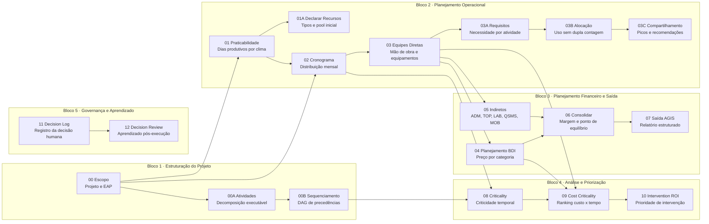

# Concilium — Resumo Executivo
**MendesLobo Construtora | Maio 2026**

---

## 1. Problema que estamos resolvendo

O processo atual de orçamentação e planejamento de obras de infraestrutura é executado de forma manual e assistemática: cada engenheiro aplica seu próprio método, as premissas de BDI são negociadas caso a caso, e não há rastreabilidade formal entre a proposta comercial aprovada e o plano de execução.

A edição anterior deste documento (27/04/2026) descreveu os três riscos recorrentes: inconsistência de premissas, dupla contagem de recursos e auditabilidade zero. Esses riscos permanecem o alvo central. O que mudou é que o Concilium agora também resolve um quarto problema, mais sutil:

| Risco adicionado | Manifestação |
|---|---|
| **Comparação informal de cenários** | Variações de premissa ("e se fossem 6 equipes?") são avaliadas em planilhas paralelas, fora do controle de versão e sem registro da hipótese que justificou cada variante |

---

## 2. A solução: Concilium

**Concilium** é um framework de planejamento de obras desenvolvido internamente que transforma dados de entrada de um projeto em um **orçamento canônico auditável** por meio de uma sequência determinística de etapas de cálculo denominadas *skills*.

A arquitetura evoluiu desde abril. O modelo operacional agora é:

```
Projeto  (container organizacional)
└── Escopo  (unidade de pipeline: lote, fase, subdivisão contratual)
    └── PlanoTrabalho  (instância de planejamento: hipótese técnica + pipeline isolado)
```

Cada nível tem sua própria máquina de estados, aprovação formal e rastreabilidade. O resultado financeiro é consolidado automaticamente de baixo para cima.

### Bases de conhecimento (inalteradas)

O framework opera sobre quatro bases versionadas independentes do projeto:

- **Jurisdição** — parâmetros legais e tributários (BR)
- **Tabela de referência** — SICRO 2024/CE
- **Catálogo** — composições de preços unitários (CPUs) calibradas para a AGIS
- **Perfil da construtora** — faixas de margem, fórmula BDI (referência TCU 2.622/2013), categorias de custo indireto

---

## 3. O pipeline de cálculo

O pipeline permanece o mesmo definido em abril — DAG de 14 skills em cinco blocos. A mudança é que agora ele opera **por PlanoTrabalho**, não por projeto. Cada plano tem seu próprio canônico isolado.

### Diagrama — DAG de skills



---

## 4. Escopos e Planos de Trabalho — ADR-031

Esta é a principal evolução de arquitetura implementada desde a última apresentação (27/04/2026).

### 4.1 Motivação

Obras de infraestrutura raramente são executadas como uma unidade indivisível. Um empreendimento típico da MendesLobo tem lotes distintos (Lote A, Lote B), fases (Terraplenagem, Pavimentação) ou subdivisões contratuais com cronogramas e equipes independentes. O modelo anterior tratava tudo como um único projeto — o que forçava o engenheiro a criar projetos separados para variações do mesmo empreendimento, perdendo a visão consolidada de margem.

### 4.2 O novo modelo

```
projetos/{projeto_id}/
├── meta.json
└── escopos/
    └── {escopo_id}/          ← Lote A, Lote B, etc.
        ├── escopo.json
        └── planos/
            └── {plano_id}/   ← Plano Agressivo, Plano Conservador, etc.
                ├── plano.json
                ├── canonical.json   ← pipeline isolado
                └── invocations.log
```

**Escopo** (`Escopo`): unidade de pipeline com tipo de obra, localização, coordenadas, regime de trabalho (dias/semana, horas/dia), datas e snapshots de catálogo/BDI independentes. Máquina de estados: `RASCUNHO → EM_VALIDACAO → APROVADO → EM_EXECUCAO → CONCLUIDO`.

**Plano de Trabalho** (`PlanoTrabalho`): instância de planejamento para um escopo. Cada plano tem nome, hipótese e pipeline isolado (canônico próprio). Máquina de estados: `RASCUNHO → EM_ANALISE → APROVADO | ARQUIVADO`. No máximo um plano `APROVADO` por escopo — ao aprovar um, os demais são arquivados automaticamente.

### 4.3 Consolidação multi-escopo

O sistema calcula automaticamente `ResultadoConsolidadoProjeto` a partir dos planos aprovados (ou ativos) de cada escopo:

| Campo | Descrição |
|---|---|
| `venda_total_com_bdi` | Soma ponderada dos escopos incluídos |
| `custo_total` | Soma dos custos diretos + indiretos |
| `margem_pct` | `resultado / venda_total` |
| `status_margem` | **VERDE** ≥ 8 pp · **AMARELO** ≥ 4 pp · **VERMELHO** < 4 pp |
| `breakdown` | Resultado individual por escopo com peso relativo |
| `avisos` | Escopos sem pipeline completo, exclusões automáticas |

### 4.4 Retrocompatibilidade

Projetos criados antes do ADR-031 (estrutura `vN/`) continuam funcionando sem migração. O sistema detecta automaticamente a estrutura legada e aplica um shim transparente que expõe a interface nova sobre a estrutura antiga.

---

## 5. Governança e ciclo de aprovação

### Por projeto (inalterado)

```
RASCUNHO ──► EM_VALIDAÇÃO ──► APROVADO ──► EM_EXECUÇÃO ──► CONCLUÍDO
```

### Por plano de trabalho (novo — ADR-031)

```
RASCUNHO ──► EM_ANALISE ──► APROVADO
                 └──────────────────► ARQUIVADO
```

**A partir da aprovação, o canônico do plano torna-se somente leitura** (imutável no sistema de arquivos). Qualquer revisão exige criação de novo plano via `new_iteration()` — que faz copy-on-write do canônico anterior e incrementa `versao_iteracao`.

Cada invocação de skill é registrada em log JSONL com timestamp, versão da skill e referências ao canônico pai — rastreabilidade completa.

---

## 6. Interface operacional

### CLI

```bash
# Escopos
concilium escopo criar <projeto_id> <escopo_id> --nome "Lote A" --tipo-obra terraplenagem ...
concilium escopo listar <projeto_id>
concilium escopo status <projeto_id> <escopo_id>

# Planos
concilium plano criar <projeto_id> [--escopo <id>] --nome "Plano Agressivo" --hipotese "..."
concilium plano listar <projeto_id> [--escopo <id>]
concilium plano aprovar <projeto_id> <plano_id> [--escopo <id>]
concilium plano comparar <projeto_id> [--escopo <id>]

# Pipeline (agora escopo/plano-aware)
concilium run <projeto_id> <skill_id> [--escopo <id>] [--plano <id>]
```

### MCP / Claude Desktop

Todos os recursos de escopo e plano estão disponíveis como ferramentas MCP:

| Ferramenta | Descrição |
|---|---|
| `listar_escopos` | Lista escopos de um projeto |
| `criar_escopo` | Cria novo escopo com todos os parâmetros |
| `listar_planos` | Lista planos de um escopo |
| `criar_plano` | Cria plano com nome e hipótese |
| `aprovar_plano` | Aprova um plano (arquiva os demais) |
| `arquivar_plano` | Arquiva manualmente um plano |
| `iniciar_planejamento` | Cria escopo + plano inicial em uma operação |
| `resumo_projeto` | Consolida ResultadoConsolidadoProjeto |
| `comparar_planos` | Tabela comparativa de planos de um escopo |

---

## 7. Estado atual do desenvolvimento

| Componente | Status em 27/04/2026 | Status em 05/05/2026 |
|---|---|---|
| Modelos de dados (EAP, cronograma, equipes, BDI, margem) | ✅ Completo | ✅ Completo |
| Storage versionado com hash de integridade | ✅ Completo | ✅ Completo |
| Ciclo de vida do projeto | ✅ Completo | ✅ Completo |
| CLI operacional | ✅ Completo | ✅ Completo + escopo/plano |
| Skills 00, 01, 06 | ✅ Completo | ✅ Completo |
| Skills 02–05 (cronograma, equipes, BDI, indiretos) | 🔄 Em desenvolvimento | 🔄 Em desenvolvimento |
| Skills 07–12 (análise, ROI, log, revisão) | 🔄 Especificadas | 🔄 Especificadas |
| **Escopos múltiplos (ADR-031)** | ❌ Não existia | ✅ **Completo** |
| **Planos de trabalho paralelos (ADR-031)** | ❌ Não existia | ✅ **Completo** |
| **Consolidação multi-escopo** | ❌ Não existia | ✅ **Completo** |
| **MCP tools para escopo/plano** | ❌ Não existia | ✅ **7 novas ferramentas** |
| **Retrocompatibilidade legado (shim)** | ❌ Não existia | ✅ **Completo** |
| Suíte de testes automatizados | ✅ 33 testes | ✅ **1.145 testes** |
| Integração Claude Desktop (agente de IA) | ✅ Operacional | ✅ Operacional |

---

## 8. Redução de risco operacional

### Aprovação seletiva de lotes
Com escopos independentes, a empresa pode aprovar o Lote A enquanto o Lote B ainda está em análise — sem travar o processo do empreendimento inteiro. O status de cada escopo é rastreado individualmente.

### Comparação formal de cenários
Ao invés de duplicar planilhas para avaliar "e se fossem 6 equipes?", o engenheiro cria um segundo plano no sistema com a hipótese registrada. Os dois planos tramitam em paralelo e podem ser comparados tecnicamente antes da aprovação.

### Dupla contagem de recursos
O pool de recursos por plano controla disponibilidade por período. Uma escavadeira alocada à escavação reduz a disponibilidade — se outra atividade tentar alocar o mesmo equipamento no mesmo período, o sistema rejeita.

### Conformidade com TCU
A fórmula BDI está parametrizada conforme o Acórdão TCU 2.622/2013. O sistema não permite orçamento aprovado com BDI fora das faixas sem registro explícito de desvio.

---

## 9. Próximos marcos

| Marco | Entrega | Impacto |
|---|---|---|
| **Skills 02–05 completas** | Cronograma, equipes diretas, BDI, indiretos | Primeiro orçamento end-to-end com múltiplos escopos |
| **Piloto em obra real** | Execução paralela com o método atual | Validação de premissas e calibração de CPUs com dados reais |
| **Consolidação multi-escopo no piloto** | Visão de margem agregada com dados reais | Primeiro resultado consolidado de empreendimento real |
| **Fase 1B** | Skills 07–12 + modelo de alocação | Análise de caminho crítico e ROI de intervenção |
| **Integração AGIS** | Skill 07 (adapter de saída) | Eliminação de retrabalho de redigitação no sistema legado |

---

## 10. O que o Concilium **não** é

- Não é um ERP nem substitui o AGIS — exporta para ele
- Não toma decisões de negócio — classifica e apresenta cenários para o engenheiro decidir
- Não é uma solução de mercado adaptada — é desenvolvido sobre as práticas e parâmetros específicos da MendesLobo/AGIS

---

*Documento gerado em 05/05/2026 — para uso interno.*
