# ADRs — Architecture Decision Records

**Projeto:** Concilium — MendesLobo Construtora  
**Convenção de nome:** `adr-{NNN}-{slug}.md` (kebab-case, lowercase) para ADRs novas; vários arquivos legados anteriores a esta convenção mantêm o prefixo `ADR-` (uppercase, ex.: `ADR-100-catalog-query-engine-duckdb.md`) e não são renomeados retroativamente

---

## Convenções de ADR

### Estrutura Obrigatória

```markdown
# ADR-{NNN} — {Título Descritivo}

**Status:** {Implementado | Decidido | Aceito | Proposta | Parcialmente Implementado | Supersedido}
**Data:** AAAA-MM-DD
**Contexto:** MendesLobo Construtora — Concilium

---

## Contexto
### Problema
P1, P2, P3 — problemas numerados

## Decisão
D1, D2, D3 — decisões numeradas com exemplos de código

## Alternativas Rejeitadas
| ID | Alternativa | Motivo |

## Consequências
### Positivas (tabela)
### Negativas / Riscos (tabela)

## Plano de Implementação
| Fase | Entregas | Status |

## Definition of Done
### Fase 1
- [ ] item
```

### Status Permitidos
- **Implementado:** Código em produção, DoD completo
- **Parcialmente Implementado:** Algumas fases concluídas
- **Aceito:** Decisão tomada, implementação pendente
- **Decidido:** Sinônimo de "Aceito" usado em algumas ADRs (ex.: ADR-122, ADR-123) — decisão tomada, implementação pendente ou já concluída na mesma entrada
- **Proposta:** Em discussão
- **Supersedido:** Substituído por ADR posterior


## Índice Completo

### ADRs Fundacionais (001–019)

| # | Título | Status | Dependências |
|---|---|---|---|
| [001](adr-001-semantic-layer.md) | Semantic Layer | ✅ Implementado | — |
| [002](adr-002-resolution-and-matching.md) | Resolution & Matching | ✅ Implementado | — |
| [003](adr-003-weekly-progress.md) | Weekly Progress | ✅ Implementado | — |
| [004](adr-004-scheduling-algorithms.md) | Scheduling Algorithms | ✅ Implementado | — |
| [005](adr-005-replanning-strategy.md) | Replanning Strategy | ✅ Implementado | — |
| [006](adr-006-team-composition.md) | Team Composition | ✅ Implementado | — |
| [007](adr-007-productivity-as-first-class.md) | Productivity as First-Class | ✅ Implementado | — |
| [008](adr-008-skills-visualization-mermaid.md) | Skills Visualization (Mermaid) | ✅ Implementado | — |
| [009](adr-009-indirect-costs-as-first-class.md) | Indirect Costs as First-Class | ✅ Implementado | — |
| [010](adr-010-activity-cost-breakdown-and-resource-allocation.md) | Activity Cost Breakdown | ✅ Implementado | — |
| [011](adr-011-computable-productivity.md) | Computable Productivity | ✅ Implementado | — |
| [012](adr-012-catalog-update.md) | Catalog Update | ✅ Implementado | — |
| [013](adr-013-mcp-facade.md) | MCP Facade (v1) | ⬜ Supersedido por ADR-037 | — |
| [014](adr-014-mcp-facade-interaction.md) | MCP Facade Interaction | ⬜ Supersedido por ADR-037 | — |
| [015](adr-015-interaction-space.md) | Interaction Space | ✅ Implementado | — |
| [016](adr-016-resource-sharing-taxonomy.md) | Resource Sharing Taxonomy | ✅ Implementado | — |
| [017](adr-017-catalog-lifecycle-management.md) | Catalog Lifecycle Management | ⬜ Supersedido por ADR-040 | — |
| [018](adr-018-typed-artifact-system.md) | Typed Artifact System | ✅ Implementado | — |
| [019](adr-019-replanning-and-structural-gaps.md) | Replanning & Structural Gaps | ✅ Implementado | — |

### ADRs de Maturação (020–033)

| # | Título | Status | Dependências |
|---|---|---|---|
| [020](adr-020-criticidade-multidimensional.md) | Criticidade Multidimensional | ✅ Implementado | — |
| [021](adr-021-plan-space-explorer.md) | Plan Space Explorer | ✅ Implementado | — |
| [022](adr-022-wave-execution-e-gate-propagation.md) | Wave Execution & Gate Propagation | ✅ Implementado | — |
| [023](adr-023-bdi-diferenciado-por-categoria.md) | BDI Diferenciado por Categoria | ✅ Implementado | — |
| [024](adr-024-referencias-planilha-editavel-snapshot-auditavel.md) | Referências: Planilha Editável + Snapshot | ✅ Implementado | — |
| [025](adr-025-mcp-catalog-tax-reference-policy.md) | MCP Catalog & Tax Reference Policy | ✅ Implementado | — |
| [026](adr-026-fase-saida-multicanal-relatorios-analiticos.md) | Saída Multicanal: Relatórios Analíticos | ✅ Implementado | — |
| [027](adr-027-cpu-sensitivity-profile.md) | CPU Sensitivity Profile | ✅ Implementado | — |
| [028](adr-028-controle-variavel-balanco-margem.md) | Controle Variável: Balanço × Margem | ✅ Implementado | — |
| [029](adr-029-ddd-package-reorganization.md) | DDD Package Reorganization | ✅ Implementado | — |
| [030](adr-030-cpu-team-composition-fuel-material.md) | CPU Team Composition + Fuel/Material | ✅ Implementado | — |
| [031](adr-031-escopos-e-planos-paralelos.md) | Escopos e Planos Paralelos | ✅ Implementado | — |
| [032](adr-032-cpu-insumo-jurisdicao-v2.md) | CPU × Insumo × Jurisdição v2 | ✅ Implementado | — |
| [033](adr-033-blob-storage-excel-ingestion.md) | Blob Storage + Excel Ingestion | ✅ Implementado | — |

### ADRs de Governança e Infraestrutura (034–052)

| # | Título | Status | Dependências |
|---|---|---|---|
| [034](adr-034-unit-conversion-service.md) | Serviço de Conversão de Unidades | ✅ Implementado | ADR-032 |
| [035](adr-035-lifecycle-data-orchestrator.md) | Lifecycle & Data Governance Orchestrator | ✅ Implementado | ADR-032, ADR-034 |
| [036](adr-036-cli-reorganization.md) | Reorganização da CLI: Gestão vs. Operação | ✅ Implementado | ADR-035 |
| [037](adr-037-mcp-facade-simplification.md) | MCP Facade: Micro → Macro-Ferramentas | ✅ Implementado | ADR-035, ADR-031 |
| [038](adr-038-regionalized-catalog-taxation.md) | Catálogo Regionalizado + BDI por Jurisdição | ✅ Implementado | ADR-032, ADR-031, ADR-033 |
| [039](adr-039-compensacao-ineficiencias-estruturais.md) | Compensação de Ineficiências Estruturais ("The Bridge") | ✅ Implementado | ADR-031, ADR-032 |
| [040](adr-040-catalog-governance-master-project.md) | Hierarquia Master vs. Project Layer | ✅ Implementado | ADR-033, ADR-038 |
| [041](adr-041-slowly-changing-dimensions.md) | SCD Type 2: Histórico Temporal do Catálogo | ✅ Implementado | ADR-033, ADR-040 |
| [042](adr-042-outsourced-services-integration.md) | Integração de Serviços Terceirizados | 💡 Proposta | ADR-009, ADR-023 |
| [043](adr-043-benchmark-application-layer.md) | Benchmark Application Layer | ✅ Implementado | ADR-024, ADR-029, ADR-039 |
| [044](adr-044-planilha-first-pu-sbdi.md) | Planilha-First: PU Direto do Catálogo | ✅ Implementado | ADR-038, ADR-023 |
| [045](adr-045-pipeline-ingestao-precos-sinapi-sicro-anp.md) | Pipeline de Ingestão SINAPI / SICRO / ANP | ✅ Implementado | ADR-038, ADR-041, ADR-032 |
| [046](adr-046-rcpsp-complete-implementation.md) | RCPSP: Escalonamento Restrito por Recursos | ✅ Implementado | ADR-004, ADR-006, ADR-007, ADR-016 |
| [047](adr-047-sharepoint-blob-storage-adapter.md) | SharePoint como Backend via BlobStoragePort | ✅ Implementado | ADR-033, ADR-024, ADR-040, ADR-041 |
| [048](adr-048-api_ui_iteracao_rapida.md) | API e UI para iteracao rapida de execucao, override e comparacao de pipelines | ✅ Implementado | ADR-031, ADR-033, ADR-035, ADR-037, ADR-040, ADR-041 |
| [049](adr-049-PU-validation-framework.md) | Validacao Convergente de Preco Unitario (Catalogo + Projeto) | ✅ Implementado | ADR-023, ADR-034, ADR-038, ADR-044 |
| [050](adr-050-cli-unificada-project-benchmark-datasource.md) | CLI Unificada para Projeto e Benchmark com Data Source Versionado | ✅ Implementado | ADR-036, ADR-043, ADR-048, ADR-049 |
| [051](adr-051-governanca-fidelidade-benchmark-e-gates-objetivos.md) | Governança de Fidelidade de Benchmark e Gates | ✅ Implementado | — |
| [052](adr-052-housekeeping-adr-numeracao-e-nomenclatura.md) | Housekeeping de ADRs: Numeração e Nomenclatura para Automação | ✅ Implementado | ADR-036, ADR-051 |
| [053](adr-053-cpu-producao-separation.md) | Separação de CPU e Produtividade — Eliminação de Redundância | ✅ Implementado | ADR-007, ADR-046 |
| [054](ADR-054-workforce-mobilization-policy.md) | Workforce Mobilization Policy System | ✅ Implementado | ADR-004, ADR-005, ADR-030, ADR-039, ADR-046, ADR-053 |
| [055](ADR-055-tax-reform-bdi-cbs-ibs.md) | Reforma Tributária CBS/IBS: Modelagem no Simulador de BDI | ✅ Implementado | ADR-023, ADR-028, ADR-038 |
| [056](ADR-056-technical-debt-remediation.md) | Remediação de Débito Técnico — Lacunas de Planejamento Temporal e Financeiro | ✅ Implementado | ADR-004, ADR-005, ADR-010, ADR-019, ADR-023, ADR-033 |
| [057](ADR-057-memorial-calculo-bdi.md) | Memorial de Cálculo BDI — Auditabilidade Ponta a Ponta | ✅ Implementado | ADR-023, ADR-055, ADR-056 |
| [058](ADR-058-analytical-richness-ontological-space.md) | Analiticidade do Espaço Ontológico — Decomposição Granular e Curva ABC | ✅ Implementado | ADR-010, ADR-023, ADR-027, ADR-039, ADR-056, ADR-057 |
| [059](ADR-059-resource-permanence-scheduling.md) | Permanência de Recursos sem Dismissal — Cronograma pelo Espaço Ontológico | ✅ Implementado | ADR-004, ADR-016, ADR-030, ADR-046, ADR-054 |
| [060](ADR-060-diagnostico-ponto-equilibrio.md) | Diagnóstico de Ponto de Equilíbrio — Decomposição Causal e Recalibração de BDI | ✅ Implementado | ADR-023, ADR-039, ADR-054, ADR-056, ADR-058, ADR-059 |
| [061](ADR-061-inversao-backtracking-pe.md) | Inversão do Cálculo de PE e Validação por Backtracking | ✅ Implementado | ADR-060, ADR-054, ADR-023, ADR-039 |
| [062](ADR-062-versionamento-contextos.md) | Versionamento Explícito de Contextos e Perfis — `ConfigVersionService` | ⚠️ Parcialmente Implementado _(revisado 2026-07-24 — infra de versionamento completa, mas `ConfigMixin.load_contexto`/`load_perfil` do pipeline real ignora `versions/`/`current` e lê o flat file direto; editar versão pela UI não afeta cálculo)_ | ADR-040, ADR-023, ADR-053, ADR-056 |
| [063](ADR-063-project-type-discriminator-and-creation-page.md) | Discriminador de Tipo de Projeto e Página de Criação Tipada | ✅ Implementado | ADR-031, ADR-040, ADR-046, ADR-048, ADR-050, ADR-053, ADR-062 |
| [064](ADR-064-no-raw-json-editing-typed-form-contract.md) | Proibição de Edição de JSON Bruto — Contrato de Formulários Tipados | ✅ Implementado | ADR-048, ADR-063, ADR-025 |
| [065](ADR-065-tema-visual-entity.md) | `TemaVisual` como Entidade de Primeira Classe — Separação de Identidade Visual | ✅ Implementado | ADR-062, ADR-064, ADR-048 |
| [066](ADR-066-catalog-overlay-model-single-source-of-truth.md) | Catálogo com Fonte Única de Verdade + Composição por Overlay | ✅ Implementado | ADR-040, ADR-032, ADR-041, ADR-018, ADR-043 |
| [067](ADR-067-master-catalog-write-api.md) | API de Escrita no Catálogo Mestre | ✅ Implementado | ADR-040, ADR-066, ADR-064, ADR-041 |
| [068](ADR-068-calendario-operacional-feriados-recesso.md) | Calendario Operacional de Producao (Feriados e Recesso) | ✅ Implementado _(loader com precedência Projeto>Jurisdição>Global; fator_calendario em η_p; render Excel + rotas API; auditado 2026-06-10)_ | ADR-007, ADR-038, ADR-046, ADR-058, ADR-060, ADR-061 |
| [069](ADR-069-cubo-analitico-faces-granularidades-ux.md) | Cubo Analitico Navegavel por Faces, Medidas e Granularidades para UX Analitica | ✅ Implementado | ADR-058, ADR-059, ADR-060, ADR-061, ADR-068, NEP-024 |
| [070](ADR-070-exploracao-deterministica-espaco-configuracao-go.md) | Exploracao Deterministica do Espaco de Configuracao Operacional para Viabilidade de GO | ✅ Implementado _(F1–F3+F5 completos 2026-06-27; F4 CPU-alternativo deferido)_ | ADR-004, ADR-005, ADR-006, ADR-020, ADR-021, ADR-022, ADR-051, ADR-060, ADR-061 |
| [071](ADR-071-resource-contract-model.md) | Resource Contract Model — Custo de Pool de Recursos por Contrato | ✅ Implementado | ADR-046, ADR-016, ADR-030, ADR-072 |
| [072](ADR-072-productive-duration-window-constraint.md) | Direção A: Duração Produtiva e Restrição de Janela de Corredor | ✅ Implementado | ADR-004, ADR-046, ADR-071 |
| [073](ADR-073-instance-matching-perpetuacao.md) | Instance Matching e Perpetuação de Recursos Π | ✅ Implementado | ADR-071, ADR-072, ADR-046 |
| [074](ADR-074-ramp-integration-auto-schedule.md) | Integração de Perfil de Rampa em AUTO_SCHEDULE | ✅ Implementado | ADR-072, ADR-073, ADR-046, ADR-054 |

### ADRs de Otimização Avançada e Diagnóstico Financeiro (075–078)

| # | Título | Status | Dependências |
|---|---|---|---|
| [075](adr-075-optimization-problem-conciliation.md) | Pipeline-Motor: Scheduling × Matching — Dois Problemas de Otimização (CP-SAT + min-cost flow) | ✅ Implementado | ADR-046, ADR-054, ADR-059, ADR-073, ADR-074 |
| [076](ADR-076-calibracao-pu-diagnostico-frentes.md) | Calibração de PU e Diagnóstico Quantitativo de Frentes em `ponto_equilibrio` | ✅ Implementado | ADR-060, ADR-071, ADR-072, ADR-075 |
| [077](ADR-077-recurso-instancial-utilizacao.md) | Recurso Instancial — Mapa de Utilização de Equipamento e Mão-de-Obra | ✅ Implementado | ADR-071, ADR-072, ADR-073, ADR-046 |
| [078](ADR-078-pre-processamento-estrutural-compartilhamento.md) | Pré-Processamento Estrutural de Compartilhamento — gap_max, η, Ω, ΔC_pot, λ_0 | ✅ Implementado | ADR-071, ADR-072, ADR-073, ADR-075, ADR-077 |
| [079](ADR-079-ativacao-economica-compartilhamento.md) | Ativação Econômica — G_r^viável, Matching Econômico, λ₀, custo_standby_idle, Desmobilização Antecipada | ✅ Implementado | ADR-073, ADR-075, ADR-077, ADR-078 |

### ADRs de Custo de Permanência e Cronograma de Obras (080–081)

| # | Título | Status | Dependências |
|---|---|---|---|
| [080](ADR-080-custo-diferenciado-permanencia-mob-tardia-taxa-ociosa.md) | Custo Diferenciado de Permanência — Mobilização Tardia por Instância, Taxa Ociosa por Componente e Desmobilização Antecipada Efetiva | ⬜ Supersedido por ADR-085 | ADR-071, ADR-073, ADR-077, ADR-079 |
| [081](ADR-081-precedencia-eap-derivacao-automatica-threshold-conclusao.md) | Precedência EAP com Derivação Automática e Threshold de Conclusão Parcial | ✅ Implementado | ADR-004, ADR-046, ADR-072, ADR-074 |

### ADRs de Diagnóstico Operacional (082–)

| # | Título | Status | Dependências |
|---|---|---|---|
| [082](ADR-082-bdi-mapeamento-ofensores-operacionais.md) | Painel de Ajuste de Ponto de Equilíbrio: Ofensores de Produtividade, Levers de Ação e Cobertura BDI | ✅ Implementado | ADR-040, ADR-053, ADR-060, ADR-074, ADR-076 |

### ADRs de Partição Causal de Custo de Pool (083–085)

| # | Título | Status | Dependências |
|---|---|---|---|
| [083](ADR-083-custo-particionado-pool-muitos-para-muitos.md) | Custo Particionado de Pool Muitos-para-Muitos — Decomposição Causal via Diagrama de Euler | ✅ Implementado | ADR-071, ADR-073, ADR-077, ADR-079 |
| [084](ADR-084-custo-particionado-pool-com-predecessao-parcial-em-dag.md) | Custo Particionado de Pool com Predecessão Parcial em DAG | ✅ Implementado | ADR-081, ADR-083 |
| [085](ADR-085-custo-instancial-composicional-temporal.md) | Custo Instancial Composicional Temporal — Linha do Tempo por Instância, Taxa Ociosa por Componente e Base Bottom-Up de Precificação | ✅ Implementado | ADR-071, ADR-077, ADR-079, ADR-080, ADR-083, ADR-084, ADR-023, ADR-039, ADR-076 |
| [086](ADR-086-cubo-pool-instancial-exploracao-honesta.md) | Cubo de Pool Instancial — Exploração Honesta e Descritiva da Decomposição Composicional-Temporal de Recursos | ✅ Implementado | ADR-085, ADR-077, ADR-073, ADR-083, ADR-084, ADR-069, ADR-021, ADR-037, ADR-018 |

### ADRs de Modelo Dimensional e Decomposição de Insumo (087–090)

| # | Título | Status | Dependências |
|---|---|---|---|
| [087](ADR-087-modelo-dimensional-hierarquico.md) | Modelo Dimensional Hierárquico — {natureza}.{atividade}.{categoria_insumo}.{propriedade} | ✅ Implementado | ADR-069, ADR-086, ADR-085, ADR-023, ADR-030 |
| [088](ADR-088-decomposicao-subcomposicional-equipamento.md) | Decomposição Sub-composicional de Equipamento — Aluguel, Combustível e Manutenção como Sub-propriedades | ✅ Implementado | ADR-087, ADR-085, ADR-086, ADR-030, ADR-077, ADR-079 |
| [089](ADR-089-bdi-por-sub-propriedade.md) | BDI por Sub-propriedade (Amend ADR-023) — amend parcial: ADR-090 reclassifica diesel como material.combustivel | ✅ Implementado | ADR-087, ADR-088, ADR-023, ADR-055 |
| [090](ADR-090-bdi-sistematico-diesel-material-indiretos.md) | BDI Sistemático — Diesel como Material + Decomposição de Indiretos por Categoria | ✅ Implementado | ADR-087, ADR-088, ADR-089, ADR-023, ADR-009 |

### ADRs de Produção e Deploy (091–096)

| # | Título | Status | Dependências |
|---|---|---|---|
| [091](ADR-091-pool-minimo-variavel-otimizacao.md) | Pool Mínimo como Variável de Otimização — Eliminação de `rcpsp_spec.resource_pool` como Entrada | ✅ Implementado | ADR-046, ADR-071, ADR-088, ADR-092 |
| [092](ADR-092-formulario-qqp-eap.md) | Formulário QQP/EAP — Interface de Entrada Estruturada para Agentes e Humanos Semi-Instruídos | ✅ Implementado (Fase 5 pendente validação real) | ADR-091, ADR-093, ADR-037 |
| [093](ADR-093-mcp-artefatos-zip-bundle.md) | MCP como Serviço de Artefatos — Download de Relatórios, Gráficos, Planilhas e Zip Bundle | ✅ Implementado | ADR-037, ADR-018, ADR-092, ADR-096 |
| [094](ADR-094-jwt-auth-layer.md) | Camada de Autenticação JWT — App Cloud-Ready antes do Deploy | ✅ Implementado | ADR-096 |
| [095](ADR-095-observabilidade-opentelemetry.md) | Observabilidade Agnóstica de Sink — OpenTelemetry para API e MCP | ✅ Implementado | ADR-096, ADR-094 |
| [096](ADR-096-deploy-azure-acr-aci-dns.md) | Deploy Azure — ACR → ACI → Application Gateway → DNS → Domínio Mendes Lobo | ✅ Implementado | ADR-094, ADR-095 |

### ADRs de Domínio Fiscal e Tributário (097)

| # | Título | Status | Dependências |
|---|---|---|---|
| [097](ADR-097-tributacao-social.md) | Modelagem de Tributação Social sobre Salário Base — Encargos SINTRACON, INSS Progressivo e IRRF 2026 | ✅ Implementado _(F1-F5 ✅ 2026-06-10; F6 MCP People&Finance 💡)_ | ADR-056, ADR-009, ADR-023 |

### ADRs de Segurança e Resiliência (098–099)

| # | Título | Status | Dependências |
|---|---|---|---|
| [098](ADR-098-rate-limiting-slowapi.md) | Rate Limiting com SlowAPI — Proteção contra DDoS e Uso Abusivo da API e MCP | ✅ Implementado | ADR-094, ADR-096 |
| [099](ADR-099-rbac-roles-permissoes.md) | RBAC — Roles e Permissões para Redução de Superfície de Ataque | ✅ Implementado | ADR-094, ADR-098 |

### ADRs de Performance, Apps e Engine de Custo (100–106)

| # | Título | Status | Dependências |
|---|---|---|---|
| [100](ADR-100-catalog-query-engine-duckdb.md) | Catalog Query Engine: DuckDB para Performance | ✅ Implementado | ADR-012, ADR-066 |
| [101](ADR-101-mcp-apps-interface-interativa.md) | MCP Apps — Interface Interativa no Chat | ✅ Implementado _(F1-5 completas 2026-07-10; F4/F5 com limitações documentadas — sem tool de "aplicar" e sem preview de abas do Excel)_ | ADR-092, ADR-093, ADR-099 |
| [102](ADR-102-pipeline-jobs-async-execution.md) | Pipeline Jobs: Execução Assíncrona | ✅ Implementado | ADR-036, ADR-050 |
| [103](ADR-103-jobs-application-layer.md) | Pipeline Jobs na Camada de Aplicação — refatoração de jobs assíncronos para `application/` (Clean Architecture) | ✅ Implementado | ADR-102 |
| [104](adr-104-centralizacao-calculo-custos-equipedireta.md) | Centralização de Cálculos de Custo em EquipeDireta | ✅ Implementado _(auditado 2026-06-08)_ | ADR-085, ADR-071, NEP-040 |
| [105](ADR-105-mobilizacao-desmobilizacao-workforce-equipment.md) | Mobilização e Desmobilização de MO e Equipamentos | ✅ Implementado 2026-06-20 _(escopo próprio: window inference + cost distribution + migração; split por fase deferido a ADR-106)_ | ADR-046, ADR-071, ADR-085 |
| [106](adr-106-equipe-custo-engine-lifecycle-unificado.md) | EquipeCustoEngine — Lifecycle Unificado Diretas e Indiretas | ✅ Implementado 2026-06-20 _(F1-F4,F6,F7; F5 bloqueado por dado de catálogo; F8→ADR-086)_ | ADR-085, ADR-104, NEP-029, NEP-031, NEP-037 |
| [107](adr-107-generalizacao-tipo-combustivel.md) | Generalização do Tipo de Combustível: DIESEL → COMBUSTIVEL + tipo_combustivel | ✅ Implementado _(D1-D4, D6 ✅ 2026-06-10; D5 analytics aguarda ADR-106)_ | ADR-030, ADR-082, ADR-085, ADR-090, ADR-092 |
| [108](ADR-108-campaign-bundle-cube-alimentado-por-cubos-existentes.md) | CampaignBundleCube alimentado pelos Cubos de Custo e Cronograma | ✅ Implementado 2026-06-12 | ADR-069, ADR-070, ADR-086, ADR-087 |
| [109](ADR-109-cardinalidade-espaco-campanha-go.md) | Cardinalidade do Espaço de Campanha GO — Produto Cartesiano de Discretizações | ✅ Implementado 2026-06-12 | ADR-070, ADR-108 |
| [110](adr-110-remediacao-fallbacks-silenciosos.md) | Remediação de Fallbacks Silenciosos — 7 Fases: logging, None/0.0, fatores, constantes, float utils, modelo, fonte de venda | ✅ Implementado 2026-06-18 | ADR-043, ADR-085, ADR-060, ADR-090 |
| [111](adr-111-logging-centralizado-otel-bridge.md) | Logging Centralizado e Ponte Python → OTel — `_setup_logging()`, `LoggingHandler`, `_JsonFormatter`, `configure_logging()` nos 3 entry points | ✅ Implementado 2026-06-18 _(TDD · 28 testes)_ | ADR-095, ADR-110, ADR-096, ADR-112 |
| [112](adr-112-pipeline-observabilidade-medalhao.md) | Pipeline Assíncrona de Observabilidade Medalhão — Bronze/Silver/Gold, backfill-incremental (fast-forward), checkpoints, DuckDB, SLIs, alertas, cross-domain | ✅ Implementado 2026-06-19 _(F1–F8 · 51 testes)_ | ADR-095, ADR-111, ADR-047, ADR-102, ADR-103 |
| [113](adr-113-desacoplamento-pipeline-otimizacao.md) | Tiers OLTP/OLAP de Skills — Planejamento (01-06) separado de Análise/Artefatos (07-11); renumeração 09→10, 10→07, 11→08, 12→09, 13→11; PipelineMode enum | ✅ Implementado 2026-06-19 _(14 testes, 8505 passed)_ | ADR-022, ADR-036, ADR-050, ADR-070, ADR-102 |
| [114](adr-114-golden-example-avaliacao.md) | Golden Example de Avaliação — benchmark sintético GOLDEN calibrado; invariantes algébricos + regressão; clarificou margem=preço operacional (não catálogo) | ✅ Implementado 2026-06-19 _(F1-F4 · 17 testes)_ | ADR-043, ADR-085, ADR-044, ADR-090, ADR-060 |
| [115](adr-115-rfx-semantica-procurement-no-concilium.md) | Semântica RFI/RFP no Concilium — intent→PipelineMode (RFI→OLTP, RFP→OLAP); CLI `--intent`; bloco rfx no report; **RFQ removido 2026-06-22** (stakeholder: fluxo é RFI→RFP→cliente) | ✅ Implementado 2026-06-22 _(F1-F5 · 18 testes · RFQ supersedido por decisão de negócio)_ | ADR-043, ADR-050, ADR-102, ADR-113, ADR-114 |
| [116](adr-116-mcp-tool-surface-cleanup.md) | Limpeza da Superfície de Tools MCP — remove duplicatas benchmark legado + avancar_pipeline (55→52); F5: 9 consolidações macro-ferramentas (52→40); teto + governança | ✅ Implementado 2026-06-22 _(F1-F5 · 55→40 tools · teto=40)_ | ADR-037, ADR-099, ADR-102, ADR-043 |
| [117](adr-117-rbac-decorator-tagging.md) | RBAC por Decorator com Tag Introspectável — `@permission` etiqueta `_required_permission`; dict TOOL_PERMISSIONS eliminado (vira cache runtime); fail-closed; governança AST; 40 tools decoradas pós-ADR-116 F5 | ✅ Implementado 2026-06-22 _(D1-D6 · 40 tools decoradas · 136 testes)_ | ADR-099, ADR-116, ADR-037 |
| [118](adr-118-tool-invocation-audit.md) | Auditoria de Invocações MCP — `ToolInvocation` frozen dataclass; `_current_user_id`/`_current_tenant_id` contextvars; `McpAuthMiddleware` propaga sub+tid; `patch_fastmcp_server_with_audit`; `BlobToolInvocationRepository` NDJSON append-only via BlobStoragePort | ✅ Implementado 2026-06-22 _(F1-F7 · model+repo+patcher+blob+55 testes)_ | ADR-014, ADR-095, ADR-099, ADR-117, ADR-103 |
| [119](adr-119-multi-actor-project-management.md) | Gestão Multi-Ator de Projetos — `ROLE_ALLOWED_INTENTS` (operator→RFI, engineer→RFI+RFP), `version_history` com autoria, fork rastreado, `/versions?tree=true`, `/compare` cross-ator, `VersionAction` audit | ✅ Implementado 2026-06-22 _(F1-F6 · 22 testes)_ | ADR-031, ADR-099, ADR-115, ADR-117, ADR-118 |
| [120](adr-120-catalog-rbac-lifecycle.md) | RBAC para Ciclo de Vida do Catálogo — `catalog:validate`/`catalog:merge`, role `catalog-manager`, `auditar_catalogo`→validate, 5 novas tools (rascunho→merge), fluxo 4-olhos, `CatalogAction`; ceiling 40→45 | ✅ Implementado 2026-06-22 _(F1-F5 · 34 testes)_ | ADR-040, ADR-099, ADR-117, ADR-119 |
| [121](adr-121-otel-instrumentation-maturation.md) | Maturação da Instrumentação OpenTelemetry: Logs, Propagação e Baggage | ✅ Implementado 2026-06-23 | ADR-095, ADR-111, ADR-112, ADR-099 |
| [122](adr-122-aci-para-azure-container-apps.md) | Migração de ACI para Azure Container Apps (ACA) | ✅ Implementado 2026-06-23 | ADR-096, ADR-099 |
| [123](adr-123-notificacao-email-e-gestao-dispositivos.md) | Serviço de Notificação por Email e Gestão de Dispositivos | ✅ Implementado 2026-07-10 _(F1-F5 completas; F3 — detecção de dispositivo desconhecido — via `application/services/device_detection.py`)_ | ADR-094, ADR-099, ADR-116 |
| [124](adr-124-reformulacao-modelo-eficiencia-planejamento-vs-controle.md) | Reformulação do Modelo de Eficiência: Separação entre Fase de Planejamento e Controle | ✅ Implementado | NEP-035, NEP-036, ADR-068, ADR-046 |
| [125](adr-125-separacao-custo-produtivo-pool-mob-demob-indireto.md) | Hierarquia de Custo: C_prod / C_pool / Contrato; Mob/Demob como Custo Indireto | ✅ Implementado 2026-06-28 _(D2/D3 são contrato conceitual — sem call site de precificação em produção ainda; slide `s_regras_custo` corrigido)_ | ADR-085, ADR-106, ADR-124, NEP-028 |
| [126](adr-126-project-ownership.md) | Project Ownership: `owner_id` em `ProjectMeta`, distinto de autoria por versão (ADR-119); autorização combinada (role + ownership) para ações destrutivas; handover híbrido; propagação de remove-user | ✅ Implementado 2026-07-08 _(F1-F7 · 48 testes)_ | ADR-099, ADR-117, ADR-118, ADR-119, ADR-094 |
| [127](adr-127-regime-contrato-vs-precificacao-horaria.md) | Regime de Contrato (Contínuo/Mensal) vs. Precificação Horária: consolida `rental_unit`/`unidade_faturamento`/custo idle já implementados (só documentação, sem código novo); multa de rescisão avaliada e descartada de escopo | ✅ Implementado 2026-07-02 | ADR-080, ADR-132, ADR-125 |
| [128](adr-128-disponibilidade-recursos-consumiveis.md) | Disponibilidade de Recursos Consumíveis: `DisponibilidadeConsumivel` (estoque/capacidade/reabastecimento) e `ReplenishableResource` no motor RCPSP para diesel/material; reaproveita `prazo_entrega` hoje não utilizado | ⚠️ Parcialmente Implementado _(atualizado 2026-07-24 — texto anterior desatualizado)_ — F1/F2/F3/F5/F6 ✅ (F5 conectou o motor ao pipeline real de skill-04; F6 contabiliza consumíveis em paridade com pool); só F4 (UI/dashboard `tanque_sugerido`) pendente | ADR-107, ADR-090, ADR-046 |
| [129](adr-129-cotacao-por-proximidade-geografica.md) | Cotação por Proximidade Geográfica: `MunicipioReferenceClient` (dataset estático), reconexão do `FuelPriceClient` via `resolver_preco_diesel_uf`, resolução por município mais próximo às coordenadas do `Escopo` (`geo_diesel_resolver`), desempate por população, integrado à skill de precificação real (opt-in via `raio_cotacao_km`) | ✅ Implementado 2026-07-08 | ADR-032, ADR-066, ADR-107 |
| [130](adr-130-composicao-equipe-grafo-sinergia-produtividade-derivada.md) | Composição de Equipe como Grafo de Sinergia: `GrafoSinergiaEquipe` (acoplamento/dimensionamento/precondição) com produtividade derivada do gargalo; estrutura estável × capacidades calibráveis (ADR-076); fallback integral para `valor_horario` declarado | ⚠️ Parcialmente Implementado — F1-F3/D5 (motor de domínio puro, testado); F4 (dados reais AGIS) e integração de F5 com ADR-076 pendentes | ADR-011, ADR-030, ADR-053, ADR-076, ADR-128 |
| [131](adr-131-notificacao-usuario-operacoes-crud-gaps-adr123.md) | Notificação do Usuário em Operações sobre Seus Próprios Dados: fecha lacunas do ADR-123 — `notify_user_removed` nunca chamado em `remove-user`, `notify_user_edited` nunca implementado, `revoke-device` admin sem notificação; regra arquitetural para mutações futuras | ✅ Implementado _(F1-F4)_ | ADR-123, ADR-094, ADR-099 |
| [132](adr-132-regime-revezamento-e-precificacao-equipamentos-por-atividade.md) | Regime de Revezamento, Turnos Noturnos e Precificação de Equipamentos por Atividade: `SV-P00XX-D/N` por turno, normalização por `n_frentes`, `preco_h_unitario` por atividade em vez de variantes `SV-EQ[1-4]-*`, mob/demob por composição — _renumerado de um ADR-108 órfão/duplicado em 2026-07-08, ver nota de auditoria_ | ✅ Implementado _(2026-06-18)_ | ADR-029, ADR-091, ADR-106, ADR-034 |
| [133](ADR-133-compartilhamento-recursos-atividades-paralelas.md) | Oportunidade de Compartilhamento Paralelo de Recursos: detecção automática pós-RCPSP de pares de atividades paralelizáveis via alternância de equipe, balanço custo de frota × indiretos — _renumerado de um ADR-110 órfão/duplicado em 2026-07-08, ver nota de auditoria_ | ✅ Implementado | ADR-007, ADR-016, ADR-075, ADR-078, ADR-081, ADR-086, ADR-091 |
| [134](adr-134-notificacao-template-jinja2-separacao-infra-aplicacao.md) | Notificação por Email: Template Jinja2 Compartilhado e Separação Infraestrutura/Aplicação — `NotificationService.send(template, context)` genérico; casos de uso migram para `application/services/notifications.py`; 5 notificações novas de ownership (ADR-126) | ✅ Implementado | ADR-123, ADR-126, ADR-131 |
| [135](adr-135-isolamento-sharepoint-sistema-vs-projetos.md) | Isolamento de Drive: dados de sistema (auth/distribuição) vs. projetos — separar `auth/`, `distribuicao/` e `projetos/` do mesmo Drive/credencial do SharePoint | ⚠️ Parcialmente Implementado _(código pronto; provisionamento do site/drive dedicado é passo manual pendente)_ | ADR-047, ADR-099, ADR-123 |
| [136](adr-136-custo-mob-demob-pool-desconexao.md) | Custo de Mobilização/Desmobilização: Campos Mortos no Pool e Cálculo Desconectado (Skill-06) — ADR-085/ADR-125 reconciliados; `InstanciaRecurso.custo_mob_instancia`/`.custo_demob_instancia` agora calculados no pool real (antes sempre 0.0); cubo de pool (ADR-086) H1 ajustado; skill-06 (`_mob.py`) deriva alimentação/seguro/cesta básica de `EquipeDireta.permanencia_efetiva_meses` por equipe; breakdown semanal (`_breakdown_mob`) usa proporção real mob/demob quando disponível (F4-bis); skill-05 consolidado com `equipe_custo_engine.py` (LifecycleEngine), eliminando a duplicação de fórmula de custo | ✅ Implementado _(F1-F6 + F4-bis)_ | ADR-085, ADR-125, ADR-105, ADR-106, ADR-104, NEP-043 |
| [137](adr-137-precificacao-mob-demob-tres-modelos-desconexos.md) | Precificação de Mobilização/Desmobilização: três modelos (pool, equipes diretas sem pool, indiretos) não derivam preço de custo real — pool automático zera `custo_mob_unit`/`custo_demob_unit` silenciosamente (afeta decisão de perpetuação, ADR-073); catálogo de equipes usa valores uniformes (R$ 6.500/R$ 800 para qualquer equipamento/função); fórmula de distância dos indiretos existe mas nenhum projeto real a usa; sem reconciliação entre os três | ⚠️ Parcialmente Implementado _(F1/D1 ✅; F2/D2, F3/D3 pendentes — dado/produto, não código)_ | ADR-106, ADR-105, ADR-129, ADR-073, ADR-136 |
| [138](adr-138-composicao-itens-restrito-material-diesel.md) | Composição de Custo: `composicao_itens` Restrito a MATERIAL/DIESEL — censo mostrou 230/317 linhas de `composicao_itens` (mendeslobo) redundantes com `Producao.composicao_padrao_equipe` (MAO_OBRA/EQUIPAMENTO), removidas de `mendeslobo`/`rfi-r02` via script idempotente; fallback (`_preco_cat_fallback_composicao`) agora falha alto (`VAL-PLAN-MO-EQ-SEM-FONTE`) em vez de silenciosamente zerar categoria sem fonte; `_cure_contextual.py` não sintetiza mais MO/EQ a partir da equipe; achado empírico do Step 0: `samples` NÃO migrado — Fonte 1 falha lá (produtividades sem `composicao_padrao_equipe`), Fonte 2 é a fonte real e ativa de preço, migrar quebraria byte-identidade; MATERIAL/DIESEL deferidos para Fase 2 | ⚠️ Parcialmente Implementado _(Fase 1 ✅ para mendeslobo/rfi-r02; Fase 1-bis `samples` e Fase 2 MATERIAL/DIESEL pendentes)_ | ADR-030, ADR-053, NEP-032 |
| [139](adr-139-origem-material-produtor-consumidor-atividades.md) | Origem de Materiais Consumíveis e Produtor-Consumidor entre Atividades — `Insumo.origem_material` (AQUISICAO_EXTERNA × GERACAO_INTERNA, ortogonal a `TipoInsumo`); `MaterialEquipe.origem_entrada` (consumo_operacional × bom_convertido, resolve ADR-138 §D7); `MaterialGerado`/`Producao.materiais_gerados` simétrico a `MaterialEquipe`; balanço da ADR-128 ganha termo `producao_por_semana` (corte→aterro, usina→pavimentação); física no catálogo, pareamento no projeto (filosofia ADR-128 D3); cotação/price_trend passam a excluir material gerado; `build_replenishable_resources` fecha a lacuna ADR-128 F4 (builder catálogo→scheduler); piloto corte→aterro E2E em `rfi-r02` (`MA-SOLO-ESCAVADO-3CAT`) | ⚠️ Parcialmente Implementado _(atualizado 2026-07-24 — texto anterior desatualizado)_ — F1-F4 ✅ (os 2 insumos ambíguos foram resolvidos via composições de usinagem bottom-up); F5 pipeline real (skill-04) ✅; só resta a UI/dashboard | ADR-128, ADR-138, ADR-030, ADR-053, ADR-130, ADR-129 |
| [140](adr-140-notificacao-email-criterio-atomico-vs-digest.md) | Notificação por Email: Critério Atômico vs. Digest para Eventos de Alta Frequência — critério de decisão (ação humana rara/1:1 → atômico; subproduto de reprocessamento/acúmulo por papel → agregado), dedup por transição de estado (não por evento bruto), mecanismo de digest via job com intervalo (precedente: `JobService._garbage_collector_loop`); candidatos futuros citados (aprovação de rascunho de catálogo, falha de pipeline, anomalias de reasonability, alertas financeiros) não implementados nesta ADR; achado inicial em `migrate-legacy-codes` investigado e descartado (fan-out correto para N destinatários distintos, não fadiga ao mesmo destinatário) | 💡 Proposta | ADR-123, ADR-126, ADR-131, ADR-134, ADR-103, ADR-120 |
| [141](adr-141-digest-aprovacao-rascunho-catalogo.md) | Digest Periódico de Rascunhos de Catálogo Pendentes de Aprovação — primeira aplicação concreta do ADR-140; `_list_versions` expõe `_rascunho`/`_rejeitado`; `rascunhos_pendentes()`/`enviar_digest_rascunhos_pendentes()` (`application/services/catalog/draft_digest_service.py`); `DraftDigestScheduler` (thread+intervalo, precedente `JobService._garbage_collector_loop`), iniciado em `app.py::main()` (nunca em `create_app()`, para não nascer em cada import de teste); destinatário = role `catalog-manager` com email cadastrado | ✅ Implementado _(status corrigido 2026-07-24 — código já existia em produção com arquivo ainda em "Proposta")_ | ADR-140, ADR-120, ADR-134, ADR-103, ADR-062 |
| [142](adr-142-jurisdicao-municipio-fallback.md) | Jurisdição por Município: Formato de Identificador e Fallback Gracioso | ✅ Implementado (infraestrutura) — sem dado real de município populado | ADR-038, ADR-055, ADR-066, ADR-129 |
| [143](adr-143-visibilidade-usuarios-entre-roles.md) | Visibilidade de Usuários entre Roles — `ROLE_VISIBILITY` (`permission_guard.py`) + `AUTH_LIST_VISIBLE`, tool MCP `listar_usuarios_visiveis` + `GET /auth/users/visible`, nunca expõe dispositivos/secret_hash, email sem mascaramento; digest opt-in "quem me consultou" a cada 5min (`VisibilityDigestScheduler`), time-gated por conteúdo, critério ADR-140 (nunca notificação atômica) | ✅ Implementado | ADR-099, ADR-117, ADR-120, ADR-118, ADR-140, ADR-141, ADR-112 |
| [144](adr-144-notificacao-deploy-e-skill-atualizavel-mcp.md) | Notificação de Deploy e Skill de Instruções Atualizável via MCP — registro `deploy/latest.json` (`DeployLogStore`, CLI `concilium ops deploy record-promotion`, `resumo` = commits brutos via `git log --format='%s'`); entrega embutida na resposta de `ping()` (não email/scheduler — deliberadamente diverge do padrão ADR-141/143), dedup por dois cursores em `ClientRecord` (`last_deploy_seen`/`last_skill_version_seen`); nova tool MCP `obter_instrucoes_atualizadas()` que lê o `.skill` por-request (não no boot, ao contrário do padrão `ui://` do ADR-101), versionamento explícito do skill file | ✅ Implementado | ADR-093, ADR-101, ADR-123, ADR-140, ADR-141, ADR-143 |
| [145](adr-145-unificacao-escrita-catalogo-mestre-preco-insumo.md) | Unificação do Caminho de Escrita de Preço no Catálogo Mestre — `atualizar_preco_insumo`/`adicionar_variante_producao` passam a exigir `rascunho_id` e gravam apenas um delta na versão do rascunho (nunca tocam `config/catalogos/` diretamente); `aprovar_merge_catalogo` vira o único ponto de escrita efetiva, aplicando os deltas via `RepositorioInsumo.atualizar_preco()` (SCD2/ADR-041) e gerando `CatalogSnapshot`/`CatalogDiff` (ADR-024) com `justificativa` persistida no registro (não só ecoada na resposta); nota de alteração vira append-only (`historico_precos`/histórico regional); `CatalogUpdater` órfão removido (D5); `consultar_impacto_reajuste` corrigido — lia chave `"modificados"` inexistente no retorno de `ContextoVersionService.compare()`, sempre reportava 0 insumos afetados (P11), agora deriva dos deltas reais do rascunho. Achado correlato (fora da decisão, ainda em aberto): overlay de projeto (ADR-040) pode orfanizar nós do grafo de sinergia (ADR-130) — `revalidar_apos_mudanca_composicao` segue não conectada ao overlay | ✅ Implementado | ADR-017, ADR-024, ADR-025, ADR-040, ADR-041, ADR-062, ADR-066, ADR-067, ADR-120, ADR-130 |
| [146](adr-146-contrato-labels-metricas-conformacao-dimensional.md) | Contrato de Labels de Métricas para Conformação Dimensional — chaves canônicas `METRIC_LABEL_*` (`skill`/`tool`/`project.id`/`status`, valores históricos preservados, zero rename); `record_tool_call` ganha `project.id` opcional (repassado por `_with_tracing`, que já o extraía para o span); `normalize_metric_record` promove as 3 chaves a colunas `skill_id`/`tool_name`/`project_id` (retroativo sobre Bronze existente); `silver_normalizer` segue módulo puro — teste de conformidade solda os dois lados sem import em runtime; fecha o gap 2 do ERD Gold (último pré-requisito do CuboMetricas) | ✅ Implementado | ADR-095, ADR-112, ADR-118, ADR-087 |
| [147](adr-147-cubos-observabilidade-gold.md) | Cubos de Observabilidade Gold — generaliza `CuboAnalitico` (ADR-087) para observabilidade: `Cubo[CelulaT]` genérica (`slice()`/`query()` via DuckDB, `GROUP BY ALL`); `CuboSpans`/`CuboLogs`/`CuboMetricas`/`CuboToolInvocations`, um por fato do ERD, medidas heterogêneas (percentil/contagem/valor/duração calculada); `read_silver_records` extraída de 3 cópias idênticas; `GoldAggregator`/`CrossDomainBuilder` migrados sem quebrar nenhum teste pré-existente (prova de preservação de comportamento); `build_tool_usage_diario` (relatório Gold do CuboMetricas, `status` promovida junto); exposto via API — `GET /gold/cubo/contrato` + `GET /gold/cubo/{cubo}/projecao` (whitelist de dimensões/medidas, nunca SQL do cliente) + `GET /gold/tool-usage`, mesmo padrão de `/cubo-analitico/projecao` | ✅ Implementado | ADR-087, ADR-093, ADR-112, ADR-146 |
| [148](adr-148-ineficiencia-horaria-diaria.md) | Ineficiência Horária Diária — fator determinístico `eta_jornada = (horas_dia - horas_improdutivas_dia) / horas_dia`, terceiro fator de planejamento ao lado de `η_clima` e `δ` (ADR-124/068), aplicado só na camada operacional (`_build_dist_cell`); não toca calibração de custo/PU do catálogo; campo `horas_improdutivas_dia` em `RegimeTrabalho` (tempo fixo por dia, default 0.5h); script de migração F0 (`scripts/dev/migrate_horas_improdutivas_dia.py`) grava `0.0` em specs legados antes do novo default valer | ⚠️ Parcialmente Implementado _(código completo; execução do F0 contra dados reais e migração de backends remotos pendentes)_ | ADR-068, ADR-072, ADR-124 |
| [149](adr-149-contexto-projeto-cpu-complementar-catalogo.md) | Contexto de Projeto complementar à descrição de CPU — novo campo `contexto_projeto` por CPU/por projeto, texto livre sem workflow de aprovação (diferente de `CPUOverride`), armazenado em `overrides/cpus_contexto.json` via `read_json`/`write_json` genéricos (sem novo método de protocolo, evita paridade File×SharePoint); `resolve_cpu` anexa a chave sempre que existir; exibição sempre complementar à descrição herdada do catálogo, nunca a substitui — _renumerado de 148 para 149 em 2026-07-24: "horas improdutivas dia" surgiu primeiro e manteve o 148_ | ✅ Implementado | ADR-040, ADR-066 |
| [150](adr-150-rascunho-catalogo-projeto-promocao-master.md) | Rascunho de Catálogo com Escopo de Projeto: Promoção Gated ao Catálogo Master — completa a Fase 3/4 pendente do ADR-040; override de projeto ganha identidade de rascunho (`abrir_ou_obter_rascunho_projeto`, reaproveita `RascunhoCatalogoStateMachine`); promoção ao master exige ownership do projeto (ADR-126, `require_owner_or_admin`) **e** aprovação 4-olhos com role `catalog:merge` (ADR-120), ambos cumulativos; escrita efetiva reaproveita `aprovar_merge_catalogo`/`CatalogSnapshot` (ADR-145) via novo tool MCP `promover_override_projeto`, cobrindo insumo (preço) e CPU (produtividade/composição, mesma semântica de merge de `ConciliumService.resolve_cpu`); fecha bypass de governança do `concilium manage catalog promote` (CLI antigo gravava direto no master via `_write_json`, sem gate algum, e buscava override pela chave errada — nunca achava o que `atualizar_preco_insumo` gravava); achado lateral corrigido: override de projeto gravava em `catalog_prices.json`, arquivo morto que nada lia; digest existente (ADR-141) estendido para `projeto_id` + dono do projeto. BDI (`bdi_override.json`) investigado e deliberadamente fora de escopo — arquivo sem leitor no pipeline real, sem "master" de destino, e BDI de projeto já é governado por mecanismo próprio (`PerfilBdiProjeto`/`bdi-update`); levantamento de uso do CLI antigo concluído por análise estática (nenhuma automação encontrada) | ✅ Implementado | ADR-040, ADR-120, ADR-126, ADR-141, ADR-145, ADR-062, ADR-130 |
| [151](adr-151-provisionamento-externo-deficit-material-geracao-interna.md) | Provisionamento Externo de Déficit em Materiais de Geração Interna — novo campo `DisponibilidadeConsumivel.deficit_provisionado_externamente` (quantidade planejada, distinta de `estoque_inicial`/`taxa_reabastecimento_max`), injetado just-in-time na projeção de estoque (início do último trecho contíguo negativo, não em t=0 — preserva o mecanismo de atraso do ADR-128 para déficits transitórios anteriores) para o caso em que a demanda agregada de um material de geração interna excede a produção pareada por razão física genuína (não bug de pareamento); herda o mecanismo de override já existente (`Escopo.logistica_consumiveis`, ADR-128 F5); nova validação `VAL-ESTOQUE-PROVISIONAMENTO-01` (AVISO) torna a causa visível em vez de só falhar; achado motivador: AGIS `MA-SOLO-ESCAVADO-3CAT` — camada final de aterro de rocha (`eap-1_10`, precedência FS 85% sobre o corpo do aterro) é fase construtiva adicional genuína, não redundância; déficit agregado real medido em 71.725,60 m³ (quase 3× a estimativa inicial pelo quantitativo isolado de `eap-1_10`), aplicado ao benchmark AGIS (71.900,00 m³ com pequena margem operacional) — `GATE Status final` = `APROVADO` | ✅ Implementado | ADR-139, ADR-128 |
| [152](adr-152-timelapse-ocupacao-instancia-recurso.md) | Timelapse de Ocupação de Instância de Recurso (Pool) — `project_ocupacao_semanal`/`project_ocupacao_contrato_semanal` (`application/scheduling/pool_timelapse.py`) expandem `segmentos_atividade`/`segmentos_idle` já persistidos em `InstanciaRecurso` (ADR-077/083/085) num dict semana→status ("prod"/"idle"/"off"), espelhando `project_estoque_semanal` (ADR-128) para material; nenhuma mudança no CP-SAT, no schema ou na cadeia de custo — função pura e aditiva; individualização de identidade física (pessoa/máquina) avaliada e mantida fora de escopo (ADR-059) | ✅ Implementado | ADR-077, ADR-083, ADR-085, ADR-128, ADR-059 |
| [153](adr-153-identidade-fisica-recurso-anotacao-declarativa.md) | Identidade Física de Recurso — Anotação Declarativa de Segmento (Fase 1) — `SegmentoAtividade.identidade_fisica_id` (campo opcional) + `atribuir_identidade_fisica_segmentos` (`application/scheduling/pool_identidade_fisica.py`) registram qual ativo físico (matrícula/placa) ocupou um segmento, puramente declarativo/rastreável, sem nenhum efeito no solver ou na cadeia de custo; Fase 2 (reformulação do CP-SAT para atribuição por unidade) e Fase 3 (individualização de custo real por pessoa/ativo) explicitamente não iniciadas — avaliadas como esforço grande, próprio de ADRs futuras dedicadas | ⚠️ Parcialmente Implementado | ADR-077, ADR-083, ADR-152, ADR-059 |
| [154](adr-154-roster-real-custo-individualizado-mo.md) | Roster Real de Mão-de-Obra — Custo Individualizado sem Amarrar Identidade ao Cronograma — `MembroEquipeReal` (`domain/models/canonical/_roster_mo.py`) + `custo_real_mo_semanal`/`custo_real_mo_total` (`domain/services/financial/roster_custo_mo.py`) somam custo real por semana a partir de pessoas reais (salário, encargos via `resolver_encargo`/ADR-097, data de admissão/desligamento), granularidade semanal, sem nenhuma ligação com `InstanciaRecurso`/`identidade_fisica_id` (ADR-153) — pool RCPSP permanece fungível; wiring ao pipeline real (`RecursoContrato.custo_unit_semanal_mo`) e roster de equipamento deferidos para ADRs futuras | ✅ Implementado | ADR-097, ADR-106, ADR-071, ADR-153 |
| [155](adr-155-roster-real-custo-individualizado-equipamento.md) | Roster Real de Equipamento — Custo Individualizado sem Amarrar Identidade ao Cronograma — `AtivoEquipamentoReal` (`domain/models/canonical/_roster_equipamento.py`) + `custo_real_eq_semanal`/`custo_real_eq_total` (`domain/services/financial/roster_custo_equipamento.py`) somam custo real por semana a partir de ativos reais (locação + manutenção mensal do contrato real, data de início/fim), granularidade semanal, mesma disciplina de escopo de ADR-154 (sem ligação com `InstanciaRecurso`/`identidade_fisica_id`, sem wiring ao pipeline real) | ✅ Implementado | ADR-154, ADR-088, ADR-071, ADR-127, ADR-153 |
| [156](adr-156-composicao-funcoes-substituicao-roster-mo.md) | Composição de Funções por Tipo de Pool: Substituição de Custo Real de MO (Fase 1 — Sem Wiring) — `RecursoContrato.composicao_funcoes_mo` (novo campo) + `extrair_composicao_funcoes_mo`/`aplicar_roster_custo_real_mo` resolvem o risco de `tipo_id` representar equipe mista (MO+equipamento sob o mesmo hash, `_tipo_recurso_fungivel`) — substituição só ocorre com verificação de cobertura por função (headcount suficiente), nunca parcial; wiring real no orquestrador de skill-05 deferido para ADR-157 | ✅ Implementado | ADR-154, ADR-046, ADR-071, ADR-153 |
| [157](adr-157-composicao-equipamentos-substituicao-roster-eq.md) | Composição de Equipamentos por Tipo de Pool: Substituição Segura de EQ (Espelho da ADR-156) — `RecursoContrato.composicao_equipamentos_eq` (novo campo) + `extrair_composicao_equipamentos_eq`/`aplicar_roster_custo_real_eq` fecham a mesma lacuna da ADR-156, agora para equipamento (`AtivoEquipamentoReal.tipo_id`, ADR-155, tinha o mesmo risco de tipo misto não corrigido); mesma disciplina de cobertura por `equip_id`, nunca substituição parcial | ✅ Implementado | ADR-156, ADR-155, ADR-046 |
| [158](adr-158-custo-real-instancia-timeline.md) | Custo Real por Instância: Timeline Analítica Prod/Idle/Off — `custo_real_eq_idle_semanal` (extensão ADR-155) + `custo_real_instancia_semanal` (`application/scheduling/custo_real_instancia.py`) combinam `project_ocupacao_semanal` (ADR-152) com as taxas médias reais do contrato (ADR-156/157), seguindo a mesma assimetria prod/idle do `LifecycleEngine` (MO integral, EQ reduzido); sem atribuir indivíduo/ativo a slot — pool permanece fungível, `identidade_fisica_id` (ADR-153) permanece dormente | ✅ Implementado | ADR-152, ADR-156, ADR-157, ADR-085 |
| [159](adr-159-wiring-composicao-pipeline-real.md) | Wiring Real: Popular `composicao_funcoes_mo`/`composicao_equipamentos_eq` no Pipeline de Skill-05 — `enriquecer_composicao_por_tipo` (novo, `_skill_helpers/_composicao_por_tipo.py`) preenche os dois campos (ADR-156/157) em todo `RecursoContrato` real, reaproveitando `_tipo_recurso_fungivel` (importada, não reimplementada) para casamento exato de `tipo_id`; wiring de uma linha em `skill.py`, zero mudança de assinatura de função existente; puramente descritivo — nenhum custo muda | ✅ Implementado | ADR-156, ADR-157, ADR-071 |
| [160](adr-160-cubo-pool-real-transiente.md) | Cubo de Pool Real: Composição Transiente, Sem Registro Persistente de Roster — correção de rumo confirmada: sem nenhum registro de instância/indivíduo persistido em catálogo/Escopo; `taxa_media_eq_idle_real` + `gerar_timeline_real_instancias` (`application/scheduling/cubo_pool_real.py`) compõem ADR-154/155/156/157/158 recebendo o roster como parâmetro transiente, nunca lido de armazenamento; `None` explícito (nunca número parcial/enganoso) quando cobertura insuficiente | ✅ Implementado | ADR-154, ADR-155, ADR-156, ADR-157, ADR-158 |
| [161](adr-161-distribuicao-proxy-mcp-desktop-extension-mcpb.md) | Distribuição do Proxy MCP via Desktop Extension (`.mcpb`) — substitui o `claude_desktop_config.json` manual (JSON com `client_code` embutido, por usuário, dois blocos por SO) por um único `.mcpb` **universal** empacotando os 3 binários PyInstaller já existentes (`build-proxy.yml`) via `platform_overrides` do manifest (Claude Desktop escolhe o binário certo sozinho — elimina de vez o "admin não sabe o SO do usuário"); `user_config` pede `CONCILIUM_CLIENT_CODE` na própria UI de instalação (campo `sensitive`, vai pro Keychain/Credential Manager, não texto plano); candidato a escapar do bug de team cloud sync que sobrescreve `mcpServers` sem merge (`remoteToolsDeviceName`, issues públicas #59368/#34359/#56296/#32345, não confirmado oficialmente) — validação experimental é pré-requisito (F1) antes de qualquer rollout; reafirma a rejeição de OAuth2 completo da ADR-099 (R4) | 💡 Proposta | ADR-123, ADR-099 |
| [162](adr-162-diagnostico-piso-teto-inequacoes-pe.md) | Diagnóstico do Ponto de Equilíbrio: Decomposição Causal Cronograma × Precificação — formaliza `Δ_i = γ_i·(Q_i/ρ_i − h·d·Σ_j m_ij)` (P1); corrige (nota de revisão) um argumento de "independência de `γ_i`" refutado pelo usuário — sob taxa única nenhuma leitura adimensional de `Δ_i` carrega informação de custo, só escala; decompõe com duas taxas (`γ_i^v` venda × `γ_i^o` real) em `Δ_i = T_cronograma + T_precificacao`, campo `causa_dominante` por magnitude relativa (não por qual limite cruzado); **Fase 0 ✅ implementada**: removido o atalho de cálculo por `custo_hora_total_referencia` em 3 camadas (skill-04 P_canonico, skill-05 dimensionamento standalone e pool), corrigido bug de precedência ADR-132 em `_custo_hora_equipamentos`, verificado bottom-up puro reproduz os 4 CPUs Serra Verde com delta<0,003% (fecha NEP-029/NEP-043 Bug 3 definitivamente); teto `Γ` opt-in por perfil com `VAL-PONTO-EQUILIBRIO-TETO` (AVISO, D1-D4 ainda proposta); P5: `H_i`/`N_i` só existem por completo pós skill-04 (cronograma+praticabilidade) — `causa_dominante` é estritamente diagnóstico pós-schedule, nunca validação prospectiva de mobilização; migração da base operacional para semanal-por-frente deferida (Fase 3, condicionada) | 💡 Proposta (D1-D4) — Fase 0 ✅ Implementado | ADR-060, ADR-061, ADR-076, ADR-083, ADR-132, ADR-152, NEP-029 |
| [163](adr-163-superficie-mcp-catalogo-identificacao-insumo-locacao-mensal.md) | CRUD de Insumo no Catálogo Mestre via MCP — motivada por bloqueio real reportado por agente resolvendo 54 anomalias (E0001-E0054) via chat; generalizada para CRUD completo (achado: hoje só existe fração de R+U, nada de C/D): `listar_insumos` (Read/lista, busca paginada por id/descrição/tipo — `pesquisar_catalogo` só busca CPUs); `descricao` no `detalhe` de anomalias `INCOMPLETO` em `_pc_eq_locacao` (já existia em `ESTATISTICO`); `BreakdownPU.itens` + `calcular_pu_producao(detalhado=True)` expõe composição de equipe item-a-item; `atualizar_preco_insumo` ganha `novo_valor_locacao_mensal` (Update); `criar_insumo` (Create) e `descontinuar_insumo` como soft-delete via novo `Insumo.status` (Delete, nunca remoção física — preserva fidelidade retroativa ADR-024/041/066); todas C/U/D gated pelo caminho rascunho→merge da ADR-145. **D7 emenda ADR-099/ADR-120**: `engineer` perde `catalog:write` (escopo restrito a domínio projeto), exclusivo de `catalog-manager`/`admin` — reverte decisão original do ADR-120 §D3 a pedido do usuário; caso combinado via multi-role (`engineer`+`catalog-manager`), mecanismo já existente; `_ADMIN` precisa ganhar `CATALOG_WRITE` explícito (hoje herdado de `_ENGINEER`) para não perder acesso silenciosamente | ✅ Implementado | ADR-024, ADR-025, ADR-037, ADR-041, ADR-066, ADR-092, ADR-099, ADR-116, ADR-120, ADR-145 |
| [164](adr-164-operacoes-lote-crud-insumo.md) | Operações em Lote (Batch) para CRUD de Insumo — `criar_insumos_lote`/`atualizar_precos_insumos_lote`/`descontinuar_insumos_lote` espelham as 3 tools individuais do ADR-163 recebendo `itens: list[dict]`; teto `MAX_LOTE_INSUMOS=100` por chamada; `_append_delta_to_rascunho` generalizada para `_append_deltas_to_rascunho` (N deltas numa única leitura+escrita do rascunho, singular vira wrapper de 1 item — zero mudança de comportamento nos 4 call sites individuais existentes); validação por item (não all-or-nothing, mesmo padrão do CLI `auth batch`) com persistência atômica dos itens válidos; `aprovar_merge_catalogo` não mudou — o loop de deltas já era genérico para qualquer quantidade | ✅ Implementado | ADR-116, ADR-145, ADR-163 |
| [165](adr-165-catalogo-treinamentos-exames-epis-beneficios-mo.md) | Catálogo de Treinamentos, Exames, EPIs e Benefícios de Mão de Obra — dado individualizável para o que hoje é a verba QSMS lump ("EPIs e treinamentos" R$3.000/mês fixo, `_dimensionamento.py:86`, wiring de substituição deliberadamente fora de escopo): EPI modelado como `Insumo` tipo `MATERIAL` existente (prefixo `EPI-`, sem tipo novo); `TipoInsumo` ganha `TREINAMENTO`/`EXAME`/`BENEFICIO` (específicos por função, comuns, e recorrentes por dia/mês respectivamente); `AtributosInsumo` ganha `vida_util_dias`, `funcoes_aplicaveis` (`None`=comum a todas as funções MAO_OBRA, lista=específico), `periodicidade_beneficio` (diária/mensal) e `aplicavel_tipo_contrato` (jantar opcional para PJ); zero tools MCP novas — generalizam automaticamente via `tipo_dir = str(tipo).lower()`; achado adicional: `InsumoVersionado` (ADR-032) tinha o mesmo `Literal` de 4 tipos, estendido para não quebrar `preco_na_data` (SCD Type 2); F4 carregou 34 itens reais no catálogo `mendeslobo` via script (`scripts/catalog/adr165_carga_inicial_rh.py`) que reusa a governança rascunho→merge/quatro-olhos das tools MCP, sem sessão ao vivo; wiring no pipeline de indiretos e mapeamento função→item específico ficam para trabalho futuro — **ver ADR-166**, que implementa os dois | ✅ Implementado | ADR-032, ADR-107, ADR-116, ADR-139, ADR-145, ADR-163, ADR-164 |
| [166](adr-166-wiring-indiretos-mapeamento-funcao-item-rh.md) | Wiring do Custo de RH no Pipeline de Indiretos + Mapeamento Função→Item — revisita a ADR-165 D9: `_composicao_qsms_bottom_up` substitui a verba QSMS lump (R$3.000/mês) por EPI+treinamento+exame reais por função; `_composicao_mob_beneficio_bottom_up` substitui `custo_pessoa_mes` fixo (R$1.850, MOB) pelos itens `BENEFICIO` reais, preservando `permanencia_efetiva_meses` por equipe (ADR-136) — resolve duplicação de conceito entre as duas verbas legadas; `atualizar_preco_insumo(s)` ganha `novos_funcoes_aplicaveis` para popular insumo já existente; mapeamento função→item confirmado com o usuário (rascunho publicado, 3 perguntas) e aplicado via script, cobrindo aliases duplicados de código MAO_OBRA (achado ADR-163); **achado crítico durante a implementação**: `criar_rascunho_catalogo` fazia todo rascunho novo herdar `_aprovado`/`_deltas` do rascunho anterior já aprovado (bug em `ContextoVersionService.create_version`, nunca exercitado antes por nenhum catálogo ter tido 2 rascunhos pós-aprovação) — corrigido com reset explícito de estado + teste de regressão | ✅ Implementado | ADR-032, ADR-120, ADR-136, ADR-145, ADR-163, ADR-164, ADR-165 |
| [167](adr-167-adm-top-funcao-real-multi-catalogo.md) | ADM/TOP com Função Real + Paridade de Catálogo (mendeslobo × rfi-r02) — auditoria pós-ADR-166 achou o mesmo padrão de lump hardcoded em ADM ("Coordenador" R$12.500/mês) e TOP ("Topógrafo" R$9.216/mês): itens usavam `"funcao"` (texto solto) em vez de `"funcao_id"`, então `_bcfd_enrich_mo_itens` nunca disparava mesmo com catálogo disponível; corrigido com `funcao_id` real (`P0092`/`P0057`) + fallback seguro (`valor_mensal`) se o catálogo não tiver o código; novo cargo `P0092` "Coordenador" (PJ, R$12.500/mês) criado — não existia em nenhum catálogo; usuário pediu para replicar também no catálogo `rfi-r02` (contexto `mendeslobo-rfi`) tudo que a ADR-165/166 tinham feito só em `mendeslobo` — 34 itens RH + mapeamento função→item reaplicado sobre o roster próprio de `rfi-r02` (82 códigos `P0xxx` bare, sem aliases, script dedicado); LAB (R$4.000/mês) e "Alojamento" (ADM, R$3.500/mês) ficam explicitamente adiados — não têm hoje tipo de insumo catalogável equivalente — **Alojamento implementado na ADR-168** | ✅ Implementado (ADM/TOP) — LAB adiado | ADR-163, ADR-164, ADR-165, ADR-166 |
| [168](adr-168-alojamento-bottom-up-num-casas.md) | Alojamento (ADM) Bottom-Up por Número de Casas — usuário forneceu o modelo de negócio que faltava na ADR-167 (D6): casa de referência com 3 quartos × 2 pessoas/quarto (capacidade 6, configurável), aluguel R$4.000/mês/casa; `_custo_alojamento_bottom_up` calcula `num_casas = ceil(headcount_direto / capacidade)`, substituindo a verba lump de R$3.500/mês fixo — headcount vem de `equipes_diretas` (mesmo escopo do bottom-up de QSMS, ADR-166); capacidade/valor configuráveis via nova chave `cat["alojamento"]`/`regra["alojamento"]` no perfil, sem precisar de nova versão do driver; item "Coordenador" (P0092, ADR-167) não afetado; degradação segura preservada (sem headcount, cai no lump antigo) | ✅ Implementado | ADR-166, ADR-167 |
| [169](adr-169-lab-condicional-terraplenagem-pavimentacao.md) | LAB Condicional a Terraplenagem/Pavimentação — relato do engenheiro de planejamento (ex-engenheiro de campo): laboratório (aluguel de equipamentos de ensaio) só existe em projetos com atividades de terraplenagem ou pavimentação; nova `_categorias_cpu_do_projeto` deriva as `CategoriaCPU` presentes via `canonical_in.eap` cruzado com `catalogo["cpus"]`; `_composicao_default_por_categoria("LAB")` só cobra R$4.000/mês quando o conjunto intersecta `{TERRAPLENAGEM, PAVIMENTACAO}` — custo zero quando se sabe positivamente que não; `None` (categorias desconhecidas, sem EAP/catálogo) preserva o comportamento antigo (sempre cobra), mesma degradação segura de QSMS/MOB/Alojamento (ADR-166/168) — nunca zera por falta de dado, só por resposta positiva | ✅ Implementado | ADR-166, ADR-167, ADR-168 |
| [170](adr-170-alojamento-como-beneficio-catalogado.md) | Alojamento como Benefício Catalogado (BEN-ALOJAMENTO) — usuário observou que Alojamento se enquadra em `BENEFICIO` (mesma categoria de café/almoço/vale-alimentação, ADR-165), só que compartilhado (uma casa serve várias pessoas); novo insumo `BEN-ALOJAMENTO` criado em mendeslobo/rfi-r02; `AtributosInsumo` ganha `quartos_por_casa`/`pessoas_por_quarto` (só `BENEFICIO`) para capturar capacidade compartilhada, que os demais benefícios (custo direto por pessoa) não têm; **decisão do usuário**: custo continua aparecendo em ADM (não migra para o bottom-up de MOB) — só a fonte de capacidade/valor muda, com prioridade perfil > catálogo > hardcoded; matematicamente incompatível generalizar via o loop por-função do MOB (dividir por capacidade por função superestimaria casas) | ✅ Implementado | ADR-165, ADR-168 |
| [171](adr-171-enriquecimento-samples-recalibracao-golden.md) | Enriquecimento do Catálogo `samples` + Recalibração do GOLDEN — usuário questionou a falha de `test_regression_against_calibrated_values` (custo.total 6,19% fora do calibrado); investigação (cruzando logs de suíte + timestamps de commit) achou o erro de processo: cada rodada rotulava a falha "pré-existente" sem comparar a *magnitude* do desvio — na real, um gap de 9,83% já existia antes de qualquer ADR desta sessão (confirmado por `git stash`), mas a **ADR-168** (Alojamento bottom-up) moveu o número (557.959,98→580.459,98) porque só depende de headcount, não de catálogo — as demais ADRs (165/166/167/169/170) não afetaram o teste porque o GOLDEN usa o catálogo `samples`, que não tinha nenhum dos itens novos; `samples` enriquecido com os mesmos 34 itens RH + `P0092` + `BEN-ALOJAMENTO` + mapeamento função→item (roster próprio, 78 códigos descritivos sem aliases) via script novo; `referencia.json` recalibrado (custo.total 618.759,49→780.810,75, margem_pct 14,26%→15,28%) — `custo.direto_equipes` idêntico confirma que só indiretos mudaram; gap pré-existente de 9,83% fica absorvido pela recalibração, documentado como não-investigado | ✅ Implementado | ADR-165, ADR-166, ADR-167, ADR-168, ADR-169, ADR-170 |
| [172](adr-172-produtividade-efetiva-precificacao-beta.md) | Produtividade Efetiva de Precificação (β_i) — stakeholder propôs reajustar preço unitário reativamente por um fator α sempre que o Ponto de Equilíbrio desse déficit; prova matemática (a partir de P1 do ADR-162) mostra que isso não é sintoma de um projeto específico: sob `p^u_i=γ_i/ρ_i` puro, `Δ_i ≤ 0` **sempre** que a praticabilidade (`η_p = fator_clima×fator_calendario×fator_jornada`, todos clampados ≤1) for <1 em qualquer semana — o caso normal, já que a skill 04 já assume `η_p<1` ao montar o cronograma, mas o preço ignora essa mesma ineficiência; componente `cr` do BDI (criado exatamente para isso) está zerado no default, deixando `l`/`ac` absorverem a lacuna; decisão: calcular `β_i` = média de `η_p` ponderada por `num_equipes` sobre o cronograma **já construído** do item (skill 06 depende de 05 que depende de 04 — dado já existe no pipeline), usado como produtividade efetiva (`ρ_i·β_i`) só na precificação — nunca sobrescreve o catálogo, nunca reage a um PE já calculado; usa só `η_p` (planejamento), não `η_s`/`η_w` (controle, ADR-124, fase futura); `cr` do BDI fica reservado para risco genuíno residual (fora de escopo aqui); **D6 (achado na verificação)**: `delta` também subestimava o custo em itens multi-frente (`custo_venda_total` agregado vs. `custo_fixo_total` de 1 frente, nunca multiplicado por `num_equipes_base`) — corrigido com `EquipeDireta.custo_operacional_agregado`, a integral semana a semana já calculada em skill-05 e antes descartada (não multiplica por constante nominal, robusto a rampa como o D4 do ADR-162); `delta_pct` deixa de escalar com `num_equipes_base` (565%→14,3%, 331%→49,7% no AGIS) | ✅ Implementado | ADR-060, ADR-061, ADR-068, ADR-124, ADR-148, ADR-162 |
| [173](adr-173-roster-real-persistido-escopo-custo-direto-indireto-individualizado.md) | Roster Real de MO Persistido por Escopo + Custo Direto/Indireto Individualizado por Instância — supera a ADR-160 D4: a cadeia de custo real individualizado de MO (ADR-154→160) nunca foi wireada a nenhum orquestrador real porque o roster era só parâmetro transiente, sem nenhum caminho de produção para fornecê-lo; usuário confirmou querer (a) persistir o roster por projeto e (b) que custo de equipe (direto+indireto) seja agregação do custo de instância — não uma verba paralela; novo `Escopo.roster_mo` (mesmo padrão de `logistica_consumiveis`, ADR-128); **achado de implementação corrige a premissa original**: `StorageProjectHandle` (blob/SharePoint) não é usado por nenhuma tool MCP hoje (produção roda via `ProjectStore`/filesystem) — sem gap a fechar aí; em compensação, `Runtime.run_skill_on_plano` já faz spread de `escopo.json` inteiro em `inputs`, então `roster_mo` chega a qualquer skill sem nenhum código novo de propagação; `_custo_mensal_rh_por_funcao`/`_custo_mensal_beneficio_por_funcao` (ADR-166) extraídas para `rh_custo_catalogo.py` compartilhado; substituição integral por função (nunca parcial) aplicada em skill-05 (direto, `aplicar_roster_custo_real_mo` finalmente wireada) e skill-06 (indireto, contagem real de indivíduos substitui headcount agregado), usando `cobertura_funcao_suficiente` como critério único; suíte completa verde | ✅ Implementado | ADR-032, ADR-047, ADR-097, ADR-128, ADR-136, ADR-145, ADR-153, ADR-154, ADR-155, ADR-156, ADR-157, ADR-158, ADR-159, ADR-160, ADR-165, ADR-166 |
| [174](adr-174-cubo-roster-real-categoria-grupo-instancia.md) | Cubo de Roster Real: Custo por Instância (Categoria/Grupo/Instância) — resposta a "de que forma consumimos isso downstream no cubo analítico?"; hierarquia categoria (MAO_OBRA/EQUIPAMENTO) > grupo_id (funcao_id/equip_id) > instancia_id (individuo_id/ativo_id), alimentada por `custo_semanal_individual_mo/_eq` (ADR-173 D13); novo cubo-irmão (não funde com `CuboPoolInstancial`, ADR-086 — mesmo raciocínio da ADR-128 F6 para estoque consumível); achado: `Escopo` só persistia `roster_mo`, não `roster_eq` — estendido para fechar simetria MO/EQ; serviço precisa carregar canonical (datas) E Escopo (roster) — desvio documentado do padrão dos outros cubos-irmãos, que só leem canonical; exposto via API (`GET /cubo-roster-real/projecao[/contrato]`) e MCP (`explorar_roster_real`), em paridade com `explorar_pool_recursos`/`explorar_estoque_consumiveis`; suíte completa verde | ✅ Implementado | ADR-086, ADR-128, ADR-154, ADR-155, ADR-173 |

**Legenda:** ✅ Implementado/Decidido · ⚠️ Parcialmente Implementado · 💡 Proposta · ⬜ Supersedido

---

## Mapa de Dependências

Cores: **verde** = Implementado · **amarelo** = Parcialmente Implementado · **vermelho** = Proposto/Aceito

```mermaid
graph TD
    classDef green fill:#22c55e,color:#000,stroke:#16a34a
    classDef yellow fill:#facc15,color:#000,stroke:#ca8a04
    classDef red fill:#ef4444,color:#fff,stroke:#dc2626

    subgraph FUND["ADRs Fundacionais (001–019)"]
        A004[ADR-004\nScheduling Algos]
        A005[ADR-005\nReplanning]
        A006[ADR-006\nTeam Composition]
        A007[ADR-007\nProductivity]
        A009[ADR-009\nIndirect Costs]
        A016[ADR-016\nResource Sharing]
    end

    subgraph MATUR["ADRs de Maturação (020–033)"]
        A023[ADR-023\nBDI Categoria]
        A024[ADR-024\nReferências]
        A028["ADR-028\nBalanco x Margem"]
        A029[ADR-029\nDDD Package]
        A030[ADR-030\nCPU Team + Fuel]
        A031[ADR-031\nEscopos e Planos]
        A032["ADR-032\nCPU x Insumo x Jurisdicao"]
        A033[ADR-033\nBlob Storage]
    end

    subgraph GOV["ADRs de Governança e Infraestrutura (034–055)"]
        A034[ADR-034\nConversor Unidades]
        A035[ADR-035\nLifecycle Coordinator]
        A036[ADR-036\nCLI Reorganization]
        A037[ADR-037\nMCP Facade]
        A038[ADR-038\nCatálogo Regional]
        A039[ADR-039\nThe Bridge]
        A040[ADR-040\nMaster vs Project]
        A041[ADR-041\nSCD Type 2]
        A042[ADR-042\nOutsourced Services]
        A043[ADR-043\nBenchmark App Layer]
        A044[ADR-044\nPlanilha-First PU]
        A045[ADR-045\nPipeline SINAPI/SICRO]
        A046[ADR-046\nRCPSP Completo]
        A047[ADR-047\nSharePoint BlobStorage]
        A048[ADR-048\nAPI + UI Iteracao Rapida]
        A049[ADR-049\nValidacao PU Convergente]
        A050[ADR-050\nCLI Unificada]
        A051[ADR-051\nGovernança Benchmark]
        A052[ADR-052\nHousekeeping ADRs]
        A053["ADR-053\nCPU x Producao"]
        A054[ADR-054\nWMP Policy System]
        A055[ADR-055\nCBS/IBS BDI Reform]
    end

    %% ── Maturação → Governança ─────────────────────────────────────
    A032 --> A034
    A032 --> A035
    A034 --> A035
    A035 --> A036
    A035 --> A037
    A031 --> A037
    A031 --> A038
    A032 --> A038
    A033 --> A038
    A031 --> A039
    A032 --> A039
    A033 --> A040
    A038 --> A040
    A033 --> A041
    A040 --> A041
    A009 --> A042
    A023 --> A042
    A024 --> A043
    A029 --> A043
    A039 --> A043
    A023 --> A044
    A038 --> A044
    A032 --> A045
    A038 --> A045
    A041 --> A045
    A033 --> A047
    A024 --> A047
    A040 --> A047
    A041 --> A047
    A031 --> A048
    A033 --> A048
    A035 --> A048
    A037 --> A048
    A040 --> A048
    A041 --> A048
    A023 --> A049
    A034 --> A049
    A038 --> A049
    A044 --> A049
    A036 --> A050
    A043 --> A050
    A048 --> A050
    A049 --> A050
    A051 --> A052
    A036 --> A052

    %% ── Fundacionais → Governança ───────────────────────────────────
    A004 --> A046
    A006 --> A046
    A007 --> A046
    A016 --> A046
    A007 --> A053
    A046 --> A053
    A004 --> A054
    A005 --> A054
    A030 --> A054
    A039 --> A054
    A046 --> A054
    A053 --> A054
    A023 --> A055
    A028 --> A055
    A038 --> A055

    %% ── Nós referenciados em arestas — definição explícita ─────────────
    A025[ADR-025\nMCP Policy]
    A056[ADR-056\nDebt Remediation]
    A057[ADR-057\nMemorial BDI]
    A060["ADR-060\nPonto Equilibrio"]
    A062[ADR-062\nVersionamento]

    A058[ADR-058\nABC Granular]
    A059[ADR-059\nRecurso Permanencia]
    A010[ADR-010\nActivity Cost]
    A027[ADR-027\nCPU Sensitivity]
    A039 --> A058
    A056 --> A058
    A057 --> A058
    A004 --> A059
    A046 --> A059
    A054 --> A059

    A063[ADR-063\nTipo Projeto + UI]
    A031 --> A063
    A040 --> A063
    A046 --> A063
    A048 --> A063
    A050 --> A063
    A053 --> A063
    A062 --> A063

    A064[ADR-064\nNo Raw JSON Editing]
    A048 --> A064
    A063 --> A064
    A025 --> A064

    %% ── Status ──────────────────────────────────────────────────────
    class A004,A005,A006,A007,A009,A016 green
    class A023,A024,A028,A029,A030,A031,A032,A033 green
    class A034,A035,A036,A037,A038,A039,A040,A041,A043,A044,A045,A046,A047,A048,A049,A050,A051,A052,A053,A054,A055 green
    class A010,A027 green
    class A042 red
    class A063 green
    A065[ADR-065\nTemaVisual]
    A062 --> A065
    A064 --> A065
    A048 --> A065

    A066[ADR-066\nCatalog Overlay]
    A040 --> A066
    A032 --> A066
    A041 --> A066
    A043 --> A066

    class A064,A065,A066 green
    class A058,A059 green

    A071[ADR-071\nResource Contract\nModel]
    A046 --> A071
    A016 --> A071
    A030 --> A071

    A072[ADR-072\nDireção A\nDur. Produtiva]
    A004 --> A072
    A046 --> A072
    A071 --> A072

    A073["ADR-073\nInstance Matching\nPerpetuacao Pi"]
    A071 --> A073
    A072 --> A073
    A046 --> A073

    A074[ADR-074\nRamp Integration\nAUTO_SCHEDULE]
    A072 --> A074
    A073 --> A074
    A046 --> A074

    class A071,A072,A073,A074 green

    A075["ADR-075\nPipeline-Motor\nScheduling x Matching"]
    A046 --> A075
    A054 --> A075
    A059 --> A075
    A073 --> A075
    A074 --> A075

    A076["ADR-076\nCalibração PU\nFrentes PE"]
    A060 --> A076
    A071 --> A076
    A072 --> A076
    A075 --> A076

    A077["ADR-077\nRecurso Instancial\nMapa Utilização"]
    A071 --> A077
    A072 --> A077
    A073 --> A077
    A046 --> A077

    A078["ADR-078\nPré-Processamento\nCompartilhamento"]
    A071 --> A078
    A072 --> A078
    A073 --> A078
    A075 --> A078
    A077 --> A078

    A079["ADR-079\nAtivação Econômica\nCompartilhamento"]
    A073 --> A079
    A075 --> A079
    A077 --> A079
    A078 --> A079

    class A075,A076,A077,A078,A079 green

    A080["ADR-080\nCusto Diferenciado\nPermanência\n(Mob Tardia, Taxa Ociosa)"]
    A071 --> A080
    A073 --> A080
    A077 --> A080
    A079 --> A080

    A081["ADR-081\nPrecedência EAP\nDerivação Auto\n+ Threshold θ"]
    A004 --> A081
    A046 --> A081
    A072 --> A081
    A074 --> A081

    A082["ADR-082\nPainel Equilíbrio\nOfensores + Levers"]
    A060 --> A082
    A076 --> A082
    A074 --> A082

    class A080 yellow
    class A081,A082 green
    class A025,A056,A057,A060,A062 green

    %% ── ADRs de Produção e Deploy ──────────────────────────────────────
    A091["ADR-091\nPool Minimo\nOtimizacao"]
    A046 --> A091
    A071 --> A091

    A092["ADR-092\nFormulário QQP/EAP\n(Fase 2 ok)"]
    A091 --> A092

    A094["ADR-094\nJWT Auth\n✅ Completo"]
    A095["ADR-095\nOpenTelemetry\n✅"]
    A096["ADR-096\nDeploy Azure\n✅"]
    A098["ADR-098\nRate Limiting\n✅"]
    A094 --> A096
    A095 --> A096
    A094 --> A098
    A096 --> A098

    class A091 green
    class A092 yellow
    class A094,A095,A096,A098 green
```



---

## ADRs Supersedidos / Arquivados

| Arquivo Original | Motivo | Supersedido por |
|---|---|---|
| `adr-013-mcp-facade.md` | Conceito inicial de fachada MCP, substituído pela simplificação macro | ADR-037 |
| `adr-014-mcp-facade-interaction.md` | Padrão de interação detalhado, absorvido pela nova fachada | ADR-037 |
| `adr-017-catalog-lifecycle-management.md` | Gestão do lifecycle do catálogo, supersedida pela hierarquia Master/Project | ADR-040 |
| ~~`ADR-037-mcp-business-tools.md`~~ | Conceito precursor absorvido pelo ADR-037 | ADR-037 |
| `ADR-080-custo-diferenciado-permanencia-mob-tardia-taxa-ociosa.md` | Mob tardia / idle escalar / desmob efetiva — generalizado para taxa ociosa por componente e base bottom-up de BDI | ADR-085 |

---
