# ADRs — Architecture Decision Records

**Projeto:** Concilium — MendesLobo Construtora  
**Convenção de nome:** `adr-{NNN}-{slug}.md` (kebab-case, lowercase) para ADRs novas; vários arquivos legados anteriores a esta convenção mantêm o prefixo `ADR-` (uppercase, ex.: `ADR-100-catalog-query-engine-duckdb.md`) e não são renomeados retroativamente

---

## Convenções de ADR

### Estrutura Obrigatória

```markdown
# ADR-{NNN} — {Título Descritivo}

**Status:** {Implementado | Decidido | Aceito | Proposta | Parcialmente Implementado | Supersedido}
**Data:** AAAA-MM-DD
**Contexto:** MendesLobo Construtora — Concilium

---

## Contexto
### Problema
P1, P2, P3 — problemas numerados

## Decisão
D1, D2, D3 — decisões numeradas com exemplos de código

## Alternativas Rejeitadas
| ID | Alternativa | Motivo |

## Consequências
### Positivas (tabela)
### Negativas / Riscos (tabela)

## Plano de Implementação
| Fase | Entregas | Status |

## Definition of Done
### Fase 1
- [ ] item
```

### Status Permitidos
- **Implementado:** Código em produção, DoD completo
- **Parcialmente Implementado:** Algumas fases concluídas
- **Aceito:** Decisão tomada, implementação pendente
- **Decidido:** Sinônimo de "Aceito" usado em algumas ADRs (ex.: ADR-122, ADR-123) — decisão tomada, implementação pendente ou já concluída na mesma entrada
- **Proposta:** Em discussão
- **Supersedido:** Substituído por ADR posterior


## Índice Completo

### ADRs Fundacionais (001–019)

| # | Título | Status | Dependências |
|---|---|---|---|
| [001](adr-001-semantic-layer.md) | Semantic Layer | ✅ Implementado | — |
| [002](adr-002-resolution-and-matching.md) | Resolution & Matching | ✅ Implementado | — |
| [003](adr-003-weekly-progress.md) | Weekly Progress | ✅ Implementado | — |
| [004](adr-004-scheduling-algorithms.md) | Scheduling Algorithms | ✅ Implementado | — |
| [005](adr-005-replanning-strategy.md) | Replanning Strategy | ✅ Implementado | — |
| [006](adr-006-team-composition.md) | Team Composition | ✅ Implementado | — |
| [007](adr-007-productivity-as-first-class.md) | Productivity as First-Class | ✅ Implementado | — |
| [008](adr-008-skills-visualization-mermaid.md) | Skills Visualization (Mermaid) | ✅ Implementado | — |
| [009](adr-009-indirect-costs-as-first-class.md) | Indirect Costs as First-Class | ✅ Implementado | — |
| [010](adr-010-activity-cost-breakdown-and-resource-allocation.md) | Activity Cost Breakdown | ✅ Implementado | — |
| [011](adr-011-computable-productivity.md) | Computable Productivity | ✅ Implementado | — |
| [012](adr-012-catalog-update.md) | Catalog Update | ✅ Implementado | — |
| [013](adr-013-mcp-facade.md) | MCP Facade (v1) | ⬜ Supersedido por ADR-037 | — |
| [014](adr-014-mcp-facade-interaction.md) | MCP Facade Interaction | ⬜ Supersedido por ADR-037 | — |
| [015](adr-015-interaction-space.md) | Interaction Space | ✅ Implementado | — |
| [016](adr-016-resource-sharing-taxonomy.md) | Resource Sharing Taxonomy | ✅ Implementado | — |
| [017](adr-017-catalog-lifecycle-management.md) | Catalog Lifecycle Management | ⬜ Supersedido por ADR-040 | — |
| [018](adr-018-typed-artifact-system.md) | Typed Artifact System | ✅ Implementado | — |
| [019](adr-019-replanning-and-structural-gaps.md) | Replanning & Structural Gaps | ✅ Implementado | — |

### ADRs de Maturação (020–033)

| # | Título | Status | Dependências |
|---|---|---|---|
| [020](adr-020-criticidade-multidimensional.md) | Criticidade Multidimensional | ✅ Implementado | — |
| [021](adr-021-plan-space-explorer.md) | Plan Space Explorer | ✅ Implementado | — |
| [022](adr-022-wave-execution-e-gate-propagation.md) | Wave Execution & Gate Propagation | ✅ Implementado | — |
| [023](adr-023-bdi-diferenciado-por-categoria.md) | BDI Diferenciado por Categoria | ✅ Implementado | — |
| [024](adr-024-referencias-planilha-editavel-snapshot-auditavel.md) | Referências: Planilha Editável + Snapshot | ✅ Implementado | — |
| [025](adr-025-mcp-catalog-tax-reference-policy.md) | MCP Catalog & Tax Reference Policy | ✅ Implementado | — |
| [026](adr-026-fase-saida-multicanal-relatorios-analiticos.md) | Saída Multicanal: Relatórios Analíticos | ✅ Implementado | — |
| [027](adr-027-cpu-sensitivity-profile.md) | CPU Sensitivity Profile | ✅ Implementado | — |
| [028](adr-028-controle-variavel-balanco-margem.md) | Controle Variável: Balanço × Margem | ✅ Implementado | — |
| [029](adr-029-ddd-package-reorganization.md) | DDD Package Reorganization | ✅ Implementado | — |
| [030](adr-030-cpu-team-composition-fuel-material.md) | CPU Team Composition + Fuel/Material | ✅ Implementado | — |
| [031](adr-031-escopos-e-planos-paralelos.md) | Escopos e Planos Paralelos | ✅ Implementado | — |
| [032](adr-032-cpu-insumo-jurisdicao-v2.md) | CPU × Insumo × Jurisdição v2 | ✅ Implementado | — |
| [033](adr-033-blob-storage-excel-ingestion.md) | Blob Storage + Excel Ingestion | ✅ Implementado | — |

### ADRs de Governança e Infraestrutura (034–052)

| # | Título | Status | Dependências |
|---|---|---|---|
| [034](adr-034-unit-conversion-service.md) | Serviço de Conversão de Unidades | ✅ Implementado | ADR-032 |
| [035](adr-035-lifecycle-data-orchestrator.md) | Lifecycle & Data Governance Orchestrator | ✅ Implementado | ADR-032, ADR-034 |
| [036](adr-036-cli-reorganization.md) | Reorganização da CLI: Gestão vs. Operação | ✅ Implementado | ADR-035 |
| [037](adr-037-mcp-facade-simplification.md) | MCP Facade: Micro → Macro-Ferramentas | ✅ Implementado | ADR-035, ADR-031 |
| [038](adr-038-regionalized-catalog-taxation.md) | Catálogo Regionalizado + BDI por Jurisdição | ✅ Implementado | ADR-032, ADR-031, ADR-033 |
| [039](adr-039-compensacao-ineficiencias-estruturais.md) | Compensação de Ineficiências Estruturais ("The Bridge") | ✅ Implementado | ADR-031, ADR-032 |
| [040](adr-040-catalog-governance-master-project.md) | Hierarquia Master vs. Project Layer | ✅ Implementado | ADR-033, ADR-038 |
| [041](adr-041-slowly-changing-dimensions.md) | SCD Type 2: Histórico Temporal do Catálogo | ✅ Implementado | ADR-033, ADR-040 |
| [042](adr-042-outsourced-services-integration.md) | Integração de Serviços Terceirizados | 💡 Proposta | ADR-009, ADR-023 |
| [043](adr-043-benchmark-application-layer.md) | Benchmark Application Layer | ✅ Implementado | ADR-024, ADR-029, ADR-039 |
| [044](adr-044-planilha-first-pu-sbdi.md) | Planilha-First: PU Direto do Catálogo | ✅ Implementado | ADR-038, ADR-023 |
| [045](adr-045-pipeline-ingestao-precos-sinapi-sicro-anp.md) | Pipeline de Ingestão SINAPI / SICRO / ANP | ✅ Implementado | ADR-038, ADR-041, ADR-032 |
| [046](adr-046-rcpsp-complete-implementation.md) | RCPSP: Escalonamento Restrito por Recursos | ✅ Implementado | ADR-004, ADR-006, ADR-007, ADR-016 |
| [047](adr-047-sharepoint-blob-storage-adapter.md) | SharePoint como Backend via BlobStoragePort | ✅ Implementado | ADR-033, ADR-024, ADR-040, ADR-041 |
| [048](adr-048-api_ui_iteracao_rapida.md) | API e UI para iteracao rapida de execucao, override e comparacao de pipelines | ✅ Implementado | ADR-031, ADR-033, ADR-035, ADR-037, ADR-040, ADR-041 |
| [049](adr-049-PU-validation-framework.md) | Validacao Convergente de Preco Unitario (Catalogo + Projeto) | ✅ Implementado | ADR-023, ADR-034, ADR-038, ADR-044 |
| [050](adr-050-cli-unificada-project-benchmark-datasource.md) | CLI Unificada para Projeto e Benchmark com Data Source Versionado | ✅ Implementado | ADR-036, ADR-043, ADR-048, ADR-049 |
| [051](adr-051-governanca-fidelidade-benchmark-e-gates-objetivos.md) | Governança de Fidelidade de Benchmark e Gates | ✅ Implementado | — |
| [052](adr-052-housekeeping-adr-numeracao-e-nomenclatura.md) | Housekeeping de ADRs: Numeração e Nomenclatura para Automação | ✅ Implementado | ADR-036, ADR-051 |
| [053](adr-053-cpu-producao-separation.md) | Separação de CPU e Produtividade — Eliminação de Redundância | ✅ Implementado | ADR-007, ADR-046 |
| [054](ADR-054-workforce-mobilization-policy.md) | Workforce Mobilization Policy System | ✅ Implementado | ADR-004, ADR-005, ADR-030, ADR-039, ADR-046, ADR-053 |
| [055](ADR-055-tax-reform-bdi-cbs-ibs.md) | Reforma Tributária CBS/IBS: Modelagem no Simulador de BDI | ✅ Implementado | ADR-023, ADR-028, ADR-038 |
| [056](ADR-056-technical-debt-remediation.md) | Remediação de Débito Técnico — Lacunas de Planejamento Temporal e Financeiro | ✅ Implementado | ADR-004, ADR-005, ADR-010, ADR-019, ADR-023, ADR-033 |
| [057](ADR-057-memorial-calculo-bdi.md) | Memorial de Cálculo BDI — Auditabilidade Ponta a Ponta | ✅ Implementado | ADR-023, ADR-055, ADR-056 |
| [058](ADR-058-analytical-richness-ontological-space.md) | Analiticidade do Espaço Ontológico — Decomposição Granular e Curva ABC | ✅ Implementado | ADR-010, ADR-023, ADR-027, ADR-039, ADR-056, ADR-057 |
| [059](ADR-059-resource-permanence-scheduling.md) | Permanência de Recursos sem Dismissal — Cronograma pelo Espaço Ontológico | ✅ Implementado | ADR-004, ADR-016, ADR-030, ADR-046, ADR-054 |
| [060](ADR-060-diagnostico-ponto-equilibrio.md) | Diagnóstico de Ponto de Equilíbrio — Decomposição Causal e Recalibração de BDI | ✅ Implementado | ADR-023, ADR-039, ADR-054, ADR-056, ADR-058, ADR-059 |
| [061](ADR-061-inversao-backtracking-pe.md) | Inversão do Cálculo de PE e Validação por Backtracking | ✅ Implementado | ADR-060, ADR-054, ADR-023, ADR-039 |
| [062](ADR-062-versionamento-contextos.md) | Versionamento Explícito de Contextos e Perfis — `ConfigVersionService` | ✅ Implementado | ADR-040, ADR-023, ADR-053, ADR-056 |
| [063](ADR-063-project-type-discriminator-and-creation-page.md) | Discriminador de Tipo de Projeto e Página de Criação Tipada | ✅ Implementado | ADR-031, ADR-040, ADR-046, ADR-048, ADR-050, ADR-053, ADR-062 |
| [064](ADR-064-no-raw-json-editing-typed-form-contract.md) | Proibição de Edição de JSON Bruto — Contrato de Formulários Tipados | ✅ Implementado | ADR-048, ADR-063, ADR-025 |
| [065](ADR-065-tema-visual-entity.md) | `TemaVisual` como Entidade de Primeira Classe — Separação de Identidade Visual | ✅ Implementado | ADR-062, ADR-064, ADR-048 |
| [066](ADR-066-catalog-overlay-model-single-source-of-truth.md) | Catálogo com Fonte Única de Verdade + Composição por Overlay | ✅ Implementado | ADR-040, ADR-032, ADR-041, ADR-018, ADR-043 |
| [067](ADR-067-master-catalog-write-api.md) | API de Escrita no Catálogo Mestre | ✅ Implementado | ADR-040, ADR-066, ADR-064, ADR-041 |
| [068](ADR-068-calendario-operacional-feriados-recesso.md) | Calendario Operacional de Producao (Feriados e Recesso) | ✅ Implementado _(loader com precedência Projeto>Jurisdição>Global; fator_calendario em η_p; render Excel + rotas API; auditado 2026-06-10)_ | ADR-007, ADR-038, ADR-046, ADR-058, ADR-060, ADR-061 |
| [069](ADR-069-cubo-analitico-faces-granularidades-ux.md) | Cubo Analitico Navegavel por Faces, Medidas e Granularidades para UX Analitica | ✅ Implementado | ADR-058, ADR-059, ADR-060, ADR-061, ADR-068, NEP-024 |
| [070](ADR-070-exploracao-deterministica-espaco-configuracao-go.md) | Exploracao Deterministica do Espaco de Configuracao Operacional para Viabilidade de GO | ✅ Implementado _(F1–F3+F5 completos 2026-06-27; F4 CPU-alternativo deferido)_ | ADR-004, ADR-005, ADR-006, ADR-020, ADR-021, ADR-022, ADR-051, ADR-060, ADR-061 |
| [071](ADR-071-resource-contract-model.md) | Resource Contract Model — Custo de Pool de Recursos por Contrato | ✅ Implementado | ADR-046, ADR-016, ADR-030, ADR-072 |
| [072](ADR-072-productive-duration-window-constraint.md) | Direção A: Duração Produtiva e Restrição de Janela de Corredor | ✅ Implementado | ADR-004, ADR-046, ADR-071 |
| [073](ADR-073-instance-matching-perpetuacao.md) | Instance Matching e Perpetuação de Recursos Π | ✅ Implementado | ADR-071, ADR-072, ADR-046 |
| [074](ADR-074-ramp-integration-auto-schedule.md) | Integração de Perfil de Rampa em AUTO_SCHEDULE | ✅ Implementado | ADR-072, ADR-073, ADR-046, ADR-054 |

### ADRs de Otimização Avançada e Diagnóstico Financeiro (075–078)

| # | Título | Status | Dependências |
|---|---|---|---|
| [075](adr-075-optimization-problem-conciliation.md) | Pipeline-Motor: Scheduling × Matching — Dois Problemas de Otimização (CP-SAT + min-cost flow) | ✅ Implementado | ADR-046, ADR-054, ADR-059, ADR-073, ADR-074 |
| [076](ADR-076-calibracao-pu-diagnostico-frentes.md) | Calibração de PU e Diagnóstico Quantitativo de Frentes em `ponto_equilibrio` | ✅ Implementado | ADR-060, ADR-071, ADR-072, ADR-075 |
| [077](ADR-077-recurso-instancial-utilizacao.md) | Recurso Instancial — Mapa de Utilização de Equipamento e Mão-de-Obra | ✅ Implementado | ADR-071, ADR-072, ADR-073, ADR-046 |
| [078](ADR-078-pre-processamento-estrutural-compartilhamento.md) | Pré-Processamento Estrutural de Compartilhamento — gap_max, η, Ω, ΔC_pot, λ_0 | ✅ Implementado | ADR-071, ADR-072, ADR-073, ADR-075, ADR-077 |
| [079](ADR-079-ativacao-economica-compartilhamento.md) | Ativação Econômica — G_r^viável, Matching Econômico, λ₀, custo_standby_idle, Desmobilização Antecipada | ✅ Implementado | ADR-073, ADR-075, ADR-077, ADR-078 |

### ADRs de Custo de Permanência e Cronograma de Obras (080–081)

| # | Título | Status | Dependências |
|---|---|---|---|
| [080](ADR-080-custo-diferenciado-permanencia-mob-tardia-taxa-ociosa.md) | Custo Diferenciado de Permanência — Mobilização Tardia por Instância, Taxa Ociosa por Componente e Desmobilização Antecipada Efetiva | ⬜ Supersedido por ADR-085 | ADR-071, ADR-073, ADR-077, ADR-079 |
| [081](ADR-081-precedencia-eap-derivacao-automatica-threshold-conclusao.md) | Precedência EAP com Derivação Automática e Threshold de Conclusão Parcial | ✅ Implementado | ADR-004, ADR-046, ADR-072, ADR-074 |

### ADRs de Diagnóstico Operacional (082–)

| # | Título | Status | Dependências |
|---|---|---|---|
| [082](ADR-082-bdi-mapeamento-ofensores-operacionais.md) | Painel de Ajuste de Ponto de Equilíbrio: Ofensores de Produtividade, Levers de Ação e Cobertura BDI | ✅ Implementado | ADR-040, ADR-053, ADR-060, ADR-074, ADR-076 |

### ADRs de Partição Causal de Custo de Pool (083–085)

| # | Título | Status | Dependências |
|---|---|---|---|
| [083](ADR-083-custo-particionado-pool-muitos-para-muitos.md) | Custo Particionado de Pool Muitos-para-Muitos — Decomposição Causal via Diagrama de Euler | ✅ Implementado | ADR-071, ADR-073, ADR-077, ADR-079 |
| [084](ADR-084-custo-particionado-pool-com-predecessao-parcial-em-dag.md) | Custo Particionado de Pool com Predecessão Parcial em DAG | ✅ Implementado | ADR-081, ADR-083 |
| [085](ADR-085-custo-instancial-composicional-temporal.md) | Custo Instancial Composicional Temporal — Linha do Tempo por Instância, Taxa Ociosa por Componente e Base Bottom-Up de Precificação | ✅ Implementado | ADR-071, ADR-077, ADR-079, ADR-080, ADR-083, ADR-084, ADR-023, ADR-039, ADR-076 |
| [086](ADR-086-cubo-pool-instancial-exploracao-honesta.md) | Cubo de Pool Instancial — Exploração Honesta e Descritiva da Decomposição Composicional-Temporal de Recursos | ✅ Implementado | ADR-085, ADR-077, ADR-073, ADR-083, ADR-084, ADR-069, ADR-021, ADR-037, ADR-018 |

### ADRs de Modelo Dimensional e Decomposição de Insumo (087–090)

| # | Título | Status | Dependências |
|---|---|---|---|
| [087](ADR-087-modelo-dimensional-hierarquico.md) | Modelo Dimensional Hierárquico — {natureza}.{atividade}.{categoria_insumo}.{propriedade} | ✅ Implementado | ADR-069, ADR-086, ADR-085, ADR-023, ADR-030 |
| [088](ADR-088-decomposicao-subcomposicional-equipamento.md) | Decomposição Sub-composicional de Equipamento — Aluguel, Combustível e Manutenção como Sub-propriedades | ✅ Implementado | ADR-087, ADR-085, ADR-086, ADR-030, ADR-077, ADR-079 |
| [089](ADR-089-bdi-por-sub-propriedade.md) | BDI por Sub-propriedade (Amend ADR-023) — amend parcial: ADR-090 reclassifica diesel como material.combustivel | ✅ Implementado | ADR-087, ADR-088, ADR-023, ADR-055 |
| [090](ADR-090-bdi-sistematico-diesel-material-indiretos.md) | BDI Sistemático — Diesel como Material + Decomposição de Indiretos por Categoria | ✅ Implementado | ADR-087, ADR-088, ADR-089, ADR-023, ADR-009 |

### ADRs de Produção e Deploy (091–096)

| # | Título | Status | Dependências |
|---|---|---|---|
| [091](ADR-091-pool-minimo-variavel-otimizacao.md) | Pool Mínimo como Variável de Otimização — Eliminação de `rcpsp_spec.resource_pool` como Entrada | ✅ Implementado | ADR-046, ADR-071, ADR-088, ADR-092 |
| [092](ADR-092-formulario-qqp-eap.md) | Formulário QQP/EAP — Interface de Entrada Estruturada para Agentes e Humanos Semi-Instruídos | ✅ Implementado (Fase 5 pendente validação real) | ADR-091, ADR-093, ADR-037 |
| [093](ADR-093-mcp-artefatos-zip-bundle.md) | MCP como Serviço de Artefatos — Download de Relatórios, Gráficos, Planilhas e Zip Bundle | ✅ Implementado | ADR-037, ADR-018, ADR-092, ADR-096 |
| [094](ADR-094-jwt-auth-layer.md) | Camada de Autenticação JWT — App Cloud-Ready antes do Deploy | ✅ Implementado | ADR-096 |
| [095](ADR-095-observabilidade-opentelemetry.md) | Observabilidade Agnóstica de Sink — OpenTelemetry para API e MCP | ✅ Implementado | ADR-096, ADR-094 |
| [096](ADR-096-deploy-azure-acr-aci-dns.md) | Deploy Azure — ACR → ACI → Application Gateway → DNS → Domínio Mendes Lobo | ✅ Implementado | ADR-094, ADR-095 |

### ADRs de Domínio Fiscal e Tributário (097)

| # | Título | Status | Dependências |
|---|---|---|---|
| [097](ADR-097-tributacao-social.md) | Modelagem de Tributação Social sobre Salário Base — Encargos SINTRACON, INSS Progressivo e IRRF 2026 | ✅ Implementado _(F1-F5 ✅ 2026-06-10; F6 MCP People&Finance 💡)_ | ADR-056, ADR-009, ADR-023 |

### ADRs de Segurança e Resiliência (098–099)

| # | Título | Status | Dependências |
|---|---|---|---|
| [098](ADR-098-rate-limiting-slowapi.md) | Rate Limiting com SlowAPI — Proteção contra DDoS e Uso Abusivo da API e MCP | ✅ Implementado | ADR-094, ADR-096 |
| [099](ADR-099-rbac-roles-permissoes.md) | RBAC — Roles e Permissões para Redução de Superfície de Ataque | ✅ Implementado | ADR-094, ADR-098 |

### ADRs de Performance, Apps e Engine de Custo (100–106)

| # | Título | Status | Dependências |
|---|---|---|---|
| [100](ADR-100-catalog-query-engine-duckdb.md) | Catalog Query Engine: DuckDB para Performance | ✅ Implementado | ADR-012, ADR-066 |
| [101](ADR-101-mcp-apps-interface-interativa.md) | MCP Apps — Interface Interativa no Chat | ✅ Implementado _(F1-5 completas 2026-07-10; F4/F5 com limitações documentadas — sem tool de "aplicar" e sem preview de abas do Excel)_ | ADR-092, ADR-093, ADR-099 |
| [102](ADR-102-pipeline-jobs-async-execution.md) | Pipeline Jobs: Execução Assíncrona | ✅ Implementado | ADR-036, ADR-050 |
| [103](ADR-103-jobs-application-layer.md) | Pipeline Jobs na Camada de Aplicação — refatoração de jobs assíncronos para `application/` (Clean Architecture) | ✅ Implementado | ADR-102 |
| [104](adr-104-centralizacao-calculo-custos-equipedireta.md) | Centralização de Cálculos de Custo em EquipeDireta | ✅ Implementado _(auditado 2026-06-08)_ | ADR-085, ADR-071, NEP-040 |
| [105](ADR-105-mobilizacao-desmobilizacao-workforce-equipment.md) | Mobilização e Desmobilização de MO e Equipamentos | ✅ Implementado 2026-06-20 _(escopo próprio: window inference + cost distribution + migração; split por fase deferido a ADR-106)_ | ADR-046, ADR-071, ADR-085 |
| [106](adr-106-equipe-custo-engine-lifecycle-unificado.md) | EquipeCustoEngine — Lifecycle Unificado Diretas e Indiretas | ✅ Implementado 2026-06-20 _(F1-F4,F6,F7; F5 bloqueado por dado de catálogo; F8→ADR-086)_ | ADR-085, ADR-104, NEP-029, NEP-031, NEP-037 |
| [107](adr-107-generalizacao-tipo-combustivel.md) | Generalização do Tipo de Combustível: DIESEL → COMBUSTIVEL + tipo_combustivel | ✅ Implementado _(D1-D4, D6 ✅ 2026-06-10; D5 analytics aguarda ADR-106)_ | ADR-030, ADR-082, ADR-085, ADR-090, ADR-092 |
| [108](ADR-108-campaign-bundle-cube-alimentado-por-cubos-existentes.md) | CampaignBundleCube alimentado pelos Cubos de Custo e Cronograma | ✅ Implementado 2026-06-12 | ADR-069, ADR-070, ADR-086, ADR-087 |
| [109](ADR-109-cardinalidade-espaco-campanha-go.md) | Cardinalidade do Espaço de Campanha GO — Produto Cartesiano de Discretizações | ✅ Implementado 2026-06-12 | ADR-070, ADR-108 |
| [110](adr-110-remediacao-fallbacks-silenciosos.md) | Remediação de Fallbacks Silenciosos — 7 Fases: logging, None/0.0, fatores, constantes, float utils, modelo, fonte de venda | ✅ Implementado 2026-06-18 | ADR-043, ADR-085, ADR-060, ADR-090 |
| [111](adr-111-logging-centralizado-otel-bridge.md) | Logging Centralizado e Ponte Python → OTel — `_setup_logging()`, `LoggingHandler`, `_JsonFormatter`, `configure_logging()` nos 3 entry points | ✅ Implementado 2026-06-18 _(TDD · 28 testes)_ | ADR-095, ADR-110, ADR-096, ADR-112 |
| [112](adr-112-pipeline-observabilidade-medalhao.md) | Pipeline Assíncrona de Observabilidade Medalhão — Bronze/Silver/Gold, backfill-incremental (fast-forward), checkpoints, DuckDB, SLIs, alertas, cross-domain | ✅ Implementado 2026-06-19 _(F1–F8 · 51 testes)_ | ADR-095, ADR-111, ADR-047, ADR-102, ADR-103 |
| [113](adr-113-desacoplamento-pipeline-otimizacao.md) | Tiers OLTP/OLAP de Skills — Planejamento (01-06) separado de Análise/Artefatos (07-11); renumeração 09→10, 10→07, 11→08, 12→09, 13→11; PipelineMode enum | ✅ Implementado 2026-06-19 _(14 testes, 8505 passed)_ | ADR-022, ADR-036, ADR-050, ADR-070, ADR-102 |
| [114](adr-114-golden-example-avaliacao.md) | Golden Example de Avaliação — benchmark sintético GOLDEN calibrado; invariantes algébricos + regressão; clarificou margem=preço operacional (não catálogo) | ✅ Implementado 2026-06-19 _(F1-F4 · 17 testes)_ | ADR-043, ADR-085, ADR-044, ADR-090, ADR-060 |
| [115](adr-115-rfx-semantica-procurement-no-concilium.md) | Semântica RFI/RFP no Concilium — intent→PipelineMode (RFI→OLTP, RFP→OLAP); CLI `--intent`; bloco rfx no report; **RFQ removido 2026-06-22** (stakeholder: fluxo é RFI→RFP→cliente) | ✅ Implementado 2026-06-22 _(F1-F5 · 18 testes · RFQ supersedido por decisão de negócio)_ | ADR-043, ADR-050, ADR-102, ADR-113, ADR-114 |
| [116](adr-116-mcp-tool-surface-cleanup.md) | Limpeza da Superfície de Tools MCP — remove duplicatas benchmark legado + avancar_pipeline (55→52); F5: 9 consolidações macro-ferramentas (52→40); teto + governança | ✅ Implementado 2026-06-22 _(F1-F5 · 55→40 tools · teto=40)_ | ADR-037, ADR-099, ADR-102, ADR-043 |
| [117](adr-117-rbac-decorator-tagging.md) | RBAC por Decorator com Tag Introspectável — `@permission` etiqueta `_required_permission`; dict TOOL_PERMISSIONS eliminado (vira cache runtime); fail-closed; governança AST; 40 tools decoradas pós-ADR-116 F5 | ✅ Implementado 2026-06-22 _(D1-D6 · 40 tools decoradas · 136 testes)_ | ADR-099, ADR-116, ADR-037 |
| [118](adr-118-tool-invocation-audit.md) | Auditoria de Invocações MCP — `ToolInvocation` frozen dataclass; `_current_user_id`/`_current_tenant_id` contextvars; `McpAuthMiddleware` propaga sub+tid; `patch_fastmcp_server_with_audit`; `BlobToolInvocationRepository` NDJSON append-only via BlobStoragePort | ✅ Implementado 2026-06-22 _(F1-F7 · model+repo+patcher+blob+55 testes)_ | ADR-014, ADR-095, ADR-099, ADR-117, ADR-103 |
| [119](adr-119-multi-actor-project-management.md) | Gestão Multi-Ator de Projetos — `ROLE_ALLOWED_INTENTS` (operator→RFI, engineer→RFI+RFP), `version_history` com autoria, fork rastreado, `/versions?tree=true`, `/compare` cross-ator, `VersionAction` audit | ✅ Implementado 2026-06-22 _(F1-F6 · 22 testes)_ | ADR-031, ADR-099, ADR-115, ADR-117, ADR-118 |
| [120](adr-120-catalog-rbac-lifecycle.md) | RBAC para Ciclo de Vida do Catálogo — `catalog:validate`/`catalog:merge`, role `catalog-manager`, `auditar_catalogo`→validate, 5 novas tools (rascunho→merge), fluxo 4-olhos, `CatalogAction`; ceiling 40→45 | ✅ Implementado 2026-06-22 _(F1-F5 · 34 testes)_ | ADR-040, ADR-099, ADR-117, ADR-119 |
| [121](adr-121-otel-instrumentation-maturation.md) | Maturação da Instrumentação OpenTelemetry: Logs, Propagação e Baggage | ✅ Implementado 2026-06-23 | ADR-095, ADR-111, ADR-112, ADR-099 |
| [122](adr-122-aci-para-azure-container-apps.md) | Migração de ACI para Azure Container Apps (ACA) | ✅ Implementado 2026-06-23 | ADR-096, ADR-099 |
| [123](adr-123-notificacao-email-e-gestao-dispositivos.md) | Serviço de Notificação por Email e Gestão de Dispositivos | ✅ Implementado 2026-07-10 _(F1-F5 completas; F3 — detecção de dispositivo desconhecido — via `application/services/device_detection.py`)_ | ADR-094, ADR-099, ADR-116 |
| [124](adr-124-reformulacao-modelo-eficiencia-planejamento-vs-controle.md) | Reformulação do Modelo de Eficiência: Separação entre Fase de Planejamento e Controle | ✅ Implementado | NEP-035, NEP-036, ADR-068, ADR-046 |
| [125](adr-125-separacao-custo-produtivo-pool-mob-demob-indireto.md) | Hierarquia de Custo: C_prod / C_pool / Contrato; Mob/Demob como Custo Indireto | ✅ Implementado 2026-06-28 _(D2/D3 são contrato conceitual — sem call site de precificação em produção ainda; slide `s_regras_custo` corrigido)_ | ADR-085, ADR-106, ADR-124, NEP-028 |
| [126](adr-126-project-ownership.md) | Project Ownership: `owner_id` em `ProjectMeta`, distinto de autoria por versão (ADR-119); autorização combinada (role + ownership) para ações destrutivas; handover híbrido; propagação de remove-user | ✅ Implementado 2026-07-08 _(F1-F7 · 48 testes)_ | ADR-099, ADR-117, ADR-118, ADR-119, ADR-094 |
| [127](adr-127-regime-contrato-vs-precificacao-horaria.md) | Regime de Contrato (Contínuo/Mensal) vs. Precificação Horária: consolida `rental_unit`/`unidade_faturamento`/custo idle já implementados (só documentação, sem código novo); multa de rescisão avaliada e descartada de escopo | ✅ Implementado 2026-07-02 | ADR-080, ADR-132, ADR-125 |
| [128](adr-128-disponibilidade-recursos-consumiveis.md) | Disponibilidade de Recursos Consumíveis: `DisponibilidadeConsumivel` (estoque/capacidade/reabastecimento) e `ReplenishableResource` no motor RCPSP para diesel/material; reaproveita `prazo_entrega` hoje não utilizado | ✅ Decidido 2026-07-02 | ADR-107, ADR-090, ADR-046 |
| [129](adr-129-cotacao-por-proximidade-geografica.md) | Cotação por Proximidade Geográfica: `MunicipioReferenceClient` (dataset estático), reconexão do `FuelPriceClient` via `resolver_preco_diesel_uf`, resolução por município mais próximo às coordenadas do `Escopo` (`geo_diesel_resolver`), desempate por população, integrado à skill de precificação real (opt-in via `raio_cotacao_km`) | ✅ Implementado 2026-07-08 | ADR-032, ADR-066, ADR-107 |
| [130](adr-130-composicao-equipe-grafo-sinergia-produtividade-derivada.md) | Composição de Equipe como Grafo de Sinergia: `GrafoSinergiaEquipe` (acoplamento/dimensionamento/precondição) com produtividade derivada do gargalo; estrutura estável × capacidades calibráveis (ADR-076); fallback integral para `valor_horario` declarado | ⚠️ Parcialmente Implementado — F1-F3/D5 (motor de domínio puro, testado); F4 (dados reais AGIS) e integração de F5 com ADR-076 pendentes | ADR-011, ADR-030, ADR-053, ADR-076, ADR-128 |
| [131](adr-131-notificacao-usuario-operacoes-crud-gaps-adr123.md) | Notificação do Usuário em Operações sobre Seus Próprios Dados: fecha lacunas do ADR-123 — `notify_user_removed` nunca chamado em `remove-user`, `notify_user_edited` nunca implementado, `revoke-device` admin sem notificação; regra arquitetural para mutações futuras | ⚠️ Parcialmente Implementado _(F1-F3 ✅; F4 checklist de PR pendente)_ | ADR-123, ADR-094, ADR-099 |
| [132](adr-132-regime-revezamento-e-precificacao-equipamentos-por-atividade.md) | Regime de Revezamento, Turnos Noturnos e Precificação de Equipamentos por Atividade: `SV-P00XX-D/N` por turno, normalização por `n_frentes`, `preco_h_unitario` por atividade em vez de variantes `SV-EQ[1-4]-*`, mob/demob por composição — _renumerado de um ADR-108 órfão/duplicado em 2026-07-08, ver nota de auditoria_ | ✅ Implementado _(2026-06-18)_ | ADR-029, ADR-091, ADR-106, ADR-034 |
| [133](ADR-133-compartilhamento-recursos-atividades-paralelas.md) | Oportunidade de Compartilhamento Paralelo de Recursos: detecção automática pós-RCPSP de pares de atividades paralelizáveis via alternância de equipe, balanço custo de frota × indiretos — _renumerado de um ADR-110 órfão/duplicado em 2026-07-08, ver nota de auditoria_ | ✅ Implementado | ADR-007, ADR-016, ADR-075, ADR-078, ADR-081, ADR-086, ADR-091 |
| [134](adr-134-notificacao-template-jinja2-separacao-infra-aplicacao.md) | Notificação por Email: Template Jinja2 Compartilhado e Separação Infraestrutura/Aplicação — `NotificationService.send(template, context)` genérico; casos de uso migram para `application/services/notifications.py`; 5 notificações novas de ownership (ADR-126) | ✅ Implementado | ADR-123, ADR-126, ADR-131 |
| [136](adr-136-custo-mob-demob-pool-desconexao.md) | Custo de Mobilização/Desmobilização: Campos Mortos no Pool e Cálculo Desconectado (Skill-06) — ADR-085/ADR-125 reconciliados; `InstanciaRecurso.custo_mob_instancia`/`.custo_demob_instancia` agora calculados no pool real (antes sempre 0.0); cubo de pool (ADR-086) H1 ajustado; skill-06 (`_mob.py`) agora deriva alimentação/seguro/cesta básica de `EquipeDireta.permanencia_efetiva_meses` por equipe, não agregado por projeto; breakdown semanal (`_breakdown_mob`) usa proporção real mob/demob quando disponível (F4-bis) | ⚠️ Parcialmente Implementado _(F1-F4/F4-bis/F6 ✅; F5 deferida)_ | ADR-085, ADR-125, ADR-105, ADR-106, ADR-104, NEP-043 |
| [137](adr-137-precificacao-mob-demob-tres-modelos-desconexos.md) | Precificação de Mobilização/Desmobilização: três modelos (pool, equipes diretas sem pool, indiretos) não derivam preço de custo real — pool automático zera `custo_mob_unit`/`custo_demob_unit` silenciosamente (afeta decisão de perpetuação, ADR-073); catálogo de equipes usa valores uniformes (R$ 6.500/R$ 800 para qualquer equipamento/função); fórmula de distância dos indiretos existe mas nenhum projeto real a usa; sem reconciliação entre os três | ⚠️ Parcialmente Implementado _(F1/D1 ✅; F2/D2, F3/D3 pendentes — dado/produto, não código)_ | ADR-106, ADR-105, ADR-129, ADR-073, ADR-136 |

**Legenda:** ✅ Implementado/Decidido · ⚠️ Parcialmente Implementado · 💡 Proposta · ⬜ Supersedido

---

## Mapa de Dependências

Cores: **verde** = Implementado · **amarelo** = Parcialmente Implementado · **vermelho** = Proposto/Aceito

```mermaid
graph TD
    classDef green fill:#22c55e,color:#000,stroke:#16a34a
    classDef yellow fill:#facc15,color:#000,stroke:#ca8a04
    classDef red fill:#ef4444,color:#fff,stroke:#dc2626

    subgraph FUND["ADRs Fundacionais (001–019)"]
        A004[ADR-004\nScheduling Algos]
        A005[ADR-005\nReplanning]
        A006[ADR-006\nTeam Composition]
        A007[ADR-007\nProductivity]
        A009[ADR-009\nIndirect Costs]
        A016[ADR-016\nResource Sharing]
    end

    subgraph MATUR["ADRs de Maturação (020–033)"]
        A023[ADR-023\nBDI Categoria]
        A024[ADR-024\nReferências]
        A028["ADR-028\nBalanco x Margem"]
        A029[ADR-029\nDDD Package]
        A030[ADR-030\nCPU Team + Fuel]
        A031[ADR-031\nEscopos e Planos]
        A032["ADR-032\nCPU x Insumo x Jurisdicao"]
        A033[ADR-033\nBlob Storage]
    end

    subgraph GOV["ADRs de Governança e Infraestrutura (034–055)"]
        A034[ADR-034\nConversor Unidades]
        A035[ADR-035\nLifecycle Coordinator]
        A036[ADR-036\nCLI Reorganization]
        A037[ADR-037\nMCP Facade]
        A038[ADR-038\nCatálogo Regional]
        A039[ADR-039\nThe Bridge]
        A040[ADR-040\nMaster vs Project]
        A041[ADR-041\nSCD Type 2]
        A042[ADR-042\nOutsourced Services]
        A043[ADR-043\nBenchmark App Layer]
        A044[ADR-044\nPlanilha-First PU]
        A045[ADR-045\nPipeline SINAPI/SICRO]
        A046[ADR-046\nRCPSP Completo]
        A047[ADR-047\nSharePoint BlobStorage]
        A048[ADR-048\nAPI + UI Iteracao Rapida]
        A049[ADR-049\nValidacao PU Convergente]
        A050[ADR-050\nCLI Unificada]
        A051[ADR-051\nGovernança Benchmark]
        A052[ADR-052\nHousekeeping ADRs]
        A053["ADR-053\nCPU x Producao"]
        A054[ADR-054\nWMP Policy System]
        A055[ADR-055\nCBS/IBS BDI Reform]
    end

    %% ── Maturação → Governança ─────────────────────────────────────
    A032 --> A034
    A032 --> A035
    A034 --> A035
    A035 --> A036
    A035 --> A037
    A031 --> A037
    A031 --> A038
    A032 --> A038
    A033 --> A038
    A031 --> A039
    A032 --> A039
    A033 --> A040
    A038 --> A040
    A033 --> A041
    A040 --> A041
    A009 --> A042
    A023 --> A042
    A024 --> A043
    A029 --> A043
    A039 --> A043
    A023 --> A044
    A038 --> A044
    A032 --> A045
    A038 --> A045
    A041 --> A045
    A033 --> A047
    A024 --> A047
    A040 --> A047
    A041 --> A047
    A031 --> A048
    A033 --> A048
    A035 --> A048
    A037 --> A048
    A040 --> A048
    A041 --> A048
    A023 --> A049
    A034 --> A049
    A038 --> A049
    A044 --> A049
    A036 --> A050
    A043 --> A050
    A048 --> A050
    A049 --> A050
    A051 --> A052
    A036 --> A052

    %% ── Fundacionais → Governança ───────────────────────────────────
    A004 --> A046
    A006 --> A046
    A007 --> A046
    A016 --> A046
    A007 --> A053
    A046 --> A053
    A004 --> A054
    A005 --> A054
    A030 --> A054
    A039 --> A054
    A046 --> A054
    A053 --> A054
    A023 --> A055
    A028 --> A055
    A038 --> A055

    %% ── Nós referenciados em arestas — definição explícita ─────────────
    A025[ADR-025\nMCP Policy]
    A056[ADR-056\nDebt Remediation]
    A057[ADR-057\nMemorial BDI]
    A060["ADR-060\nPonto Equilibrio"]
    A062[ADR-062\nVersionamento]

    A058[ADR-058\nABC Granular]
    A059[ADR-059\nRecurso Permanencia]
    A010[ADR-010\nActivity Cost]
    A027[ADR-027\nCPU Sensitivity]
    A039 --> A058
    A056 --> A058
    A057 --> A058
    A004 --> A059
    A046 --> A059
    A054 --> A059

    A063[ADR-063\nTipo Projeto + UI]
    A031 --> A063
    A040 --> A063
    A046 --> A063
    A048 --> A063
    A050 --> A063
    A053 --> A063
    A062 --> A063

    A064[ADR-064\nNo Raw JSON Editing]
    A048 --> A064
    A063 --> A064
    A025 --> A064

    %% ── Status ──────────────────────────────────────────────────────
    class A004,A005,A006,A007,A009,A016 green
    class A023,A024,A028,A029,A030,A031,A032,A033 green
    class A034,A035,A036,A037,A038,A039,A040,A041,A043,A044,A045,A046,A047,A048,A049,A050,A051,A052,A053,A054,A055 green
    class A010,A027 green
    class A042 red
    class A063 green
    A065[ADR-065\nTemaVisual]
    A062 --> A065
    A064 --> A065
    A048 --> A065

    A066[ADR-066\nCatalog Overlay]
    A040 --> A066
    A032 --> A066
    A041 --> A066
    A043 --> A066

    class A064,A065,A066 green
    class A058,A059 green

    A071[ADR-071\nResource Contract\nModel]
    A046 --> A071
    A016 --> A071
    A030 --> A071

    A072[ADR-072\nDireção A\nDur. Produtiva]
    A004 --> A072
    A046 --> A072
    A071 --> A072

    A073["ADR-073\nInstance Matching\nPerpetuacao Pi"]
    A071 --> A073
    A072 --> A073
    A046 --> A073

    A074[ADR-074\nRamp Integration\nAUTO_SCHEDULE]
    A072 --> A074
    A073 --> A074
    A046 --> A074

    class A071,A072,A073,A074 green

    A075["ADR-075\nPipeline-Motor\nScheduling x Matching"]
    A046 --> A075
    A054 --> A075
    A059 --> A075
    A073 --> A075
    A074 --> A075

    A076["ADR-076\nCalibração PU\nFrentes PE"]
    A060 --> A076
    A071 --> A076
    A072 --> A076
    A075 --> A076

    A077["ADR-077\nRecurso Instancial\nMapa Utilização"]
    A071 --> A077
    A072 --> A077
    A073 --> A077
    A046 --> A077

    A078["ADR-078\nPré-Processamento\nCompartilhamento"]
    A071 --> A078
    A072 --> A078
    A073 --> A078
    A075 --> A078
    A077 --> A078

    A079["ADR-079\nAtivação Econômica\nCompartilhamento"]
    A073 --> A079
    A075 --> A079
    A077 --> A079
    A078 --> A079

    class A075,A076,A077,A078,A079 green

    A080["ADR-080\nCusto Diferenciado\nPermanência\n(Mob Tardia, Taxa Ociosa)"]
    A071 --> A080
    A073 --> A080
    A077 --> A080
    A079 --> A080

    A081["ADR-081\nPrecedência EAP\nDerivação Auto\n+ Threshold θ"]
    A004 --> A081
    A046 --> A081
    A072 --> A081
    A074 --> A081

    A082["ADR-082\nPainel Equilíbrio\nOfensores + Levers"]
    A060 --> A082
    A076 --> A082
    A074 --> A082

    class A080 yellow
    class A081,A082 green
    class A025,A056,A057,A060,A062 green

    %% ── ADRs de Produção e Deploy ──────────────────────────────────────
    A091["ADR-091\nPool Minimo\nOtimizacao"]
    A046 --> A091
    A071 --> A091

    A092["ADR-092\nFormulário QQP/EAP\n(Fase 2 ok)"]
    A091 --> A092

    A094["ADR-094\nJWT Auth\n✅ Completo"]
    A095["ADR-095\nOpenTelemetry\n✅"]
    A096["ADR-096\nDeploy Azure\n✅"]
    A098["ADR-098\nRate Limiting\n✅"]
    A094 --> A096
    A095 --> A096
    A094 --> A098
    A096 --> A098

    class A091 green
    class A092 yellow
    class A094,A095,A096,A098 green
```



---

## ADRs Supersedidos / Arquivados

| Arquivo Original | Motivo | Supersedido por |
|---|---|---|
| `adr-013-mcp-facade.md` | Conceito inicial de fachada MCP, substituído pela simplificação macro | ADR-037 |
| `adr-014-mcp-facade-interaction.md` | Padrão de interação detalhado, absorvido pela nova fachada | ADR-037 |
| `adr-017-catalog-lifecycle-management.md` | Gestão do lifecycle do catálogo, supersedida pela hierarquia Master/Project | ADR-040 |
| ~~`ADR-037-mcp-business-tools.md`~~ | Conceito precursor absorvido pelo ADR-037 | ADR-037 |
| `ADR-080-custo-diferenciado-permanencia-mob-tardia-taxa-ociosa.md` | Mob tardia / idle escalar / desmob efetiva — generalizado para taxa ociosa por componente e base bottom-up de BDI | ADR-085 |

---
