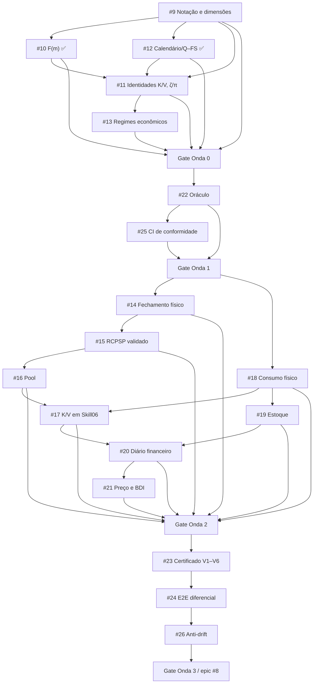

# Execução das ondas do formalismo como DAG verificável

**Programa:** [epic #8](https://github.com/brunolnetto/concilium/issues/8).
**Manifesto:** [formalism_execution_dag.json](formalism_execution_dag.json).
**Validador:** [scripts/formalism_wave_dag.py](../../scripts/formalism_wave_dag.py).

## Decisão de execução (2026-10-24 UTC)

A execução foi paralelizada incorretamente: muitos PRs de ondas 1–3 foram integrados antes que a Onda 0 estivesse aceita. **Preservamos código e evidência já mergeados**, mas não tratamos essa antecipação como liberação da onda seguinte. Daqui em diante, um PR de onda futura pode permanecer como histórico, porém não se abre nova frente de implementação de produto enquanto a onda corrente não alcançar seu gate, salvo reparo crítico para restaurar CI que proteja a própria onda corrente.

Existem três relações diferentes:

- **Dependência de código**: pode permitir que infraestrutura preliminar de outra onda seja construída antecipadamente, mas ela não autoriza certificação.
- **Dependência de aceite**: uma issue só pode ser concluída se seus predecessores na DAG e todas as ondas anteriores estiverem fechados com evidência suficiente.
- **Dependência de PR**: o pacote indicado é trabalho necessário, mas não suficiente. Os PRs precisam estar **merged** na branch canônica com testes e revisão; seus critérios de aceite são conferidos separadamente, manualmente.

Assim, `merged(PR) != accepted(issue) != certified(project)`. O indicador de PRs preparados **não** é percentual de certificação.

## DAG



A visualização é intencionalmente simplificada; o **JSON é a fonte de verdade** para todas as arestas e pacotes. Não criar dependências reversas da onda 0 para certificação global #23/#26: cada issue fecha seu contrato **local** com provas locais; o certificado de projeto completo pertence às ondas posteriores.

## Gates por onda e próxima fila executável

| Onda | Abertura | Gate de conclusão | Pacotes a concluir |
| --- | --- | --- | --- |
| **0 — formalismo matemático** | imediata | **#9, #10, #11, #12, #13 todas concluídas** | P09-C [#86](https://github.com/brunolnetto/concilium/pull/86) já integrado; P09-D [#87](https://github.com/brunolnetto/concilium/pull/87) integrado; P09-E [#88](https://github.com/brunolnetto/concilium/pull/88) exige proveniência de aliases e paridade semântica, P11-A → P11-B, P13-A → P13-B |
| **1 — oráculo e CI** | somente após W0 | #22 e #25 aceitas | P22-B → P22-C → P25-C; aproveitar P22-A/P25-A/B já integrados |
| **2 — execução física/econômica** | somente após W1 | todas #14–#21 aceitas | re-resolução #15, paridade #16/#18, P17-C e P19-C → P20-B/C → P21-A/B |
| **3 — certificado e regressões** | somente após W2 | #23/#24/#26 aceitas | P23-B/C → P24-A/B → P26-A/B; fechar epic apenas sob prova E2E |

### Definição precisa do próximo vértice

**Agora: #9**. P09-A [#28](https://github.com/brunolnetto/concilium/pull/28), P09-B [#43](https://github.com/brunolnetto/concilium/pull/43) e P09-C [#86](https://github.com/brunolnetto/concilium/pull/86) estão mergeados; P09-D [#87](https://github.com/brunolnetto/concilium/pull/87) integrado e P09-E [#88](https://github.com/brunolnetto/concilium/pull/88) **pendente e obrigatório** no manifesto. Falta o aceite dimensional *completo*: inventário versionado **símbolo → unidade → fonte → saída**, classificação de equações normativas x hipóteses x pendências, contraprovas e paridade MD/RESUMIDO/TeX. Uma equação ainda inválida deve permanecer explicitamente pendente em #11/#13 e fora do universo declarado como **normativo válido**. Não satisfazer #9 por alterar somente um checklist.

**Depois: #11**. Provar as identidades econômicas e desempenho para semana parcial, múltiplas semanas, custo por presença K e por consumo V; executar falsificadores incluindo `F(m)` saturado e BDI por categoria. Não iniciar P13-B antes de fechar o contrato matemático #11.

**Por fim: #13**. Separar baseline de standby integral, variante idle/off com tarifa e variante de consumo ocioso/desperdício, selecionadas explicitamente; ausência/incompatibilidade não implica custo zero. Fechar W0 só com os três critérios localmente demonstrados e #10/#12 já concluídas.

## Uso do validador e limites

```bash
python scripts/formalism_wave_dag.py
GH_TOKEN="$(gh auth token)" python scripts/formalism_wave_dag.py --live
GH_TOKEN="$(gh auth token)" python scripts/formalism_wave_dag.py --live --require-close 9
```

- **Primeira chamada:** valida esquema, 18 nós, 47 pacotes, direção das arestas e aciclicidade sem rede.
- **Segunda:** consulta as issues e os PRs reais; informa onda ativa, nós executáveis e bloqueios. Requer autenticação para repositório privado. Falha de autenticação/snapshot incompleto não se converte em PASS.
- **Terceira:** falha se não houver todos os predecessores fechados, ondas anteriores completas e PRs previstos *merged*. Mesmo preflight positivo **não fecha issue automaticamente**: os critérios de aceite, checks do HEAD e revisão têm de ser avaliados por quem integra.
- Fechamentos antigos #10/#12 ocorridos antes de #9 são marcados como exceções históricas, **sem desfazê-los**. Não autorizam conclusão de W1–W3.
- A DAG **não** substitui o validador numérico nem um certificado GO; esses dependem de #22/#23. A integração obrigatória deste verificador em branch protection requer política de CI apropriada, a ser completada em #25/#26.

Mudanças posteriores na matriz exigem PR de governança, teste de aciclicidade e atualização simultânea da epic.


## Cumulative PR integration and branch ancestry

A package's `packages[].prs` may include both its implementation PR and a cumulative
integration PR when the implementation was merged into a predecessor feature branch
rather than directly into `main`. For the 29–30 October stack, PR #151 is the
required main-branch integration for P14-F, P15-E/F, P16-F, P18-D/E and P19-C.
The source PRs remain listed as historical package evidence; PR #151 prevents a
feature-branch merge from being mistaken for delivery on `main`. P14-D also
requires its merged manual-scope correction PR #146, and P18-C3 requires merged
hardening PR #147.

The retired plan-only PRs #108–#119 remain historical planning records only.
They must not be reopened or reused as implementation PRs; empty P23-B/C,
P24-A/B and P26-A/B slots remain empty until actual implementation PRs are
created and merged.
