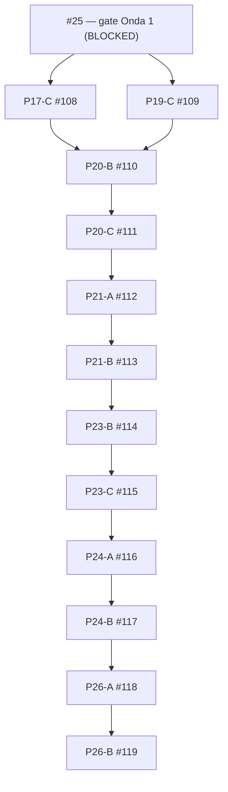

# Formalismo — drafts de planejamento e ordem topológica

**Data:** 2026-10-27. **Contrato de origem:** [formalism_execution_dag.json](formalism_execution_dag.json), épica #8. **Registro:** [formalism_planonly_pr_registry.json](formalism_planonly_pr_registry.json).

## Distinções obrigatórias

- **PLAN_ONLY** significa contrato de implementação (escopo, testes, evidência), **não** código pronto. A lista `packages[].prs` do DAG canônico continua vazia para os 12 pacotes sem implementação. Abrir um draft nunca deve elevar `pr_packages_merged`.
- **MERGED(PR) ≠ ACCEPTED(issue) ≠ CERTIFIED(project)**. Nenhuma issue é fechada por `Closes` nos drafts.
- **Onda 1 (#25) permanece bloqueada:** sem branch protection que exija jobs físicos/financeiros, não há habilitação das ondas 2/3. GH Actions `startup_failure` não é verde.
- PR #102 é P14-C e PR #103 é P18-C1, além das vagas P14-A/B e P18-A/B do manifesto: não tratá-los como slots implementados até atualização normativa e teste de DAG. PR #105 → #106 é um encadeamento técnico transversal, não substituto de P20-B/C ou P21-A/B.

## Dependências topológicas dos 12 drafts

Além dessas arestas entre drafts, **todas** as dependências por issue permanecem válidas segundo o JSON: #16 e #18 para #17; #18 para #19; #17 e #19 para #20; #20 para #21; #21 e demais issues físicas/financeiras para #23; #23 para #24; #24 e #25 para #26. Arestas repetidas de predecessor obrigatório não são facultativas só porque não aparecem no diagrama reduzido.

## Como usar os branches

As branches `plan/formalism-*` guardam apenas um documento de contrato por pacote e pertencem a PRs **draft**. Trechos lineares usam base do predecessor, p.ex. #111 base branch #110; o fork/join de #110 usa #109 como base e declara #108 como segunda dependência obrigatória. O GitHub suporta **uma única branch base**; o vínculo com a segunda é lógico e precisa ser exigido por revisão, oráculo e status check, não por mera ordenação na lista de PRs.

**Atenção ao CI de branches empilhadas:** `.github/workflows/ci.yml` atualmente dispara `pull_request` apenas quando a **branch base é `main`**. Portanto #110–#119 (base `plan/formalism-*`) não terão execução normal desse workflow enquanto empilhados. Após integrar/aceitar o predecessor, retargetar o sucessor para `main`, confirmar diff somente do pacote, disparar CI no SHA atual e exigir os jobs mandatórios. Nunca usar ausência de workflow como PASS.

Quando a Onda 1 for aceita, para cada pacote, adicionar código real, falsificadores e oráculos, atualizar no DAG canônico apenas depois do PR virar implementação validável e revalidar os bloqueios. O teste [test_formalism_planonly_pr_registry.py](../../tests/reference_formalism/test_formalism_planonly_pr_registry.py) falha se os PRs de planejamento forem indevidamente contabilizados como implementações no DAG.

O preflight de snapshot só marca `ready_to_implement=true` quando **todos os gates de issue estão fechados e todos os pacotes predecessores já saíram do registro PLAN_ONLY por promoção explícita no DAG canônico**. Fechar uma issue enquanto ainda há pacote PLAN_ONLY nela é inconsistência e falha fechado. Quando um predecessor for implementado, remova sua linha de planejamento, preencha o slot canônico com o PR de implementação e retargete o sucessor empilhado para `main`; o preflight reconhece esse predecessor como concluído, mas não confunde o draft de planejamento com implementação.

## Ações prévias ao merge

1. Proprietário resolver #25 (branch protection e execução hospedada).
2. Finalizar verificações e revisão dos PRs de código já abertos #102/#103; avaliar inserção explícita de seus novos pacotes canônicos via PR de governança.
3. Desenvolver pacotes na ordem topológica, acrescentando testes negativos e oráculos independentes.
4. Apenas após checks reais, review, aceite dos predecessors e atualização do manifesto, transformar drafts em PRs executáveis. Nenhum certificado GO global deve ser inferido antes da #23.

## Contrato durável por pacote (continua válido após aposentar um PR)

As linhas abaixo são o contrato de planejamento autoritativo. O corpo/branch original do PR é histórico; o estado do pacote continua `PLAN_ONLY` até existir implementação real no DAG canônico, falsificadores e aceite independente.

### Onda 2

- **P17-C — issue #17; PR de origem #108; depende de P16-C/#16 e P18/#18.** Conectar resultados de custo/instâncias da Skill 05 ao consumidor Skill 06 por diário exclusivo K/V e titularidade única. Falsificadores: recurso compartilhado, extensão de contrato, semana final fracionária, soma de K/V em centavos e ausência de fallback que melhore margem. Oráculo independente reconcilia `ΣK + ΣV` contra contratos e consumo; divergência negativa deve bloquear certificação.
- **P19-C — issue #19; PR de origem #109; depende de P18/#18.** Fechar estoque físico, abastecimento externo, lead times, tarifas ausentes, stockout e projeções sem fabricar saldo. Falsificadores: déficit vedado ou sem preço, entrega tardia, cobrança duplicada e origem semanal de `C_inv/C_cons`. Exigir balanço dimensional de massa e reconciliação monetária; ausência de evidência resulta em NOGO/UNKNOWN, nunca GO.
- **P20-B — issue #20; PR de origem #110; depende de P17-C e P19-C (junção obrigatória).** Consolidar `C_D = C_pool + C_cons` e `C_tot = C_D + C_ind` por atividade/instância/semana, sem fonte econômica duplicada e com paridade das projeções. Oráculo deve conferir item→projeto, recurso compartilhado, extensão de K, inventário, MOB/DEMOB uma única vez e conciliação exata em centavos.
- **P20-C — issue #20; PR de origem #111; depende de P20-B.** Aplicar BDI a K, V, indiretos e componentes MOB/DEMOB apenas em bases compatíveis e sem dupla incidência; ausência de taxa obrigatória bloqueia CERTIFIED. Verificar por categoria, variações de taxa, BDI ausente, duplicidade tributária e reconstrução exclusiva de P pelo diário.
- **P21-A — issue #21; PR de origem #112; depende de P20-C e aceite de #20.** Separar custo direto/indireto, preço operacional P, custo de catálogo `C_cat`, receita R, margem, BDI implícito e `β_eq`, sem misturar bases monetárias. Exigir reprodução de `P - C = R` e margem `R/P` a partir do diário, mais snapshot GOLDEN com fontes independentes.
- **P21-B — issue #21; PR de origem #113; depende de P21-A.** Separar piso regulatório de BDI e viabilidade econômica; BDI sobre base incompatível ou evidência ausente produz UNKNOWN. Falsificadores: BDI acima do piso mas prejuízo `P < C_tot` deve dar NOGO; base TCU incompatível ou tarifa ausente deve dar UNKNOWN; cobrir projetos fisicamente factíveis com resultado financeiro negativo.

### Onda 3

- **P23-B — issue #23; PR de origem #114; depende de P21-B, gates anteriores e envelope NOT_EVALUATED de P23-A/#55.** Avaliar V1–V6, fontes de custo, BDI e viabilidade; distinguir PREVIEW/RFI/RFP de certificado final. Falsificadores independentes para escopo, precedência, calendário, pool, consumo, estoque, BDI, margem e duplicidade; qualquer UNKNOWN bloqueia GO.
- **P23-C — issue #23; PR de origem #115; depende de P23-B.** Persistir, invalidar e expor certificado/fingerprint ao alterar fonte, reiniciar, recalcular cronograma, preços, disponibilidade ou catálogo; leituras API/MCP/UI. Cada mutação deve invalidar evidência anterior; crash/restart não pode preservar PASS obsoleto, e ausência de fonte nunca vira GO.
- **P24-A — issue #24; PR de origem #116; depende de P23-C e issue #23 aceita.** Comparar projetos RFI/RFP reais, clima, recursos compartilhados, K/V, estoque, indiretos e BDI com o oráculo de #22. Relatar primeira divergência e origem, usar tolerâncias explícitas e testar idempotência/isolamento de fixtures; nenhum aceite E2E sem certificado #23 integrado/versionado.
- **P24-B — issue #24; PR de origem #117; depende de P24-A.** Executar stress e falsificadores metamórficos de calendário/clima, saturação/ociosidade, pool concorrente, stockout, tarifa inválida e corrupção de vetores certificados. Negativos devem alterar o certificado corretamente e ser reproduzíveis sob budgets declarados; nenhuma combinação pode converter NOGO/UNKNOWN em PASS.
- **P26-A — issue #26; PR de origem #118; depende de P24-B, aceite de #24 e gate #25.** Manter matriz cláusula→código→teste→artefato para §§0–XIV, V1–V6 e ADRs, incluindo equação normativa, hipótese, aliases/produtor, fonte, falsificador e status SPEC_ERROR/UNCERTIFIED/CERTIFIED. Comparar FORMALISMO_LONGO, RESUMIDO e TeX; TeX suspenso permanece não certificado.
- **P26-B — issue #26; PR de origem #119; depende de P26-A, aceite de #24 e gate #25.** Detectar deriva normativa em CI quando fórmulas, campos canônicos, tarifas ou contratos mudarem sem oráculos/snapshots/revisão; referenciar SHA/versão da especificação no certificado. Testar mutação sem oráculo, divergência entre LONGO/RESUMIDO/TeX e evidência expirada.

## Ciclo de vida moderno para os 12 PRs de planejamento

O estado do pacote e o estado da PR são eixos distintos:

- `PLAN_ONLY`: pacote ainda não implementado; é o estado atual das 12 vagas.
- `OPEN_DRAFT`: a PR existe como rascunho de planejamento.
- `RETIRED_SUPERSEDED`: a PR documental foi fechada **sem merge** após o contrato acima ser incorporado ao registry versionado e conter o marcador literal definido em `formalism_planonly_pr_registry.json`.

O preflight aceita apenas `OPEN_DRAFT` ou `RETIRED_SUPERSEDED`. Para aposentadoria, a PR tem que estar `closed`, sem `merged_at`, sem evidência de merge e com o marcador literal no body. PR inexistente, PR merged, PR fechada sem marcador, base/head alterados ou snapshot incompleto falham fechado.

A aposentadoria **não** remove a linha do registry, não reutiliza o número, não preenche `packages[].prs` no DAG, não fecha a issue e não torna um sucessor pronto: o pacote permanece pendente até implementação real e aceite. Os IDs #108–#119 ficam reservados para sempre como histórico. Após esta governança ser integrada ao branch padrão e os gates aplicáveis estarem satisfeitos, o proprietário pode acrescentar o marcador e fechar os 12 drafts em lotes; executar `--live` depois de cada lote para verificar a migração. Não feche nenhum deles antes disso.

