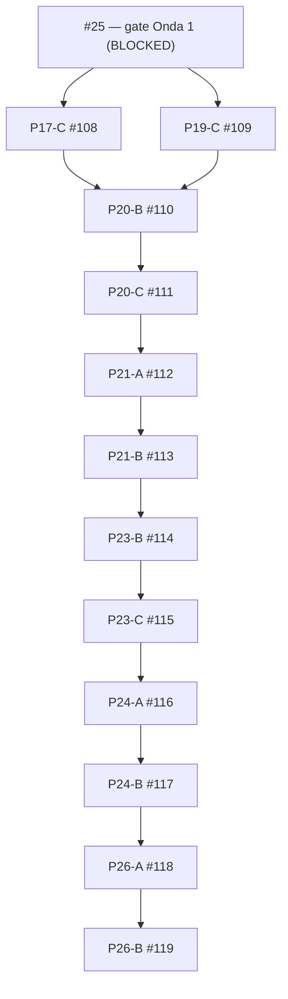

# Formalismo — drafts de planejamento e ordem topológica

**Data:** 2026-10-27. **Contrato de origem:** [formalism_execution_dag.json](formalism_execution_dag.json), épica #8. **Registro:** [formalism_planonly_pr_registry.json](formalism_planonly_pr_registry.json).

## Distinções obrigatórias

- **PLAN_ONLY** significa contrato de implementação (escopo, testes, evidência), **não** código pronto. A lista `packages[].prs` do DAG canônico continua vazia para os 12 pacotes sem implementação. Abrir um draft nunca deve elevar `pr_packages_merged`.
- **MERGED(PR) ≠ ACCEPTED(issue) ≠ CERTIFIED(project)**. Nenhuma issue é fechada por `Closes` nos drafts.
- **Onda 1 (#25) permanece bloqueada:** sem branch protection que exija jobs físicos/financeiros, não há habilitação das ondas 2/3. GH Actions `startup_failure` não é verde.
- PR #102 é P14-C e PR #103 é P18-C1, além das vagas P14-A/B e P18-A/B do manifesto: não tratá-los como slots implementados até atualização normativa e teste de DAG. PR #105 → #106 é um encadeamento técnico transversal, não substituto de P20-B/C ou P21-A/B.

## Dependências topológicas dos 12 drafts

Além dessas arestas entre drafts, **todas** as dependências por issue permanecem válidas segundo o JSON: #16 e #18 para #17; #18 para #19; #17 e #19 para #20; #20 para #21; #21 e demais issues físicas/financeiras para #23; #23 para #24; #24 e #25 para #26. Arestas repetidas de predecessor obrigatório não são facultativas só porque não aparecem no diagrama reduzido.

## Como usar os branches

As branches `plan/formalism-*` guardam apenas um documento de contrato por pacote e pertencem a PRs **draft**. Trechos lineares usam base do predecessor, p.ex. #111 base branch #110; o fork/join de #110 usa #109 como base e declara #108 como segunda dependência obrigatória. O GitHub suporta **uma única branch base**; o vínculo com a segunda é lógico e precisa ser exigido por revisão, oráculo e status check, não por mera ordenação na lista de PRs.

**Atenção ao CI de branches empilhadas:** `.github/workflows/ci.yml` atualmente dispara `pull_request` apenas quando a **branch base é `main`**. Portanto #110–#119 (base `plan/formalism-*`) não terão execução normal desse workflow enquanto empilhados. Após integrar/aceitar o predecessor, retargetar o sucessor para `main`, confirmar diff somente do pacote, disparar CI no SHA atual e exigir os jobs mandatórios. Nunca usar ausência de workflow como PASS.

Quando a Onda 1 for aceita, para cada pacote, adicionar código real, falsificadores e oráculos, atualizar no DAG canônico apenas depois do PR virar implementação validável e revalidar os bloqueios. O teste [test_formalism_planonly_pr_registry.py](../../tests/reference_formalism/test_formalism_planonly_pr_registry.py) falha se os PRs de planejamento forem indevidamente contabilizados como implementações no DAG.

## Ações prévias ao merge

1. Proprietário resolver #25 (branch protection e execução hospedada).
2. Finalizar verificações e revisão dos PRs de código já abertos #102/#103; avaliar inserção explícita de seus novos pacotes canônicos via PR de governança.
3. Desenvolver pacotes na ordem topológica, acrescentando testes negativos e oráculos independentes.
4. Apenas após checks reais, review, aceite dos predecessors e atualização do manifesto, transformar drafts em PRs executáveis. Nenhum certificado GO global deve ser inferido antes da #23.
