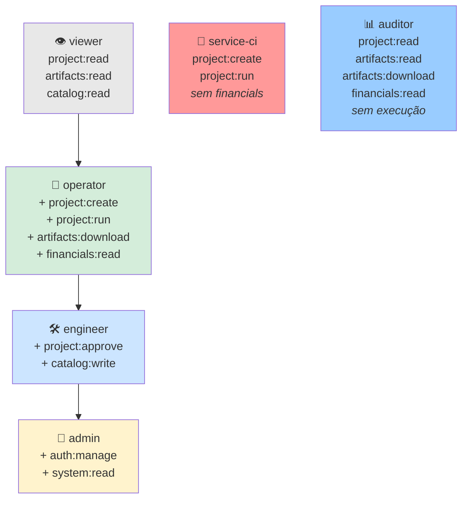
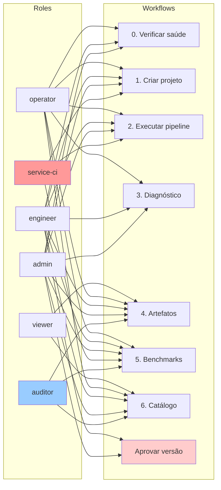

# Mapeamento: Roles → Workflows → Tools

Este documento mapeia como o sistema RBAC (ADR-099) segrega as 40 ferramentas MCP em workflows específicos, controlados por roles com blast radius reduzido.

---

## 📑 Índice

- [1. Hierarquia de Roles](#1-hierarquia-de-roles) — Herança e especialização
- [2. Roles → Permissões](#2-roles--permissões) — Blast radius ao comprometer
- [3. Permissões → Tools MCP](#3-permissões--tools-mcp) — 40 tools organizadas por permissão
- [4. Workflows → Permissões](#4-workflows--permissões-necessárias) — 6 fluxos do tutorial
- [5. Matriz Role × Workflow](#5-matriz-role--workflow) — Tabela de compatibilidade
- [6. Casos de Uso por Persona](#6-casos-de-uso-por-persona) — Exemplos práticos
- [7. Recomendações de Segurança](#7-recomendações-de-segurança) — Princípio do menor privilégio
- [8. Migração de Clientes](#8-migração-de-clientes-existentes) — Compatibilidade com scopes antigos

---

## 🎯 Consulta Rápida

**Escolher role para novo usuário:**

| Precisa de... | Role recomendado |
|---|---|
| Apenas ver status de projetos | `viewer` |
| Criar projetos e executar pipeline | `operator` |
| Aprovar propostas finais | `engineer` |
| Gerenciar usuários e sistema | `admin` |
| CI/CD sem expor custos | `service-ci` |
| Auditar resultados financeiros | `auditor` |

**Workflows mais comuns:**

| Workflow | Roles que podem executar |
|---|---|
| Criar projeto | operator, engineer, admin, service-ci |
| Executar pipeline | operator, engineer, admin, service-ci |
| Aprovar versão | engineer, admin |
| Baixar artefatos | operator, engineer, admin, auditor |
| Modificar catálogo | engineer, admin |

---

## 1. Hierarquia de Roles

```
viewer   ⊂  operator  ⊂  engineer  ⊂  admin
                                     service-ci  (especializado, sem herança)
                                     auditor     (especializado, somente leitura)
```

### Diagrama de Herança



**Legenda:**
- **Setas:** Indicam herança (filho herda todas as permissões do pai)
- **service-ci** (vermelho): Role especializado sem herança — blast radius reduzido
- **auditor** (azul): Role especializado somente leitura — não executa pipelines

---

## 2. Roles → Permissões

| Role | Permissões | Blast Radius ao Comprometer |
|---|---|---|
| **viewer** | `project:read`<br>`artifacts:read`<br>`catalog:read` | Ler projetos e catálogo — sem dados financeiros |
| **operator** | viewer +<br>`project:create`<br>`project:run`<br>`artifacts:download`<br>`financials:read` | Criar + executar projetos + ver custos — **não aprova versões** |
| **engineer** | operator +<br>`project:approve`<br>`catalog:write` | Tudo exceto gestão de usuários |
| **admin** | engineer +<br>`auth:manage`<br>`system:read` | Acesso total ao sistema |
| **service-ci** | `project:create`<br>`project:run` | CI/CD — cria e executa, **não vê dados financeiros**, não aprova |
| **auditor** | `project:read`<br>`artifacts:read`<br>`artifacts:download`<br>`financials:read` | Ler e auditar resultados — **não executa**, não modifica |

---

## 3. Permissões → Tools MCP

### 🔐 `system:read` requerido
| Tool | Permissão | Descrição |
|---|---|---|
| `ping()` | `system:read` | Health check — detalhes técnicos (versão, uptime, memória). Requer admin ou catalog-manager |

> **Nota:** `ping()` exige `system:read`. Não é público — apenas admin (e futuramente catalog-manager, ADR-120).

### 📖 `project:read` — Leitura de projetos
| Tool | Descrição |
|---|---|
| `listar_contextos()` | Lista contextos de catálogo disponíveis |
| `listar_projetos()` | Lista todos os projetos existentes |
| `consultar_status(project_id)` | Estado do pipeline e resultado (sem valores financeiros se não tiver `financials:read`) |
| `consultar_estrutura_projeto(project_id)` | Árvore de Escopos e Planos |
| `consultar_job_pipeline(job_id)` | Status de job assíncrono |
| `listar_jobs_pipeline(project_id, incluir_estatisticas=False)` | Lista jobs de pipeline; com `incluir_estatisticas=True` inclui métricas do worker pool (requer `system:read`) |
| `comparar_planos(...)` | Compara dois planos do mesmo escopo |

### ✏️ `project:create` — Criação de projetos
| Tool | Descrição |
|---|---|
| `criar_projeto(nome, spec=None, ...)` | Cria projeto a partir de formulário QQP ou spec estruturado (unifica `criar_projeto_formulario` + `criar_projeto_spec`) |
| `iniciar_orcamento(...)` | Cria projeto com EAP estruturada |
| `gerir_escopo(entidade="escopo", acao, ...)` | Cria/atualiza escopo de obra |
| `gerir_escopo(entidade="plano", acao="criar", ...)` | Cria novo plano dentro de escopo |
| `nova_versao(...)` | Cria nova versão de planejamento |

### ▶️ `project:run` — Execução de pipeline
| Tool | Descrição |
|---|---|
| `disparar_pipeline(...)` | Dispara skill em background (worker pool) |
| `simular_cenario_replan(...)` | Simula impacto de alteração no plano |

> **Nota:** `avancar_pipeline` foi removido (execução síncrona descontinuada). `aplicar_sugestao_replan` não existe na versão atual.

### ✅ `project:approve` — Aprovação (irreversível)
| Tool | Descrição |
|---|---|
| `aprovar_versao(project_id)` | **Congela versão — IRREVERSÍVEL** |
| `gerir_escopo(entidade="plano", acao="aprovar", ...)` | Aprova plano dentro de escopo |

### 📦 `artifacts:read` — Listagem de artefatos
| Tool | Descrição |
|---|---|
| `listar_artefatos_projeto(project_id)` | Lista artefatos com nome, tipo, tamanho |

### 📥 `artifacts:download` — Download de artefatos
| Tool | Descrição |
|---|---|
| `obter_artefato(formato="texto", ...)` | Lê artefato textual (.md, .json, .csv) |
| `obter_artefato(formato="binario", ...)` | Download binário em base64 (.png, .xlsx, .pdf) |
| `obter_artefato(formato="bundle", project_id)` | ZIP com todos os artefatos |

### 📚 `catalog:read` — Leitura de catálogo
| Tool | Descrição |
|---|---|
| `pesquisar_catalogo(contexto_id, query)` | Busca CPUs/recursos por descrição |
| `auditar_catalogo(modo="integridade", ...)` | Integridade estrutural do catálogo |
| `auditar_catalogo(modo="saude", ...)` | Indicadores de saúde e cobertura |
| `auditar_catalogo(modo="plausibilidade", ...)` | Detecta produtividades implausíveis |
| `comparar_rfi_catalogo(...)` | Divergências entre RFI e catálogo |
| `historico_preco_insumo(modo="tendencia", ...)` | Tendência histórica de preços |
| `historico_preco_insumo(modo="pontual", ...)` | Preço de insumo em data específica |
| `versoes_catalogo(modo="listar", ...)` | Lista versões do catálogo disponíveis |
| `versoes_catalogo(modo="comparar", ...)` | Compara duas versões do catálogo |
| `calcular_tributos(tipo="clt_empregador", ...)` | Calcula custo total empregador CLT |
| `calcular_tributos(tipo="inss_empregado", ...)` | Calcula INSS descontado do empregado |
| `calcular_tributos(tipo="irrf", ...)` | Calcula IRRF sobre salário |

### ✏️ `catalog:write` — Escrita em catálogo
| Tool | Descrição |
|---|---|
| `atualizar_preco_insumo(...)` | Atualiza preço de insumo |
| `adicionar_variante_producao(...)` | Adiciona variante com equipe |
| `salvar_perfil_bdi(...)` | Salva perfil BDI no contexto |

### 💰 `financials:read` — Leitura de dados financeiros
| Tool | Efeito |
|---|---|
| `consultar_status(project_id)` | **Desbloqueia** campos: `preco_venda`, `custo_direto`, `custo_indireto`, `margem` |
| `auditar_plano(project_id)` | **Desbloqueia** seção: `resumo_financeiro` |
| `comparar_planos(...)` | **Desbloqueia** comparação de custos e preços |

> **Nota:** Sem `financials:read`, esses campos retornam `null` ou são omitidos (segurança financeira).

### 🧪 Benchmarks (permissões mistas)
| Tool | Permissão | Descrição |
|---|---|---|
| `consultar_benchmark(benchmark_id=None)` | `project:read` | Lista todos os benchmarks quando chamado sem argumento; detalha um benchmark específico com `benchmark_id` |
| `executar_benchmark(...)` | `project:run` | Executa benchmark completo |
| `empacotar_benchmark(slug)` | `project:read` | Empacota resultados existentes |
| `download_benchmark_zip(slug)` | `artifacts:download` | Download do ZIP |

### 🔐 `auth:manage` — Gestão de autenticação (admin)
| Tool | Descrição |
|---|---|
| `concilium auth add-user` | Cria novo cliente com role |
| `concilium auth new-device` | Emite device code |
| `concilium auth revoke` | Revoga dispositivo |

### 🔧 `system:read` — Diagnóstico (admin)
| Tool | Efeito |
|---|---|
| `ping()` | Health check com detalhes técnicos (versão, uptime, memória) |
| `listar_jobs_pipeline(..., incluir_estatisticas=True)` | **Desbloqueia** métricas internas do worker pool |

### 🔮 `catalog:validate` — Validação de catálogo (futuro — ADR-120, não implementado)
> **Nota:** Role `catalog-manager` proposto em ADR-120. Permissão `catalog:validate` ainda não implementada. Prevista para separar responsabilidades de auditoria do catálogo de `catalog:write`.

---

## 4. Workflows → Permissões Necessárias

### Diagrama de Fluxo: Role → Workflow



**Observações:**
- `ping()` requer `system:read` — apenas admin (e futuramente catalog-manager) têm acesso ao health check com detalhes técnicos
- service-ci **não** pode: diagnóstico (sem `financials:read`), baixar artefatos, consultar catálogo
- auditor **não** pode: criar projetos, executar pipeline, aprovar versão
- viewer **não** pode: criar, executar, baixar artefatos

---

### Fluxo 0 — Verificar saúde do sistema
**Permissões:** `system:read`

**Tools:**
- `ping()` ← requer `system:read`

**Quem pode executar:** admin (e futuramente catalog-manager, ADR-120)

**Bloqueado para:** viewer, operator, engineer, service-ci, auditor

---

### Fluxo 1 — Criação de projeto
**Permissões:** `project:create` + `catalog:read`

**Tools:**
- `listar_contextos()`
- `criar_projeto(nome, spec=None, ...)` ← requer `project:create`
- `iniciar_orcamento(...)` ← requer `project:create`
- `pesquisar_catalogo(...)` ← requer `catalog:read`
- `gerir_escopo(entidade="escopo", acao, ...)` ← requer `project:create`
- `gerir_escopo(entidade="plano", acao="criar", ...)` ← requer `project:create`

**Quem pode executar:** operator, engineer, admin, service-ci

**Bloqueado para:** viewer, auditor

---

### Fluxo 2 — Execução do pipeline
**Permissões:** `project:run` + `project:read`

**Tools:**
- `disparar_pipeline(...)` ← requer `project:run`
- `consultar_job_pipeline(job_id)` ← requer `project:read`
- `listar_jobs_pipeline(project_id, incluir_estatisticas=False)` ← requer `project:read`; `incluir_estatisticas=True` requer adicionalmente `system:read`
- `consultar_status(project_id)` ← requer `project:read`

**Quem pode executar:** operator, engineer, admin, service-ci

**Bloqueado para:** viewer, auditor

**⚠️ Blast radius:** service-ci **não** vê `preco_venda` e `margem` (sem `financials:read`)

---

### Fluxo 3 — Diagnóstico e replanejamento
**Permissões:** `project:run` + `financials:read`

**Tools:**
- `auditar_plano(project_id)` ← requer `project:read` + `financials:read`
- `explorar_pool_recursos(...)` ← requer `project:read`
- `simular_cenario_replan(...)` ← requer `project:run`
- `comparar_planos(...)` ← requer `project:read`

**Quem pode executar:** operator, engineer, admin

**Bloqueado para:** viewer, service-ci (sem `financials:read`), auditor (sem `project:run`)

---

### Fluxo 4 — Artefatos
**Permissões:** `artifacts:read` + `artifacts:download`

**Tools:**
- `listar_artefatos_projeto(...)` ← requer `artifacts:read`
- `obter_artefato(formato="texto", ...)` ← requer `artifacts:download`
- `obter_artefato(formato="binario", ...)` ← requer `artifacts:download`
- `obter_artefato(formato="bundle", ...)` ← requer `artifacts:download`

**Quem pode executar:** 
- Listar: viewer, operator, engineer, admin, auditor
- Download: operator, engineer, admin, auditor

**Bloqueado para:** 
- Listar: service-ci
- Download: viewer, service-ci

---

### Fluxo 5 — Benchmarks
**Permissões:** `project:run` + `artifacts:download`

**Tools:**
- `consultar_benchmark(benchmark_id=None)` ← requer `project:read`; sem argumento lista todos
- `executar_benchmark(...)` ← requer `project:run`
- `empacotar_benchmark(slug)` ← requer `project:read`
- `download_benchmark_zip(slug)` ← requer `artifacts:download`

**Quem pode executar:**
- Listar/Empacotar: viewer, operator, engineer, admin, auditor
- Executar: operator, engineer, admin, service-ci
- Download: operator, engineer, admin, auditor

**Bloqueado para:**
- Executar: viewer, auditor
- Download: viewer, service-ci

---

### Fluxo 6 — Catálogo (operações avançadas)
**Permissões:** `catalog:read` + `catalog:write` (escrita)

**Tools:**
- Leitura: `pesquisar_catalogo`, `auditar_catalogo(modo=)`, `historico_preco_insumo(modo=)`, `versoes_catalogo(modo=)`, `calcular_tributos(tipo=)`, etc.
- Escrita: `atualizar_preco_insumo`, `adicionar_variante_producao`, `salvar_perfil_bdi`

**Quem pode executar:**
- Leitura: viewer, operator, engineer, admin, auditor
- Escrita: engineer, admin

**Bloqueado para:**
- Leitura: service-ci
- Escrita: viewer, operator, service-ci, auditor

---

## 5. Matriz Role × Workflow

| Workflow | viewer | operator | engineer | admin | service-ci | auditor |
|---|:---:|:---:|:---:|:---:|:---:|:---:|
| 0. Verificar saúde (`ping`) | ❌ | ❌ | ❌ | ✅ | ❌ | ❌ |
| 1. Criação de projeto | ❌ | ✅ | ✅ | ✅ | ✅ | ❌ |
| 2. Execução de pipeline | ❌ | ✅ | ✅ | ✅ | ✅⚠️ | ❌ |
| 3. Diagnóstico e replanejamento | ❌ | ✅ | ✅ | ✅ | ❌⚠️ | ⚠️ |
| 4. Artefatos (listar) | ✅ | ✅ | ✅ | ✅ | ❌ | ✅ |
| 4. Artefatos (download) | ❌ | ✅ | ✅ | ✅ | ❌ | ✅ |
| 5. Benchmarks (executar) | ❌ | ✅ | ✅ | ✅ | ✅ | ❌ |
| 5. Benchmarks (download) | ❌ | ✅ | ✅ | ✅ | ❌ | ✅ |
| 6. Catálogo (leitura) | ✅ | ✅ | ✅ | ✅ | ❌ | ✅ |
| 6. Catálogo (escrita) | ❌ | ❌ | ✅ | ✅ | ❌ | ❌ |
| Aprovar versão | ❌ | ❌ | ✅ | ✅ | ❌ | ❌ |

**Legenda:**
- ✅ Pode executar completamente
- ❌ Bloqueado (sem permissões necessárias)
- ⚠️ Pode executar parcialmente (sem dados financeiros ou sem escrita)
- ✅⚠️ Pode executar mas não vê resultados financeiros

---

## 6. Casos de Uso por Persona

### 👁️ Viewer (Stakeholder externo)
**Objetivo:** Acompanhar progresso de projetos sem modificar

**Pode fazer:**
- Ver lista de projetos e status
- Listar artefatos disponíveis
- Consultar catálogo de CPUs
- Ver benchmark results (listar/empacotar)

**Não pode fazer:**
- Criar projetos
- Executar pipeline
- Baixar artefatos (confidencialidade)
- Ver dados financeiros
- Acessar health check com detalhes técnicos

**Exemplo:** Cliente externo acompanhando o projeto sem acesso a custos

---

### 🔧 Operator (Engenheiro de campo)
**Objetivo:** Criar e executar projetos, ver resultados completos

**Pode fazer:**
- Criar projetos (`criar_projeto`, `gerir_escopo`)
- Executar pipeline (disparar skills)
- Ver resultados financeiros (custos, preços, margem)
- Baixar artefatos e bundles (`obter_artefato`)
- Simular cenários de replanejamento
- Executar benchmarks

**Não pode fazer:**
- Aprovar versões (não pode congelar)
- Escrever no catálogo mestre
- Gerenciar usuários
- Acessar health check técnico (`ping`)

**Exemplo:** Engenheiro orçamentista criando propostas

---

### 🛠️ Engineer (Engenheiro sênior)
**Objetivo:** Operator + aprovação de versões + gestão de catálogo

**Pode fazer:**
- Tudo do Operator
- Aprovar versões (congelar planos para proposta)
- Atualizar preços de insumos
- Adicionar variantes de produção
- Calibrar perfis BDI

**Não pode fazer:**
- Gerenciar usuários (auth:manage)
- Acessar health check técnico (`ping`)

**Exemplo:** Engenheiro responsável por aprovar propostas finais

---

### 👑 Admin (Administrador do sistema)
**Objetivo:** Acesso total incluindo gestão de usuários

**Pode fazer:**
- Tudo do Engineer
- Criar e revogar usuários
- Emitir device codes
- Ver health check com detalhes técnicos (`ping`)
- Ver métricas internas do worker pool (`listar_jobs_pipeline(incluir_estatisticas=True)`)

**Exemplo:** DevOps/SysAdmin gerenciando infraestrutura

---

### 🤖 Service-CI (Automação CI/CD)
**Objetivo:** Criar e executar projetos SEM acesso a dados financeiros

**Pode fazer:**
- Criar projetos
- Executar pipeline
- Executar benchmarks

**Não pode fazer:**
- Ver dados financeiros (`preco_venda`, `margem` retornam `null`)
- Baixar artefatos
- Aprovar versões
- Consultar catálogo
- Acessar health check (`ping`)

**Blast radius reduzido:** Token comprometido não expõe custos de propostas

**Exemplo:** GitHub Actions rodando testes de regressão em benchmarks

---

### 📊 Auditor (Analista financeiro externo)
**Objetivo:** Ler e auditar resultados SEM executar ou modificar

**Pode fazer:**
- Ver projetos e status
- Ver dados financeiros (custos, preços, margem)
- Baixar artefatos e relatórios (`obter_artefato`)
- Auditar planos (viabilidade, gargalos)

**Não pode fazer:**
- Criar projetos
- Executar pipeline
- Modificar catálogo
- Aprovar versões
- Acessar health check (`ping`)

**Exemplo:** Controller financeiro auditando margens de propostas

---

## 7. Recomendações de Segurança

### ✅ Princípio do Menor Privilégio

| Caso de uso | ❌ Não usar | ✅ Usar |
|---|---|---|
| CI/CD que só executa benchmarks | `engineer` (over-permissioned) | `service-ci` |
| Stakeholder que só acompanha progresso | `operator` (vê custos) | `viewer` |
| Auditor financeiro externo | `operator` (pode executar) | `auditor` |
| Engenheiro orçamentista | `engineer` (pode aprovar sem supervisão) | `operator` |
| Aprovador de propostas | `operator` (não pode aprovar) | `engineer` |

### 🚨 Blast Radius por Comprometimento

| Token comprometido | Dados expostos | Ações destrutivas possíveis |
|---|---|---|
| `viewer` | Nomes de projetos, catálogo | Nenhuma (somente leitura) |
| `service-ci` | **Nenhum dado financeiro** | Criar projetos, executar pipelines (não aprova) |
| `auditor` | Custos, preços, margens | Nenhuma (somente leitura) |
| `operator` | Custos, preços, margens, artefatos | Criar, executar, replanejamento (não aprova) |
| `engineer` | Tudo | Aprovar versões (**irreversível**), modificar catálogo |
| `admin` | Tudo + credenciais de usuários | Tudo incluindo revogar acessos |

### 📝 Auditoria de Acessos

Logs devem capturar:
- `user_id`, `role`, `permission`, `tool`, `project_id`, `timestamp`

Exemplo:
```json
{
  "user": "agente-copilot",
  "role": "service-ci",
  "permission": "project:run",
  "tool": "disparar_pipeline",
  "project_id": "rodovia-ce040",
  "timestamp": "2026-06-22T14:32:01Z",
  "result": "success"
}
```

Alertas críticos:
- `service-ci` tentando `aprovar_versao` → **bloqueado**
- `viewer` tentando `obter_artefato` → **bloqueado**
- Múltiplas tentativas de acesso negado → **possível comprometimento**

---

## 8. Migração de Clientes Existentes

### Fase de Transição (ADR-099 Fase 4)

Tokens com `scopes` antigos (ADR-094) são mapeados automaticamente:

| Token antigo | Mapeamento para role |
|---|---|
| `scopes: ["mcp:read"]` | `roles: ["viewer"]` |
| `scopes: ["mcp:read", "pipeline:run"]` | `roles: ["operator"]` |
| `scopes: ["admin"]` | `roles: ["admin"]` |

### Migração de Tools Renomeadas (ADR-116 F5)

| Tool antiga | Tool nova |
|---|---|
| `criar_projeto_formulario(...)` | `criar_projeto(nome, spec=None, ...)` |
| `criar_projeto_spec(...)` | `criar_projeto(nome, spec=..., ...)` |
| `configurar_escopo(...)` | `gerir_escopo(entidade="escopo", ...)` |
| `gerenciar_plano(acao="criar", ...)` | `gerir_escopo(entidade="plano", acao="criar", ...)` |
| `gerenciar_plano(acao="aprovar", ...)` | `gerir_escopo(entidade="plano", acao="aprovar", ...)` |
| `ler_artefato_texto(...)` | `obter_artefato(formato="texto", ...)` |
| `baixar_artefato_binario(...)` | `obter_artefato(formato="binario", ...)` |
| `baixar_bundle_zip(project_id)` | `obter_artefato(formato="bundle", project_id)` |
| `consultar_saude_catalogo(...)` | `auditar_catalogo(modo="saude", ...)` |
| `verificar_integridade_catalogo(...)` | `auditar_catalogo(modo="integridade", ...)` |
| `avaliar_plausibilidade_catalogo(...)` | `auditar_catalogo(modo="plausibilidade", ...)` |
| `consultar_preco_insumo_temporal(...)` | `historico_preco_insumo(modo="pontual", ...)` |
| `tendencia_precos_catalogo(...)` | `historico_preco_insumo(modo="tendencia", ...)` |
| `listar_versoes_catalogo(...)` | `versoes_catalogo(modo="listar", ...)` |
| `comparar_versoes_catalogo(...)` | `versoes_catalogo(modo="comparar", ...)` |
| `calcular_custo_empregador_clt(...)` | `calcular_tributos(tipo="clt_empregador", ...)` |
| `calcular_inss_empregado(...)` | `calcular_tributos(tipo="inss_empregado", ...)` |
| `calcular_irrf(...)` | `calcular_tributos(tipo="irrf", ...)` |
| `obter_estatisticas_jobs()` | `listar_jobs_pipeline(..., incluir_estatisticas=True)` |
| `listar_benchmarks()` | `consultar_benchmark()` (sem argumento lista todos) |
| `avancar_pipeline(...)` | **REMOVIDO** — use `disparar_pipeline` (assíncrono) |

### Migração Recomendada

1. **Identificar tokens CI/CD:** Devem ser migrados para `service-ci` (não `operator`)
2. **Identificar stakeholders externos:** Migrar de `operator` para `viewer` (se não precisam executar)
3. **Identificar auditores:** Criar role `auditor` específico (não `operator`)
4. **Documentar em AGENT_SKILL_TUTORIAL.md:** Atualizar seção "Autenticação JWT"

---

## 9. Referências

- [ADR-099: RBAC — Roles e Permissões](../../engineering/0-architecture/adrs/ADR-099-rbac-roles-permissoes.md)
- [ADR-094: JWT Auth Layer](../../engineering/0-architecture/adrs/ADR-094-jwt-auth-layer.md)
- [ADR-116: Tool Consolidation F5](../../engineering/0-architecture/adrs/ADR-116-tool-consolidation-f5.md)
- [ADR-120: Catalog Manager Role](../../engineering/0-architecture/adrs/ADR-120-catalog-manager-role.md) *(proposto, não implementado)*
- [AGENT_SKILL_TUTORIAL.md](./AGENT_SKILL_TUTORIAL.md)
- [Principle of Least Privilege — OWASP](https://owasp.org/www-community/Access_Control)

---

**Última atualização:** 2026-06-22  
**Autor:** Sistema — baseado em ADR-099, ADR-116 F5 e fluxos do tutorial
